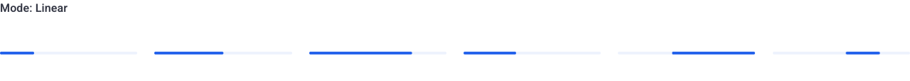
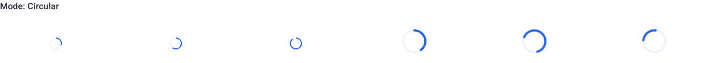
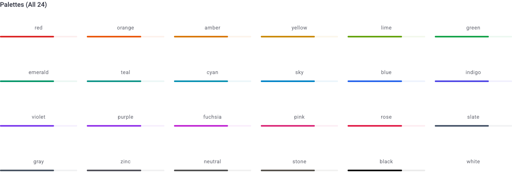
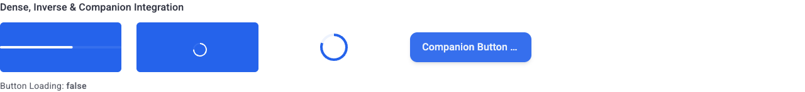
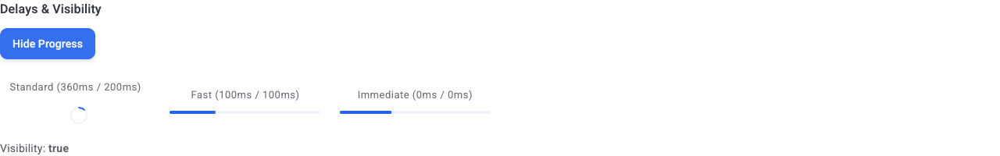
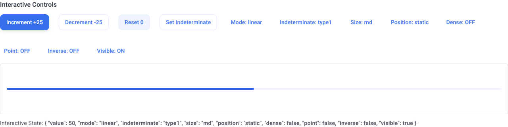
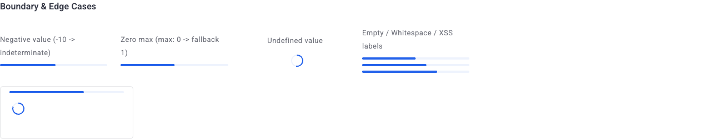
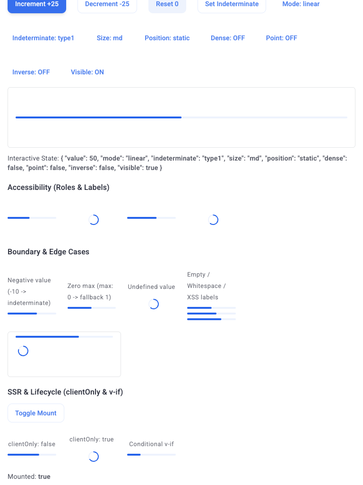
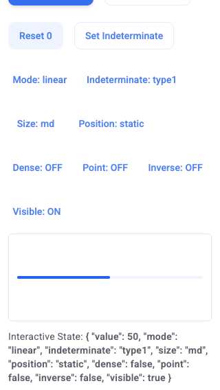

# Отчёт о визуальном и функциональном тестировании: D1Progress

## 1. Сводка тестирования

- **Компонент:** `D1Progress` (`@dxtmisha/d1`)
- **Исходный код:** [`D1Progress`](../../src/components/Ui/Progress) ([`Progress`](../../../constructor/src/constructors/Progress))
- **Демо / Целевой URL:** `http://localhost:3000/component-progress`
- **Материалы:** `Нет`
- **Дата тестирования (UTC):** `2026-11-25T08:22:37Z`
- **Окружение:** `Headless Chrome (Puppeteer / CDP, Desktop 1440x900, Tablet 768x1024, Mobile 375x812 / 320x568)`
- **Покрытие тест-кейсов:** 16 / 16 (`100%`)
- **Итог:** **16 ✅, 0 ⚠️, 0 ❌** (`✅` пройдено, `⚠️` предупреждение, `❌` ошибка) — `D1Progress` прошёл все визуальные, интерактивные, граничные, адаптивные, A11y и runtime-проверки со статусом SSR `200`, без горизонтального переполнения на всех вьюпортах и при `0` ошибках и предупреждениях консоли.

---

## 2. Базовая матрица

### 2.1 Визуальный рендеринг (`VIS`)

| ID | Сценарий | Статус | Фактический результат | Скриншот |
| :--- | :--- | :---: | :--- | :--- |
| `TC-VIS-001` | Линейный режим (`linear`), типы `indeterminate` (`type1`, `type2`, `type3`) и точка-индикатор (`point`) | ✅ | Линейные индикаторы `.d1-progress.d1-progress--linear` отображают детерминированные значения (`25`, `50`, `75`) и три типа неопределённой анимации (`type1`/`type2`/`type3`); точка `.d1-progress__point` рендерится при `point` с `value` и `type1`, отсутствуя при `type2`. |  |
| `TC-VIS-002` | Круговой режим (`circular`), SVG-структура и модификатор `dense` | ✅ | Круговые индикаторы рендерят `<svg class="d1-progress d1-progress--circular" viewBox="0 0 48 48">` с элементами `.d1-progress__circleSub` и `.d1-progress__circle` без обрезания контуров, включая компактный вариант `dense` и `type1`/`type2`/`type3`. |  |
| `TC-VIS-003` | Позиционирование (`position`: `top`, `bottom`, `static`) и размеры (`size`: `sm`, `md`, `lg`) | ✅ | Применяются модификаторы `--position--top`, `--position--bottom` и `--position--static` (включая `circular` со `static`); размеры `sm`, `md` и `lg` корректно масштабируют толщину полосы и кольца. |  |
| `TC-VIS-004` | Палитры (`palette`: все 24 значения) | ✅ | Отрендерены все 24 класса `d1-palette--<name>` (`red`–`white`) в сетке без наложений и артефактов. |  |
| `TC-VIS-005` | Инверсия цвета (`inverse`), `dense` и интеграция с `D1Button` (`loading`) | ✅ | На цветной поверхности `.demo-progress-page__inverse-surface` линейный и круговой варианты `inverse` отображаются контрастным светлым цветом поверх фона; встроенный индикатор в `D1Button` выровнен корректно. |  |

### 2.2 Интерактивность и управление состоянием (`INT`)

| ID | Сценарий | Статус | Фактический результат | Скриншот |
| :--- | :--- | :---: | :--- | :--- |
| `TC-INT-001` | Задержки показа и скрытия (`delay`, `delayHide`, `visible`) | ✅ | Кнопка `Show Progress` перевела состояние в `Visibility: true`; индикаторы `Immediate (0ms / 0ms)`, `Fast (100ms / 100ms)` и `Standard (360ms / 200ms)` получили `.d1-progress--visible` и корректно переходят в скрытие по `Hide Progress`. |  |
| `TC-INT-002` | Интерактивное управление значением `value` (`+25`, `-25`, `0`, `undefined`) | ✅ | Действия `+25`, `-25`, `Reset 0` и `Set Indeterminate` синхронно обновляют `Interactive State` (`"value": 50`), `--d1-progress-sys-value`, `aria-valuenow` и переключают роль `progressbar` ↔ `status`. |  |
| `TC-INT-003` | Динамическое переключение режима, `indeterminate`, `size`, `position`, `dense`, `point`, `inverse` и `visible` | ✅ | Переключатели панели управления обновляют соответствующие модификаторы классов на целевом экземпляре `D1Progress` в реальном времени без визуальных сбоев. | — |
| `TC-INT-004` | Интеграция с компаньоном `D1Button :loading` | ✅ | При активации `Companion Button Loading` кнопка отображает встроенный спиннер `.d1-button__loading.d1-progress--circular` и переходит в состояние блокировки повторных кликов. | — |

### 2.3 Граничные случаи (`BND`)

| ID | Сценарий | Статус | Фактический результат | Скриншот |
| :--- | :--- | :---: | :--- | :--- |
| `TC-BND-001` | Граничные числовые значения (`value="0"`, `value="-10"`, `max="0"`, `value > max`, дробные, строковые) | ✅ | Значение `0` сохраняет `role="progressbar"` и `aria-valuenow="0"`, отрицательное `-10` переводит индикатор в `role="status"`, `max="0"` безопасно приводится к `1`, а `value > max` ограничивается верхним пределом. | — |
| `TC-BND-002` | Пустые строки, пробелы и XSS-полезная нагрузка в `ariaLabel` | ✅ | Проверка XSS подтвердила `badImgs: 0`, `hasEscapedPayloadText: false` (строка в `aria-label` не исполняется и не создаёт HTML-узлы). | — |
| `TC-BND-003` | Ограниченный узкий контейнер (`max-width: 240px`) | ✅ | Внутри `.demo-box.demo-box--sm.demo-progress-page__narrow` переполнение отсутствует: `scrollWidth: 238 === clientWidth: 238` (`overflowsBox: false`, `overflowChildren: []`). |  |

### 2.4 Адаптивность (`RSP`)

| ID | Сценарий | Статус | Фактический результат | Скриншот |
| :--- | :--- | :---: | :--- | :--- |
| `TC-RSP-001` | Планшетный вьюпорт (`768×1024`) | ✅ | На `768×1024` горизонтальное переполнение отсутствует: `innerWidth: 768`, `scrollWidth: 768`, `overflowX: false`, `offenders: []`. |  |
| `TC-RSP-002` | Мобильные вьюпорты (`375×812` и `320×568`) | ✅ | На `375×812` (`scrollWidth: 375 === 375`, `overflowX: false`) и `320×568` (`scrollWidth: 320 === 320`, `overflowX: false`, `offenders: []`) индикаторы и кнопки управления не выходят за границы экрана. |  |

### 2.5 Доступность (`A11Y`)

| ID | Сценарий | Статус | Фактический результат | Скриншот |
| :--- | :--- | :---: | :--- | :--- |
| `TC-A11Y-001` | Семантические роли (`progressbar` vs `status`), ARIA-атрибуты и `textLoading` | ✅ | Детерминированные индикаторы выставляют `role="progressbar"` с `aria-valuemin`/`aria-valuemax`/`aria-valuenow`, неопределённые — `role="status"` с `aria-label`, а внутренние `<circle>` скрыты (`aria-hidden="true"`). | — |

### 2.6 Консоль и рантайм (`LOG`)

| ID | Сценарий | Статус | Фактический результат | Скриншот |
| :--- | :--- | :---: | :--- | :--- |
| `TC-LOG-001` | SSR (`clientOnly`), жизненный цикл (`v-if`) и чистота консоли | ✅ | SSR возвращает HTTP `200`; цикл размонтирования и повторного монтирования (`beforeLen: 109` → `unmountedLen: 110` → `remountedLen: 109`) проходит чисто; `consoleErrors: []`, `vueWarnings: []`, `pageErrors: []`, `networkErrors: []`, `dialogs: []`. | — |

---

## 3. AI-аудит и рекомендации

1. **Изоляция демо-стенда для палитры `white` и кнопки `Companion Button`:** В матрице `Palettes (All 24)` вариант `white` рендерится белым цветом поверх светлого фона демо-карточки, из-за чего практически сливается с подложкой, а текст на кнопке в секции `Dense, Inverse & Companion Integration` обрезается до `Companion Button ...`. Рекомендуется на уровне демо-страницы добавить тёмную подложку для `palette="white"` (по аналогии с `.demo-progress-page__inverse-surface`) и сократить/расширить подпись кнопки-компаньона, не меняя стили самого `D1Progress`.
2. **Адаптивная устойчивость и нулевое переполнение:** На всех четырёх контрольных разрешениях (`1440×900`, `768×1024`, `375×812`, `320×568`) зафиксировано `overflowX: false` (`scrollWidth === innerWidth`), а в узком контейнере `240px` получено `scrollWidth: 238 === clientWidth: 238` (`overflowChildren: []`), что подтверждает корректное масштабирование как линейных, так и SVG-круговых индикаторов.
3. **Надёжность SSR, таймеров и чистота рантайма:** Страница отдаётся по SSR со статусом `200`, а переключение условного рендеринга `v-if` и задержек `delay`/`delayHide` восстанавливает исходное состояние (`beforeLen: 109` → `remountedLen: 109`) при `0` ошибках в `consoleErrors`, `vueWarnings`, `pageErrors`, `networkErrors` и `dialogs`.
