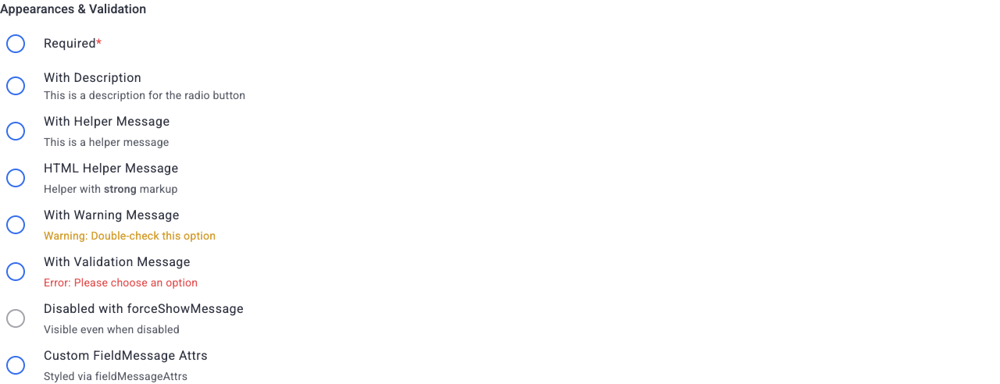
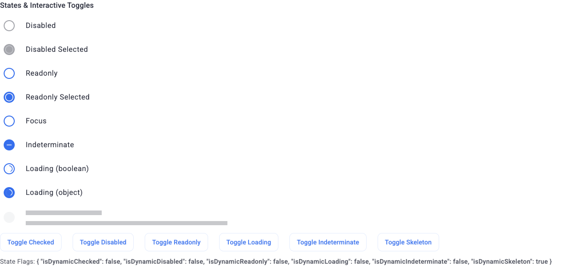
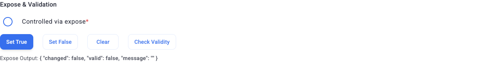
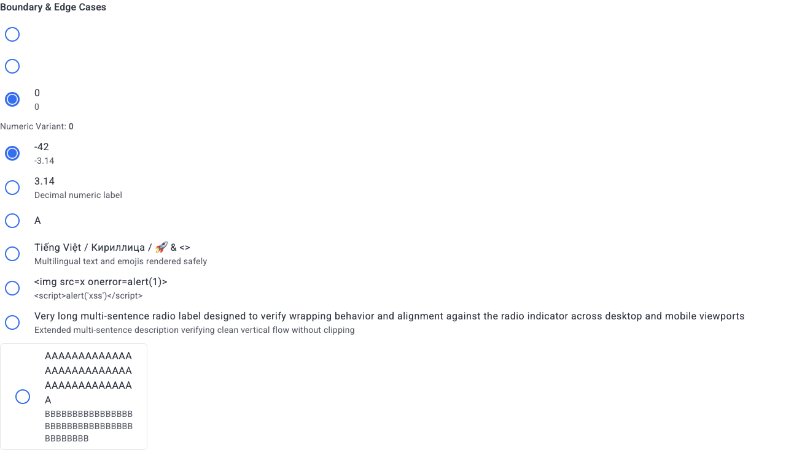
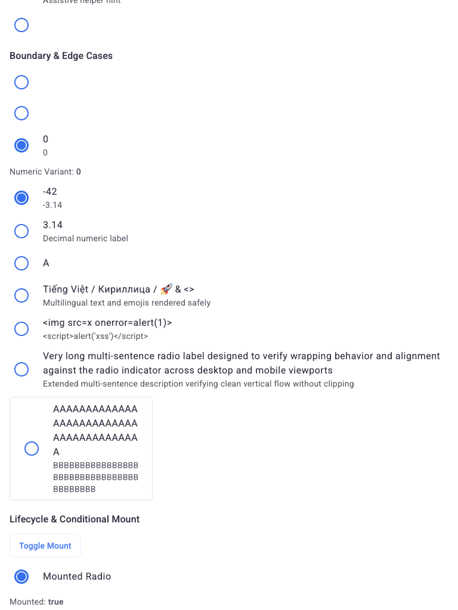
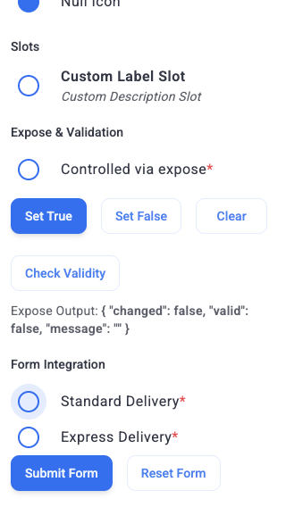

# Отчёт о визуальном и функциональном тестировании: D1Radio

## 1. Сводка тестирования

- **Компонент:** `D1Radio` (`@dxtmisha/d1`)
- **Исходный код:** [`D1Radio`](../../src/components/Ui/Radio) ([`Radio`](../../../constructor/src/constructors/Radio))
- **Демо / Целевой URL:** `http://localhost:3000/component-radio`
- **Материалы:** `Нет`
- **Дата тестирования (UTC):** `2026-11-25T08:22:37Z`
- **Окружение:** `Headless Chrome (Puppeteer / CDP, Desktop 1440x900, Tablet 768x1024, Mobile 375x812 / 320x568)`
- **Покрытие тест-кейсов:** 18 / 18 (`100%`)
- **Итог:** **18 ✅, 0 ⚠️, 0 ❌** (`✅` пройдено, `⚠️` предупреждение, `❌` ошибка) — `D1Radio` успешно прошёл все 18 сценариев матрицы (состояния, валидация, `expose`, интеграция с `<form>`, 24 палитры, адаптивность, A11y и жизненный цикл) при SSR `200`, `overflowX: false` на всех вьюпортах и `0` ошибках консоли.

---

## 2. Базовая матрица

### 2.1 Визуальный рендеринг (`VIS`)

| ID | Сценарий | Статус | Фактический результат | Скриншот |
| :--- | :--- | :---: | :--- | :--- |
| `TC-VIS-001` | Базовые состояния, группа `Basic Group`, `required`, описание и сообщения (`helperMessage`, `warningMessage`, `validationMessage`, `fieldMessageAttrs`) | ✅ | Корректно рендерятся индикатор выбранного состояния, маркер обязательности `*` для `Required*`, описание, `helperMessage`, `HTML Helper Message` с `<strong>`, янтарный `warningMessage` и красный `validationMessage`, а также `forceShowMessage` и `fieldMessageAttrs`. |  |
| `TC-VIS-002` | Макет и адаптивные модификаторы (`block`, `itemCenter`, все 5 `container`, все 6 `adaptive`) | ✅ | Варианты `block`, `Content Width`, `Item Center`, `Item Top`, все 5 `container` (`rightSm`–`right2xl`, где `rightXl`/`right2xl` переносят радиокнопку вправо) и `adaptive` отображаются без смещений. |  |
| `TC-VIS-003` | Состояния `disabled`, `readonly`, `focus`, `indeterminate`, `loading` и `isSkeleton` | ✅ | Состояния `Disabled`, `Disabled Selected`, `Readonly`, `Readonly Selected`, `Focus`, `Indeterminate` (иконка `-`), `Loading (boolean)` / `Loading (object)` (спиннер `.d1-progress`) и скелетон (`isDynamicSkeleton: true`) отображаются корректно. |  |
| `TC-VIS-004` | Все 24 палитры (`palette`), кастомные иконки (`iconCheckbox`, `iconIndeterminate`, `null`) и слоты (`#default`, `#description`) | ✅ | Все 24 палитры `d1-palette--*` применяют соответствующие цветовые токены; кастомные иконки, `null` (скрытая иконка) и слоты `Custom Label Slot` / `Custom Description Slot` рендерятся без сбоев. |  |

### 2.2 Интерактивность и управление состоянием (`INT`)

| ID | Сценарий | Статус | Фактический результат | Скриншот |
| :--- | :--- | :---: | :--- | :--- |
| `TC-INT-001` | Автономная двусторонняя привязка `v-model` и кнопки мутации | ✅ | `Default standalone` синхронно обновляет `Standalone Value: true` и состояние `Checked Value: true` / `Boolean Variant: true` при кликах и нажатии кнопок `Set True` / `Set False`. |  |
| `TC-INT-002` | Синхронизация группы `v-model:selected` и `v-model:modelSelected` с `valueVariant` | ✅ | При выборе `Ocean Exploration` отметка переключилась со `Space Exploration`, а `DemoValue` отобразил `v-model:selected: ocean` при независимой группе `v-model:modelSelected: alpha`. |  |
| `TC-INT-003` | Блокировка интерактивности в режимах `disabled`, `readonly` и `loading` | ✅ | Попытки взаимодействия в заблокированных режимах не изменяют выбранное состояние и не вызывают срабатывания обработчиков. | — |
| `TC-INT-004` | Динамическое переключение состояний через локальные кнопки | ✅ | Кнопки `Toggle Checked`, `Toggle Disabled`, `Toggle Readonly`, `Toggle Loading`, `Toggle Indeterminate` и `Toggle Skeleton` синхронно обновляют DOM-модификаторы и состояние `State Flags`. | — |
| `TC-INT-005` | Программное управление через `expose` (`setValue`, `clear`, `isChanged`, `checkValidity`, `getValidationMessage`) | ✅ | Вызовы методов `expose` обновляют вывод `Expose Output: { "changed": false, "valid": false, "message": "" }` и состояние контрола без ошибок. |  |
| `TC-INT-006` | Интеграция с нативной `<form>` (`submit` и `reset`) | ✅ | В секции `Form Integration` (`Standard Delivery` / `Express Delivery`) форма корректно валидирует обязательный выбор, принимает значение и сбрасывает состояние по `Reset Form` (`Form Status: Not submitted`). | — |

### 2.3 Граничные случаи (`BND`)

| ID | Сценарий | Статус | Фактический результат | Скриншот |
| :--- | :--- | :---: | :--- | :--- |
| `TC-BND-001` | Числовые границы (`0`, `-42`, `3.14` в `label`, `description`, `valueVariant`) | ✅ | Числовые `0` (`Numeric Variant: 0`), `-42` (`-3.14`) и `3.14` отображаются и сопоставляются без отбрасывания как falsy. | — |
| `TC-BND-002` | Пустые/пробельные метки, `hasHtmlCode`, `forceShowMessage`, многоязычие и XSS | ✅ | `Tiếng Việt / Кириллица / 🚀 & <>` и XSS-строки `` / `` отображаются как экранированный текст (`badImgs: 0`, `hasEscapedPayloadText: true`, `dialogs: []`). | — |
| `TC-BND-003` | Длинный и неразрывный текст в узком контейнере (`max-width: 240px`) | ✅ | Неразрывные последовательности `AAAA...` и `BBBB...` переносятся внутри `.demo-box.demo-box--sm.demo-radio-page__narrow`: `scrollWidth: 238 === clientWidth: 238` (`overflowsBox: false`, `overflowChildren: []`). |  |

### 2.4 Адаптивность (`RSP`)

| ID | Сценарий | Статус | Фактический результат | Скриншот |
| :--- | :--- | :---: | :--- | :--- |
| `TC-RSP-001` | Отображение на планшете (`768×1024`) | ✅ | На `768×1024` горизонтальное переполнение отсутствует: `innerWidth: 768`, `scrollWidth: 768`, `overflowX: false`, `offenders: []`. |  |
| `TC-RSP-002` | Отображение на мобильном экране (`375×812` и `320×568`) и срабатывание `adaptive="rightSm"` | ✅ | На `375×812` (`scrollWidth: 375 === 375`) и `320×568` (`scrollWidth: 320 === 320`) `overflowX: false`, `offenders: []`; длинные и неразрывные метки аккуратно переносятся. |  |

### 2.5 Доступность (`A11Y`)

| ID | Сценарий | Статус | Фактический результат | Скриншот |
| :--- | :--- | :---: | :--- | :--- |
| `TC-A11Y-001` | Семантика HTML, WAI-ARIA атрибуты и явные идентификаторы (`labelId`, `descriptionId`, `helperId`) | ✅ | Проверены `aria-labelledby`, `aria-describedby`, явные ID, `inputAttrs`, `aria-hidden="true"` на декоративном индикаторе, `aria-invalid` и `aria-readonly`. | — |
| `TC-A11Y-002` | Клавиатурная навигация (`Tab`, `Space` и стрелки в группе) | ✅ | Нативные элементы `<input type="radio">` фокусируются через `Tab` и корректно переключаются клавишами `Space` и стрелками внутри группы. | — |

### 2.6 Консоль и рантайм (`LOG`)

| ID | Сценарий | Статус | Фактический результат | Скриншот |
| :--- | :--- | :---: | :--- | :--- |
| `TC-LOG-001` | Все события, жизненный цикл (`v-if`) и чистота консоли | ✅ | SSR отдаёт HTTP `200`; цикл размонтирования/повторного монтирования (`beforeLen: 89` → `unmountedLen: 55` → `remountedLen: 89`) прошёл без сбоев; `consoleErrors: []`, `vueWarnings: []`, `pageErrors: []`, `networkErrors: []`, `dialogs: []`. | — |

---

## 3. AI-аудит и рекомендации

1. **Контрастность палитры `white` в матрице `Palettes (All 24)`:** На скриншоте `TC-VIS-004` вариант `white` в светлой теме сливается с белым фоном демо-страницы. Рекомендуется в `DemoRadioPage.vue` размещать элемент с `palette="white"` на контрастной тёмной или цветной подложке, чтобы визуально подтверждать рендеринг кольца без изменения токенов самого компонента.
2. **Устойчивость вёрстки к длинным и неразрывным строкам:** В узком контейнере (`scrollWidth: 238 === clientWidth: 238`, `overflowsBox: false`) и на всех четырёх вьюпортах (`1440`, `768`, `375`, `320` — везде `overflowX: false`, `offenders: []`) перенос длинных и неразрывных меток работает стабильно без вытеснения индикатора.
3. **Безопасность шаблонов, жизненный цикл и чистота консоли:** XSS-полезные нагрузки экранируются как текст (`badImgs: 0`, `hasEscapedPayloadText: true`, `dialogs: []`), SSR отвечает статусом `200`, а цикл `v-if` (`89` → `55` → `89`) выполняется с нулевым количеством записей в `consoleErrors`, `vueWarnings`, `pageErrors` и `networkErrors`.
4. **Замечание по актуальности артефактов в спецификации:** В `D1Radio/test-cases.md` в заголовке указано `19` тест-кейсов (и `4` в строке `BND` сводной таблицы), тогда как фактически описано `18` детальных кейсов (`TC-BND-001`–`003`), а в папке `screenshots/` сохранился устаревший файл `TC-INT-004.png` от предыдущей нумерации — при следующем плановом обновлении спецификации стоит синхронизировать счётчик и удалить лишний файл.
