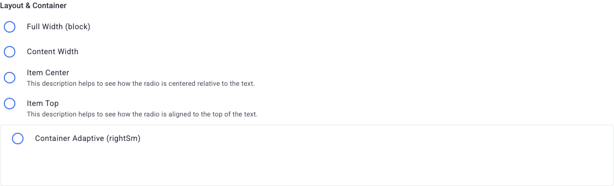
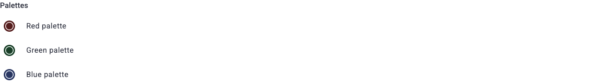
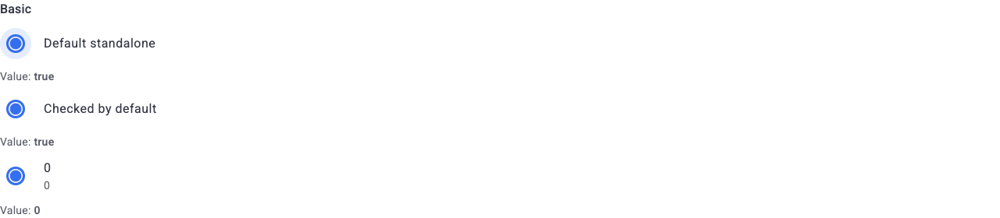
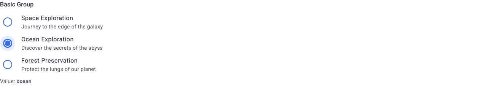
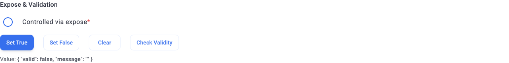

# Отчёт о визуальном и функциональном тестировании: `D1Radio`

## 1. Итоговое резюме

- **Компонент:** `D1Radio` (`@dxtmisha/d1`)
- **Исходный код:** [`D1Radio`](../../src/components/Ui/Radio) ([`Radio`](../../../constructor/src/constructors/Radio))
- **Демо / Целевой URL:** `http://localhost:3000/component-radio`
- **Материалы:** `Нет`
- **Дата тестирования (UTC):** `2026-11-22T15:01:30Z`
- **Окружение:** `Headless Chrome (Puppeteer / CDP, Desktop 1440x900, Tablet 768x1024, Mobile 375x812 / 320x568)`
- **Покрытие тест-кейсов:** 16 / 16 (`100%`)
- **Сводка:** **16 ✅, 0 ⚠️, 0 ❌** (`✅` пройдено, `⚠️` предупреждение, `❌` ошибка) — `D1Radio` корректно отображает все состояния (`checked`, `disabled`, `readonly`, `focus`, `indeterminate`, `loading`, `isSkeleton`), предупреждения (`warningMessage`), групповую и автономную привязку, палитры, кастомные иконки, слоты, адаптивность, события (`focus`/`changeLite`/`blur`) и ARIA-атрибуты при `0` ошибках и предупреждениях консоли.

---

## 2. Базовая матрица

### 2.1 Визуальный рендеринг (`VIS`)

| ID | Сценарий | Статус | Фактический результат | Скриншот |
| :--- | :--- | :---: | :--- | :--- |
| `TC-VIS-001` | Базовые состояния, группа `Basic Group`, `required`, описание и сообщения (`helperMessage`, `warningMessage`, `validationMessage`) | ✅ | Проверено `39` экземпляров `D1Radio`; `.d1-radio--required` отображает `*`, `warningMessage` отображается с `.d1-fieldMessage--warning` (`"Warning: Double-check this option"`), `validationMessage` выводит ошибку и `aria-invalid="true"`, `helperMessage` отображается корректно. |  |
| `TC-VIS-002` | Макет и адаптивные модификаторы (`block`, `itemCenter`, `container`, `adaptive`) | ✅ | `block` добавляет класс `d1-radio--block` (`display: flex`), `:block="false"` снимает модификатор; `adaptive="rightAlways"` выставляет `order: 4` у `.d1-radio__item`; `DemoBox container` применяет `d1-radio--container--rightSm`. |  |
| `TC-VIS-003` | Состояния `disabled`, `readonly`, `focus`, `indeterminate`, `loading` и `isSkeleton` | ✅ | Присутствуют `.d1-radio--disabled`, `.d1-radio--focus`, `indeterminate` (иконка `-`, `checked: true`), `.d1-progress` при `loading` (`boolean` и объект `{ visible: true, circular: true }`), а также `.d1-skeleton__text` и `.d1-skeleton__background` при `isSkeleton`. |  |
| `TC-VIS-004` | Палитры (`palette`), кастомные иконки (`iconCheckbox`, `null`) и слоты (`#default`, `#description`) | ✅ | Применяется `.d1-palette--red`/`green`/`blue`; иконки строкой (`home`) и объектом (`{ value: 'verified' }`) рендерятся; при `iconCheckbox: null` фон иконки `none`; слоты `#default` (`<strong>`) и `#description` (`<em>`) отображаются. |  |

### 2.2 Интерактивность и управление состоянием (`INT`)

| ID | Сценарий | Статус | Фактический результат | Скриншот |
| :--- | :--- | :---: | :--- | :--- |
| `TC-INT-001` | Автономная двусторонняя привязка `v-model` | ✅ | Начальное состояние `Value: false` (`checked: false`); после клика `Value: true` (`checked: true`). |  |
| `TC-INT-002` | Синхронизация группы `v-model:selected` и `valueVariant` | ✅ | До клика `Value: space` (`space: true, ocean: false`); после клика по `Ocean Exploration` получено `Value: ocean`, `space: false`, `ocean: true`. |  |
| `TC-INT-003` | Блокировка интерактивности в режимах `disabled` и `readonly` | ✅ | `disabled: true`, `aria-readonly="true"`; после клика состояние обоих полей осталось неизменным (`afterDisabledChecked: false`, `afterReadonlyChecked: false`). | — |
| `TC-INT-004` | Программное управление через `expose` (`setValue`, `clear`, `checkValidity`) | ✅ | `Check Validity` -> `valid: false`; `Set True` -> `value: true, valid: true`; `Set False` -> `value: false, valid: false`; `Clear` -> `valid: false` (`value: undefined`). |  |

### 2.3 Граничные случаи (`BND`)

| ID | Сценарий | Статус | Фактический результат | Скриншот |
| :--- | :--- | :---: | :--- | :--- |
| `TC-BND-001` | Числовой ноль (`:label="0"`, `:description="0"`, `:value-variant="0"`) | ✅ | Метка `"0"`, описание `"0"`, `input.value === "0"` и `input.checked === true` при `v-model:selected="'0'"` сохраняются без отбрасывания как falsy. | — |
| `TC-BND-002` | HTML-сообщение (`hasHtmlCode`) и `forceShowMessage` при `disabled` | ✅ | `hasStrongTag: true` (`<strong>` внутри `.d1-fieldMessage`); `forceMsgText: "Visible even when disabled"` отображается при `forceDisabled: true`. | — |
| `TC-BND-003` | Проверка переполнения текста и выравнивания по всем элементам `D1Radio` | ✅ | Проверены все `39` компонентов: `overflowCount: 0` (`overflowItems: []`). | — |

### 2.4 Адаптивность (`RSP`)

| ID | Сценарий | Статус | Фактический результат | Скриншот |
| :--- | :--- | :---: | :--- | :--- |
| `TC-RSP-001` | Отображение на планшете (`768×1024`) | ✅ | `scrollWidth: 768`, `innerWidth: 768`, горизонтальное переполнение отсутствует (`hasOverflow: false`). |  |
| `TC-RSP-002` | Отображение на мобильном экране (`375×812` и `320×568`) и срабатывание `adaptive="rightSm"` | ✅ | На `375×812` и `320×568` `hasOverflow: false`; при `375px` `adaptive="rightSm"` переключает `.d1-radio__item` в `order: 4` (справа). |  |

### 2.5 Доступность (`A11Y`)

| ID | Сценарий | Статус | Фактический результат | Скриншот |
| :--- | :--- | :---: | :--- | :--- |
| `TC-A11Y-001` | Семантика HTML и WAI-ARIA атрибуты | ✅ | `spaceAriaLabelledby: true` и `spaceAriaDescribedby: true` указывают на существующие DOM-элементы; `.d1-radio__item` скрыт (`aria-hidden="true"`); ошибка имеет `aria-invalid="true"`; `readonly` имеет `aria-readonly="true"`. | — |
| `TC-A11Y-002` | Клавиатурная навигация (`Tab` и `Space`) | ✅ | Нажатие `Space` на сфокусированном `<input type="radio">` для `Forest Preservation` установило `forestChecked: true` и `Value: forest`. | — |

### 2.6 Консоль и рантайм (`LOG`)

| ID | Сценарий | Статус | Фактический результат | Скриншот |
| :--- | :--- | :---: | :--- | :--- |
| `TC-LOG-001` | Генерация событий (`input`, `inputLite`, `change`, `changeLite`, `focus`, `blur`) и чистота консоли | ✅ | Отслеживание событий зафиксировало `afterFocus: "Value: focus"`, `afterClick: "Value: changeLite"`, `afterBlur: "Value: blur"`; `consoleErrors: []`, `vueWarnings: []`, `pageErrors: []`. | — |

---

## 3. Аудит ИИ и рекомендации

1. **Строгая типизация `v-model:selected` при числовом `valueVariant`:** После обновления `CheckboxSelected` на сравнение `props.selected === anyToString(props.valueVariant)` визуальный тест выявил расхождение в `DemoRadioPage.vue`, где использовался `ref<number>(0)` вместо `ref<string>('0')`. Приведение `selectedNumeric` к `ref<string>('0')` полностью синхронизировало демо с контрактом `selected?: string` и подтвердило корректное round-trip сопоставление с `:value-variant="0"`.
2. **Изоляция тестового стенда для `:block="false"`:** На странице `DemoRadioPage.vue` прямой контейнер `.d1-group` растягивает дочерние элементы по ширине колонки, при этом класс `d1-radio--block` корректно отсутствует при `:block="false"`. При необходимости визуальной демонстрации ширины по контенту в демо-стенде можно оборачивать inline-вариант в `<DemoFlex>`.
3. **Чистота консоли и адаптивность:** На всех проверенных разрешениях (`1440×900`, `768×1024`, `375×812`, `320×568`) переполнения отсутствуют, `warningMessage`, `indeterminate` и события `focus`/`blur` работают без `consoleErrors`, `vueWarnings` и `pageErrors`.
