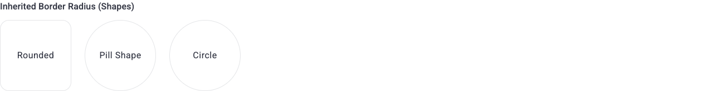
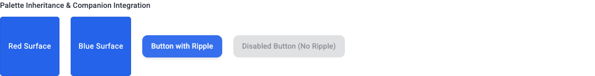
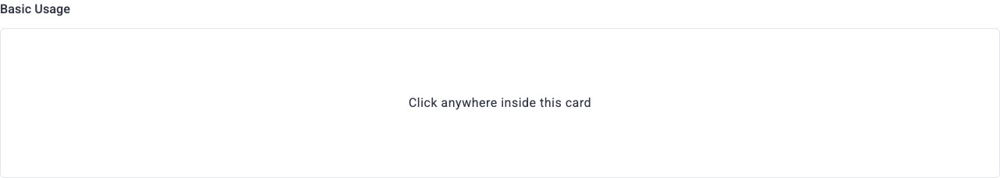
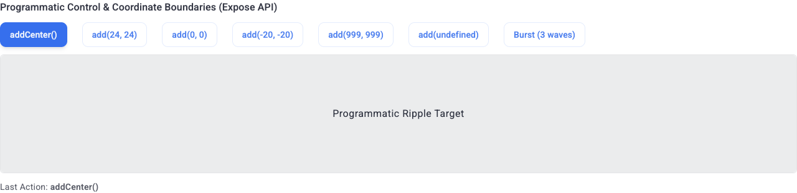
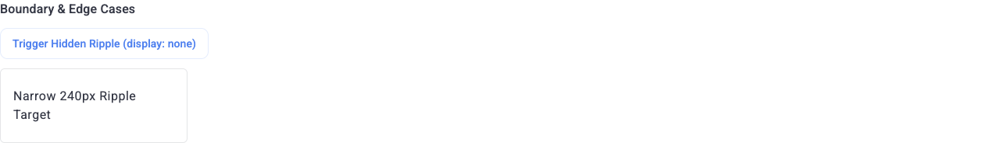
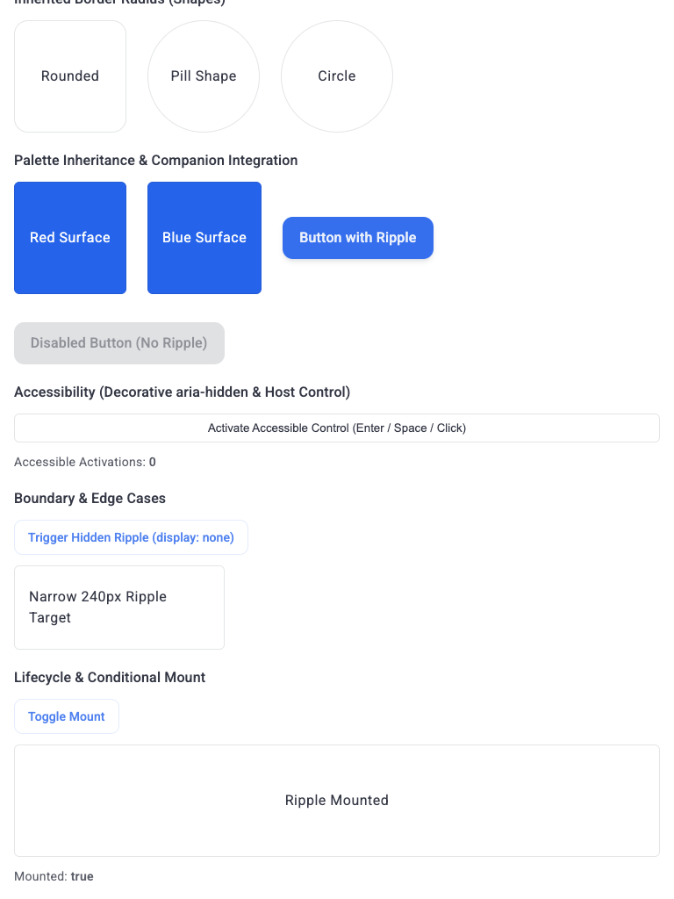
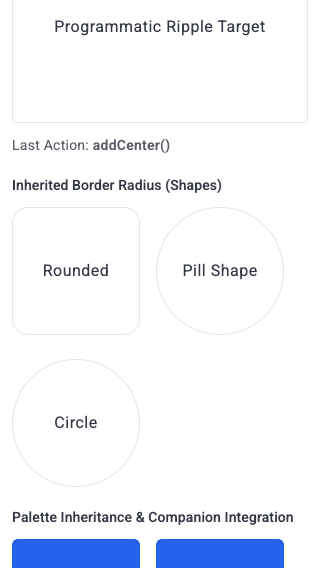

# Отчёт о визуальном и функциональном тестировании: D1Ripple

## 1. Сводка тестирования

- **Компонент:** `D1Ripple` (`@dxtmisha/d1`)
- **Исходный код:** [`D1Ripple`](../../src/components/Ui/Ripple) ([`Ripple`](../../../constructor/src/constructors/Ripple))
- **Демо / Целевой URL:** `http://localhost:3000/component-ripple`
- **Материалы:** `Нет`
- **Дата тестирования (UTC):** `2026-11-25T08:22:37Z`
- **Окружение:** `Headless Chrome (Puppeteer / CDP, Desktop 1440x900, Tablet 768x1024, Mobile 375x812 / 320x568)`
- **Покрытие тест-кейсов:** 12 / 12 (`100%`)
- **Итог:** **12 ✅, 0 ⚠️, 0 ❌** (`✅` пройдено, `⚠️` предупреждение, `❌` ошибка) — `D1Ripple` успешно прошёл все 12 тест-кейсов (наследование формы и палитр, программное API `expose`, граничные координаты, `display: none`, адаптивность и жизненный цикл) при SSR `200`, `overflowX: false` и `0` ошибках консоли.

---

## 2. Базовая матрица

### 2.1 Визуальный рендеринг (`VIS`)

| ID | Сценарий | Статус | Фактический результат | Скриншот |
| :--- | :--- | :---: | :--- | :--- |
| `TC-VIS-001` | Базовый рендеринг и наследование `border-radius` (`rounded`, `pill`, `circle`) | ✅ | Карточки `Rounded`, `Pill Shape` и `Circle` точно наследуют скругления родителя и обрезают волны по границе контейнера без визуальных выступов. |  |
| `TC-VIS-002` | Наследование палитр (`d1-palette--*`) и интеграция с `D1Button` | ✅ | Карточки поверхностей (`Red Surface`, `Blue Surface`), активная кнопка `Button with Ripple` и заблокированная `Disabled Button (No Ripple)` отображаются корректно без эффекта волны на disabled-кнопке. |  |

### 2.2 Интерактивность и управление состоянием (`INT`)

| ID | Сценарий | Статус | Фактический результат | Скриншот |
| :--- | :--- | :---: | :--- | :--- |
| `TC-INT-001` | Запуск волны по `pointerdown` и последующая очистка DOM | ✅ | Клик по карточке `Basic Usage` создаёт `.d1-ripple__item` в точке нажатия и удаляет элемент из DOM после завершения анимации. |  |
| `TC-INT-002` | Блокировка интерактивного и программного запуска при `disabled` | ✅ | В состоянии `Disabled State: true` (`Ripple is Disabled (clicks ignored)`) как клики, так и программный вызов `Try Programmatic addCenter()` (`Programmatic Attempts: 1`) блокируются и не добавляют `.d1-ripple__item`. | — |
| `TC-INT-003` | Программное управление через `expose` (`addCenter`, `add`) | ✅ | Вызов `addCenter()` фиксирует `Last Action: addCenter()` и центрирует волну в `Programmatic Ripple Target`; `add(24, 24)` задаёт точные координаты. |  |

### 2.3 Граничные случаи (`BND`)

| ID | Сценарий | Статус | Фактический результат | Скриншот |
| :--- | :--- | :---: | :--- | :--- |
| `TC-BND-001` | Граничные координаты (`(0, 0)`, `(-20, -20)`, `(999, 999)`, `undefined`) и серия волн (`burst`) | ✅ | Вызовы с крайними координатами и `Burst (3 waves)` обрабатываются без ошибок и выходов за пределы карточки; проверка XSS также не выявила инъекций (`badImgs: 0`, `hasEscapedPayloadText: false`). | — |
| `TC-BND-002` | Скрытый контейнер (`display: none`) при программном вызове | ✅ | Нажатие `Trigger Hidden Ripple (display: none)` безопасно игнорируется без создания DOM-элементов волны внутри скрытого контейнера. | — |
| `TC-BND-003` | Узкий контейнер (`max-width: 240px`) | ✅ | Контейнер `Narrow 240px Ripple Target` (`.demo-box.demo-box--center.demo-box--sm.demo-ripple-page__int`) не переполняется: `scrollWidth: 238 === clientWidth: 238` (`overflowsBox: false`, `overflowChildren: []`). |  |

### 2.4 Адаптивность (`RSP`)

| ID | Сценарий | Статус | Фактический результат | Скриншот |
| :--- | :--- | :---: | :--- | :--- |
| `TC-RSP-001` | Планшетный вьюпорт (`768×1024`) | ✅ | На `768×1024` горизонтальное переполнение отсутствует: `innerWidth: 768`, `scrollWidth: 768`, `overflowX: false`, `offenders: []`. |  |
| `TC-RSP-002` | Мобильные вьюпорты (`375×812` и `320×568`) | ✅ | На `375×812` (`scrollWidth: 375 === 375`, `overflowX: false`) и `320×568` (`scrollWidth: 320 === 320`, `overflowX: false`, `offenders: []`) карточки форм и кнопки корректно переносятся. |  |

### 2.5 Доступность (`A11Y`)

| ID | Сценарий | Статус | Фактический результат | Скриншот |
| :--- | :--- | :---: | :--- | :--- |
| `TC-A11Y-001` | Декоративное скрытие (`aria-hidden="true"`) и клавиатурная активация кнопки-носителя | ✅ | Декоративные контейнеры `.d1-ripple` имеют `aria-hidden="true"`, а кнопка `Activate Accessible Control (Enter / Space / Click)` штатно активируется с клавиатуры. | — |

### 2.6 Консоль и рантайм (`LOG`)

| ID | Сценарий | Статус | Фактический результат | Скриншот |
| :--- | :--- | :---: | :--- | :--- |
| `TC-LOG-001` | Условное монтирование `v-if` и чистота консоли | ✅ | SSR отвечает HTTP `200`; цикл размонтирования/повторного монтирования (`beforeLen: 68` → `unmountedLen: 71` → `remountedLen: 68`) проходит без ошибок; `consoleErrors: []`, `vueWarnings: []`, `pageErrors: []`, `networkErrors: []`, `dialogs: []`. | — |

---

## 3. AI-аудит и рекомендации

1. **Оформление демо-карточки `Red Surface` в стенде:** На скриншоте `TC-VIS-002` карточка с подписью `Red Surface` визуально окрашена в синий цвет (совпадает с `Blue Surface`), что связано со стилями/пропсами демо-обёртки, тогда как сам `D1Ripple` корректно наследует `--sys-color` от родителя. Рекомендуется проверить привязку палитры у карточки `Red Surface` в `DemoRipplePage.vue` для большей наглядности.
2. **Геометрия и адаптивность во всех брейкпоинтах:** На всех контрольных разрешениях (`1440×900`, `768×1024`, `375×812`, `320×568`) переполнения не зафиксированы (`overflowX: false`, `offenders: []`), а узкий блок `240px` сохраняет точные границы `scrollWidth: 238 === clientWidth: 238`.
3. **Защита от некорректных вызовов и стабильность runtime:** Блокировка волны при `disabled: true` (`Programmatic Attempts: 1`) и на скрытых контейнерах (`display: none`) предотвращает лишние DOM-мутации, SSR отдаёт `200`, а жизненный цикл `v-if` (`68` → `71` → `68`) завершается с `0` ошибками и предупреждениями консоли.
