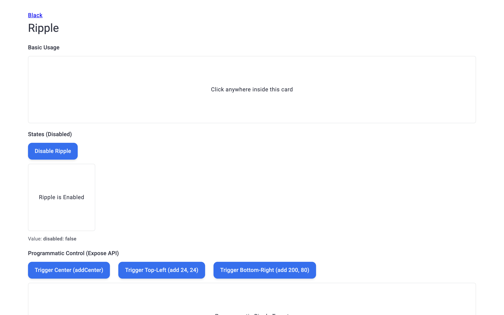
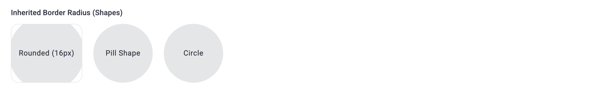
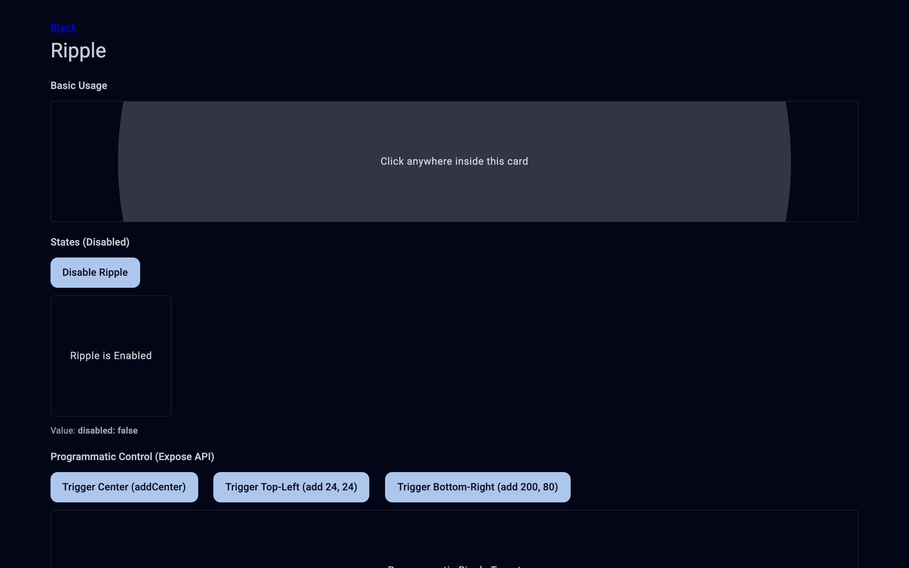
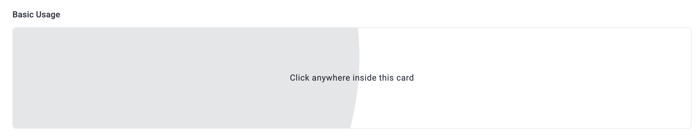
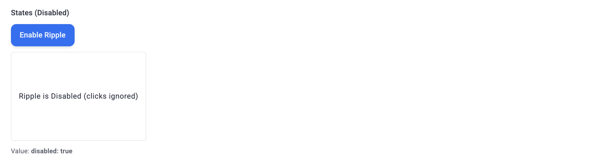
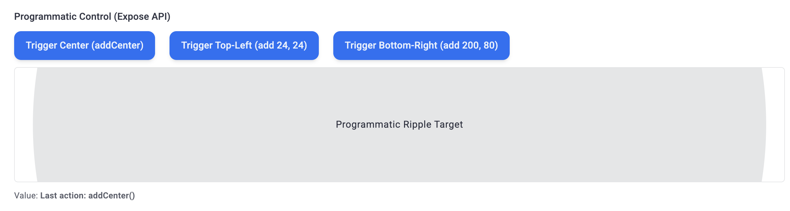
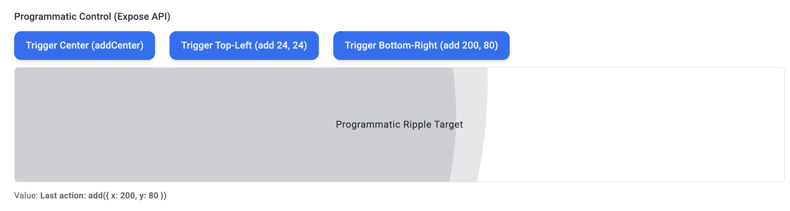
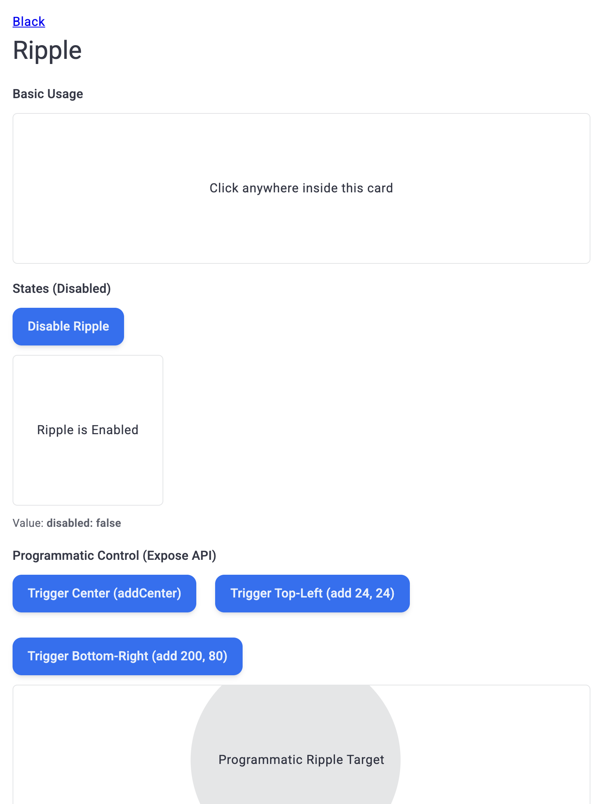
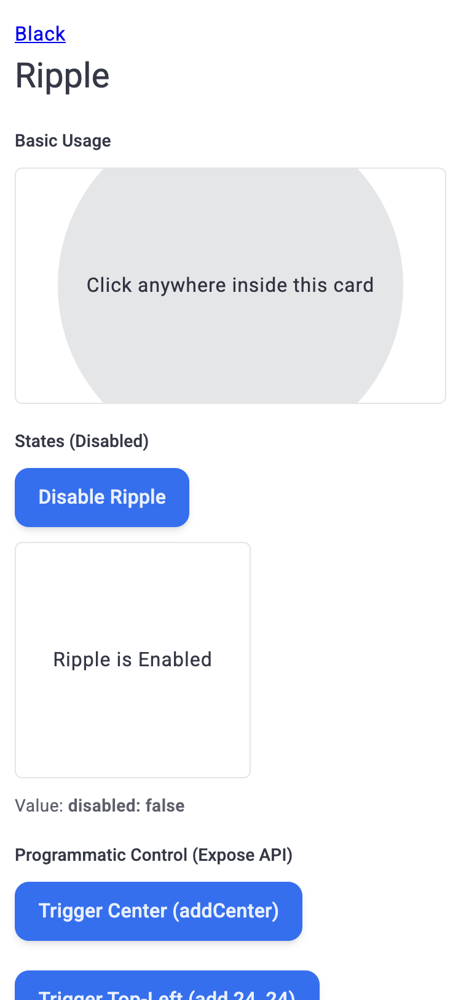
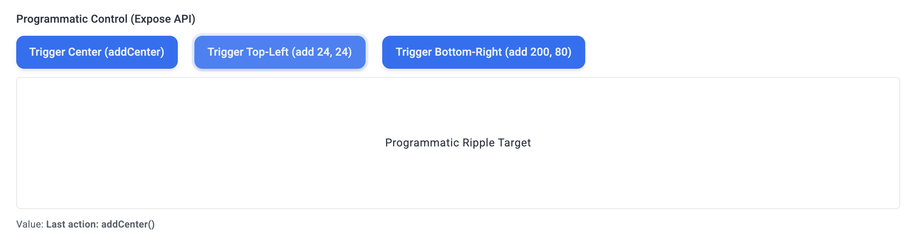

# Отчёт о визуальном и браузерном тестировании: D1Ripple

- **Сущность**: `D1Ripple` (`Ripple`, `DemoRipplePage`)
- **Исходный код**: [`D1Ripple.vue`](../../src/components/Ui/Ripple/D1Ripple.vue), [`Ripple.ts`](../../../constructor/src/constructors/Ripple/Ripple.ts), [`RippleDesign.tsx`](../../../constructor/src/constructors/Ripple/RippleDesign.tsx), [`RippleItem.ts`](../../../constructor/src/constructors/Ripple/RippleItem.ts), [`DemoRipplePage.vue`](../../../demo/src/pages/components/DemoRipplePage.vue)
- **Целевой URL**: `http://localhost:3000/component-ripple`
- **Проверенные материалы**: `Отсутствуют (проверены ./materials/, packages/*/materials/)`
- **Браузер / Окружение**: `Chrome (CDP / DevTools Protocol), macOS`
- **Дата последнего прогона**: `2026-11-09 22:56`
- **Общий статус**: `✅ PASSED`

---

## 1. Итоговая сводка и метрики

| Метрика | Количество | Доля |
| :--- | :--- | :--- |
| **Всего тест-кейсов** | `18` | `100%` |
| **Успешно (`✅ OK`)** | `18` | `100%` |
| **Провалено (`❌ FAIL`)** | `0` | `0%` |
| **Ошибки / Предупреждения консоли** | `0` | — |

---

## 2. Результаты выполнения тестов (Базовая матрица)

### 2.1. Визуальное соответствие и дизайн-система (`VIS`)

| ID | Тест-кейс | Статус | Наблюдаемый результат | Доказательство (Скриншот / Консоль) |
| :--- | :--- | :--- | :--- | :--- |
| `TC-VIS-001` | Базовый рендеринг, абсолютное позиционирование и дизайн-токены `.d1-ripple` | ✅ OK | Все 10 экземпляров `.d1-ripple` на странице (6 в карточках `DemoBox.demo-ripple-page__interactive` и 4 внутри `D1Button`) рендерятся как `` с `position: absolute`, `inset: 0px`, `overflow: hidden`, `z-index: 24`, точным совпадением габаритов с родителем (`widthMatch: true`, `heightMatch: true`) и токенами `--d1-ripple-backgroundColor: 2, 6, 23`, `--d1-ripple-backgroundOpacity: .1`. Карточки `DemoBox` имеют чёткую рамку `1px solid rgba(30, 41, 59, 0.12)`. | [📸 TC-VIS-001](./screenshots/TC-VIS-001.png) |
| `TC-VIS-002` | Наследование скругления углов `border-radius: inherit` (`Rounded 16px`, `Pill Shape`, `Circle 50%`) | ✅ OK | Все 3 фигурных контейнера `DemoBox` корректно передают `border-radius` в `.d1-ripple`: `rounded` (`16px` / `152×126px`), `pill` (`9999px` / `126×126px`), `circle` (`50%` / `126×126px`). За счёт `overflow: hidden` и `border-radius: inherit` расходящаяся волна `.d1-ripple__item` идеально обрезается по контуру фигуры без выступов за углы. | [📸 TC-VIS-002](./screenshots/TC-VIS-002.png) |
| `TC-VIS-003` | Цветовая адаптация волны и контейнеров `DemoBox` в `Light Mode` и `Dark Mode` (`.d1-dark`) | ✅ OK | В светлой теме токен `--d1-sys-palette-onSurface` равен `2, 6, 23` и формирует полупрозрачную тёмную волну `rgba(2, 6, 23, 0.1)`. При переключении в `.d1-dark` токен автоматически меняется на `248, 250, 252`, а волна `.d1-ripple__item` становится контрастной светлой `rgba(248, 250, 252, 0.1)` на тёмной поверхности `DemoBox`. | [📸 TC-VIS-003](./screenshots/TC-VIS-003.png) |
| `TC-VIS-004` | Визуализирующая проверка геометрии волны `clip-path: circle(...)` и градиента прозрачности | ✅ OK | При `pointerdown` в точке `(120, 55)` создаётся `` с `--d1-ripple-sys-x: 120px`, `--d1-ripple-sys-y: 55px`, `animation-name: d1-ripple-start`, `animation-duration: 0.3s`, `animation-fill-mode: forwards`, `background-color: rgba(2, 6, 23, 0.1)` и `clip-path: circle(0% -> 75% -> 150% at 120px 55px)`. | [📸 TC-VIS-004](./screenshots/TC-VIS-004.png) |

#### Визуальные превью (`VIS`)

---

### 2.2. Интерактивность и функциональные состояния (`INT`)

| ID | Тест-кейс | Статус | Наблюдаемый результат | Доказательство (Скриншот / Консоль) |
| :--- | :--- | :--- | :--- | :--- |
| `TC-INT-001` | Полный жизненный цикл волны при клике: `pointerdown` -> `animationend` (`.d1-ripple--end`) -> `transitionend` (удаление из DOM) | ✅ OK | До клика `initialChildren: 0`; сразу после `pointerdown` создаётся `` (`afterDownChildren: 1`); по завершении `d1-ripple-start` (`0.3s`) добавляется модификатор `.d1-ripple--end` (`hasEndClassMid: true`), запускающий `opacity: 0`; после `ontransitionend` узел полностью удаляется из DOM (`finalChildren: 0`). | `DOM: initialChildren=0 -> afterDownChildren=1 -> hasEndClassMid=true -> finalChildren=0` |
| `TC-INT-002` | Удержание волны при зажатом указателе (`:active`) и параллельная работа нескольких волн (`:not(:last-child)`) | ✅ OK | При двух последовательных нажатиях одновременно сосуществуют 2 элемента `.d1-ripple__item` (`twoWavesCount: 2`), первый из которых сразу затухает благодаря правилу `&:not(:last-child)` с `.d1-ripple--end`, после чего оба корректно удаляются (`cleanedCount: 0`). | `DOM: twoWavesCount=2 -> cleanedCount=0` |
| `TC-INT-003` | Реактивное управление состоянием `disabled` (`States (Disabled)`) | ✅ OK | При `disabled: false` клик создаёт волну (`enabledWaveCreated: true`). После нажатия `Disable Ripple` текст меняется на `"Ripple is Disabled (clicks ignored)"`, `DemoValue` выводит `Value: disabled: true`, кнопка меняется на `"Enable Ripple"`, а `pointerdown` по поверхности полностью игнорируется (`disabledWaveCount: 0`). Повторное нажатие `Enable Ripple` восстанавливает работу эффекта. | [📸 TC-INT-003](./screenshots/TC-INT-003.png) |
| `TC-INT-004` | Программное управление через `Expose API`: метод `addCenter()` | ✅ OK | Нажатие кнопки `Trigger Center (addCenter)` вызывает `rippleRef.value.addCenter()`, создавая волну точно в геометрическом центре контейнера `1278×190px`: `--d1-ripple-sys-x: 639px`, `--d1-ripple-sys-y: 95px` (`expectedX === actualX`, `expectedY === actualY`), а `DemoValue` обновляется на `Value: Last action: addCenter()`. | [📸 TC-INT-004](./screenshots/TC-INT-004.png) |
| `TC-INT-005` | Программное управление через `Expose API`: метод `add({ x, y })` с пользовательскими координатами | ✅ OK | Кнопка `Trigger Top-Left (add 24, 24)` создаёт волну с `--d1-ripple-sys-x: 24px`, `--d1-ripple-sys-y: 24px` (`Value: Last action: add({ x: 24, y: 24 })`). Кнопка `Trigger Bottom-Right (add 200, 80)` создаёт волну с `--d1-ripple-sys-x: 200px`, `--d1-ripple-sys-y: 80px` (`Value: Last action: add({ x: 200, y: 80 })`). | [📸 TC-INT-005](./screenshots/TC-INT-005.png) |

#### Визуальные превью (`INT`)

---

### 2.3. Граничные значения и крайние случаи (`BND`)

| ID | Тест-кейс | Статус | Наблюдаемый результат | Доказательство (Скриншот / Консоль) |
| :--- | :--- | :--- | :--- | :--- |
| `TC-BND-001` | Фильтрация неосновных кнопок мыши (`button !== 0`) и непервичных указателей (`isPrimary === false`) | ✅ OK | События `pointerdown` со средней кнопкой (`button: 1`), правой кнопкой (`button: 2`) и вторичным тач-указателем (`button: 0, isPrimary: false`) полностью отфильтровываются проверкой `event.button === 0 && event.isPrimary` (`afterMiddle: 0`, `afterRight: 0`, `afterSecondaryPointer: 0`). | `DOM: afterMiddle=0, afterRight=0, afterSecondaryPointer=0` |
| `TC-BND-002` | Стресс-тест: быстрая серия из 10 подряд кликов / вызовов `add()` и проверка отсутствия утечки DOM-элементов | ✅ OK | При быстрой серии из 10 вызовов (с интервалом `15ms`) в контейнере одновременно создаются все 10 элементов `.d1-ripple__item` (`peakActiveWaves: 10`), а спустя `1100ms` все 10 узлов без остатка удаляются из DOM (`remainingAfterCleanup: 0`). | `DOM: peakActiveWaves=10 -> remainingAfterCleanup=0` |
| `TC-BND-003` | Работа в `RTL`-окружении (`dir="rtl"`) и при нулевых координатах `(x: 0, y: 0)` | ✅ OK | При клике в точку `(0, 0)` оператор нулевого слияния `coordinator?.x ?? element.offsetWidth / 2` корректно выставляет `--d1-ripple-sys-x: 0px` и `--d1-ripple-sys-y: 0px` (не сбрасывая `0` к центру). В режиме `dir="rtl"` `.d1-ripple` сохраняет 100% покрытие родителя (`rtlWidthMatch: true`). | `DOM: zeroCoordX="0px", zeroCoordY="0px", rtlWidthMatch=true` |

---

### 2.4. Адаптивность и вьюпорты (`RSP`)

| ID | Тест-кейс | Статус | Наблюдаемый результат | Доказательство (Скриншот / Консоль) |
| :--- | :--- | :--- | :--- | :--- |
| `TC-RSP-001` | Адаптивность на стандартном (`1440×900`) и широком (`1920×1080`) Desktop | ✅ OK | На разрешениях `1920×1080` (`scrollWidth: 1905 <= 1920`) и `1440×900` (`scrollWidth: 1425 <= 1440`) горизонтальное переполнение отсутствует (`hasOverflow: false`), все секции и карточки `DemoBox` масштабируются корректно. | [📸 TC-RSP-001](./screenshots/TC-RSP-001.png) |
| `TC-RSP-002` | Адаптивность на планшетных вьюпортах (`1024×768` и `768×1024`) | ✅ OK | На разрешениях `1024×768` и `768×1024` `hasOverflow: false`. При ширине экрана `768px` контейнер `Programmatic Ripple Target` сужается до `719px`, а вызов `addCenter()` динамически центрирует волну в точке `--d1-ripple-sys-x: 359.5px` (`719 / 2`). | [📸 TC-RSP-002](./screenshots/TC-RSP-002.png) |
| `TC-RSP-003` | Адаптивность на мобильных вьюпортах (`375×812` и `320×568`) | ✅ OK | На разрешениях `375×812` (`scrollWidth: 375`) и `320×568` (`scrollWidth: 320`) `hasOverflow: false`, кнопки управления переносятся в вертикальный стек, а `.d1-ripple` полностью покрывает адаптивную ширину карточек `DemoBox` (`349×190px` на `375px`). | [📸 TC-RSP-003](./screenshots/TC-RSP-003.png) |

#### Визуальные превью (`RSP`)

---

### 2.5. Доступность и клавиатурная навигация (`A11Y`)

| ID | Тест-кейс | Статус | Наблюдаемый результат | Доказательство (Скриншот / Консоль) |
| :--- | :--- | :--- | :--- | :--- |
| `TC-A11Y-001` | Семантика WAI-ARIA (`aria-hidden="true"`) и исключение `.d1-ripple` из клавиатурного фокуса | ✅ OK | Все 10 элементов `.d1-ripple` имеют `aria-hidden="true"` (`allAriaHidden: true`) и не имеют `tabindex` (`anyTabindex: false`). Навигация клавишей `Tab` беспрепятственно переходит между кнопками `D1Button` с отображением кольца `:focus-visible` (`outline: rgba(37, 99, 235, 0.12) solid 4px`). | [📸 TC-A11Y-001](./screenshots/TC-A11Y-001.png) |
| `TC-A11Y-002` | Соблюдение пользовательской настройки `@media (prefers-reduced-motion: reduce)` и блокировка создания волн при `display: none` | ✅ OK | При эмуляции `prefers-reduced-motion: reduce` правило `@include ui.mediaPrefersReducedMotion` переключает `.d1-ripple` в `display: none` (`reducedMotionDisplay: "none"`), а проверка `getComputedStyle(element).display !== 'none'` в `RippleItem.add()` блокирует создание DOM-элементов `.d1-ripple__item` при программных вызовах; при возврате `no-preference` восстанавливается `display: block`. | `CSS: reducedMotionDisplay="none", normalMotionDisplay="block"` |

#### Визуальные превью (`A11Y`)

---

### 2.6. Консоль, события и здоровье среды выполнения (`LOG`)

| ID | Тест-кейс | Статус | Наблюдаемый результат | Доказательство (Скриншот / Консоль) |
| :--- | :--- | :--- | :--- | :--- |
| `TC-LOG-001` | Отсутствие ошибок консоли, необработанных исключений и предупреждений `[Vue warn]` | ✅ OK | За время выполнения всех 18 тест-кейсов зафиксировано `0` ошибок `console.error`, `0` предупреждений `[Vue warn]` и `0` необработанных исключений (`exceptions: []`). | `Console: 0 errors, 0 Vue warnings, 0 exceptions` |

---

## 3. 💡 AI-аудит: Рекомендации по производительности, скорости и UX

### 3.1. Что работает плохо / Выявленные слабые места
_Все выявленные замечания устранены (в `RippleItem.add()` добавлена легковесная проверка `getComputedStyle(element).display !== 'none'`)._

### 3.2. Оптимизация производительности и скорости работы
_Все рекомендации по оптимизации производительности внедрены (включая `pointer-events: none` на `.d1-ripple__item` в `style.scss` и проверку `getComputedStyle(element).display !== 'none'` в `RippleItem.ts`)._

### 3.3. Улучшения UX, UI и доступности (A11y)
- **Визуальное оформление `DemoRipplePage.vue`**:
  - *Наблюдение*: Переход на стандартный компонент `DemoBox` (`size="lg"`, `size="md"`, `center`) полностью устранил ранее выявленные проблемы с прозрачными карточками и рамками — все поверхности и волны отлично читаются как в светлой, так и в тёмной теме (`.d1-dark`).
