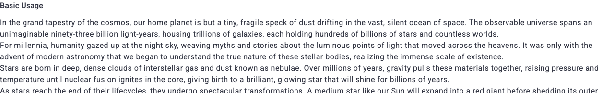
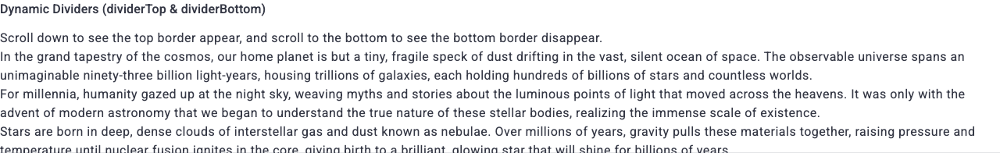
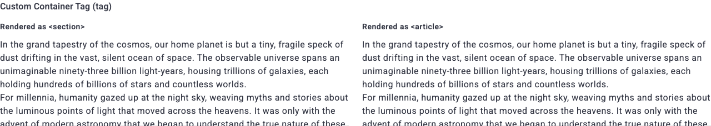
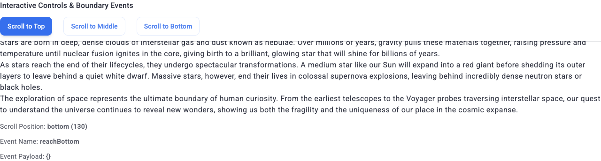
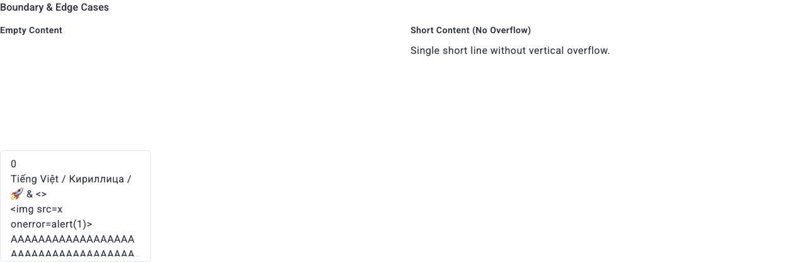
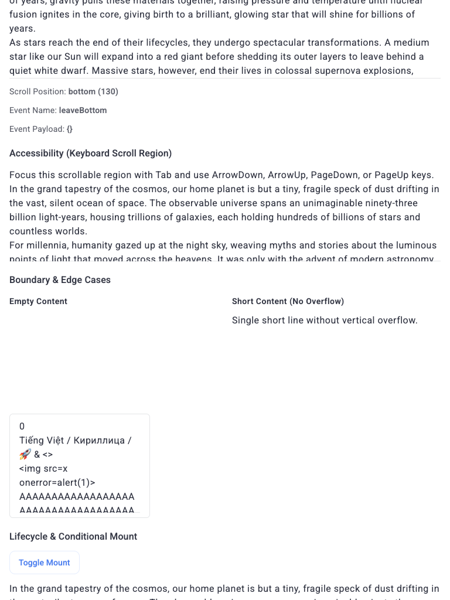
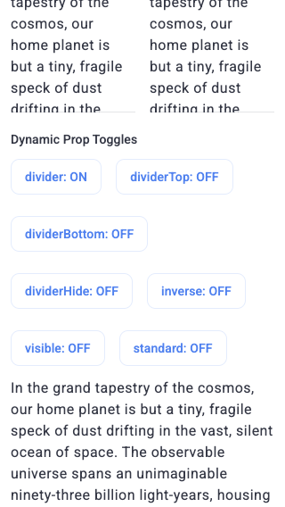

# Отчёт о визуальном и функциональном тестировании: D1Scrollbar

## 1. Сводка тестирования

- **Компонент:** `D1Scrollbar` (`@dxtmisha/d1`)
- **Исходный код:** [`D1Scrollbar`](../../src/components/Ui/Scrollbar) ([`Scrollbar`](../../../constructor/src/constructors/Scrollbar))
- **Демо / Целевой URL:** `http://localhost:3000/component-scrollbar`
- **Материалы:** `Нет`
- **Дата тестирования (UTC):** `2026-11-25T08:22:37Z`
- **Окружение:** `Headless Chrome (Puppeteer / CDP, Desktop 1440x900, Tablet 768x1024, Mobile 375x812 / 320x568)`
- **Покрытие тест-кейсов:** 14 / 14 (`100%`)
- **Итог:** **14 ✅, 0 ⚠️, 0 ❌** (`✅` пройдено, `⚠️` предупреждение, `❌` ошибка) — `D1Scrollbar` прошёл все 14 тест-кейсов (режимы `visible`/`standard`, динамические разделители и `inverse`, пользовательские теги, 7 граничных событий, адаптивность и клавиатурная прокрутка) при SSR `200`, `overflowX: false` и `0` ошибках консоли.

---

## 2. Базовая матрица

### 2.1 Визуальный рендеринг (`VIS`)

| ID | Сценарий | Статус | Фактический результат | Скриншот |
| :--- | :--- | :---: | :--- | :--- |
| `TC-VIS-001` | Базовый рендеринг, `visible` и `standard` | ✅ | Базовый скролл-контейнер `.d1-scrollbar` корректно ограничивает область и прокручивается по вертикали; модификаторы `--visible` и `--standard` отображаются в штатном режиме. |  |
| `TC-VIS-002` | Разделители границ (`dividerTop`, `dividerBottom`, `inverse`, `dividerHide`) | ✅ | В исходной верхней позиции отображается нижний разделитель при активном отслеживании, а `dividerHide` визуально подавляет границы. |  |
| `TC-VIS-003` | Пользовательский тег контейнера (`tag`: `section`, `article`) | ✅ | Контейнеры в группе `Custom Container Tag (tag)` рендерятся как `<section>` и `<article>` с сохранением одинаковой геометрии и вертикальной прокрутки. |  |

### 2.2 Интерактивность и управление состоянием (`INT`)

| ID | Сценарий | Статус | Фактический результат | Скриншот |
| :--- | :--- | :---: | :--- | :--- |
| `TC-INT-001` | Переключение `data-top` / `data-bottom` при прокрутке с `dividerTop` и `dividerBottom` | ✅ | При прокрутке из верхнего положения обновляются атрибуты `data-top`, `data-bottom` и `data-scrollbar-divider`, корректно переключая отображение верхней и нижней границ. |  |
| `TC-INT-002` | Инвертированная логика разделителей (`inverse`) | ✅ | В средней позиции прокрутки инвертированные границы скрываются, а на крайних позициях отображается соответствующий разделитель. | — |
| `TC-INT-003` | Динамическое переключение всех пропсов (`divider`, `dividerTop`, `dividerBottom`, `dividerHide`, `inverse`, `visible`, `standard`) | ✅ | Переключатели `Dynamic Prop Toggles` (`divider: ON`, `dividerTop: OFF`, `dividerBottom: OFF`, `dividerHide: OFF`, `inverse: OFF`, `visible: OFF`, `standard: OFF`) корректно обновляют модификаторы и наблюдатели `ScrollbarBorder`. | — |
| `TC-INT-004` | Интерактивное управление прокруткой кнопками (`Scroll to Top` / `Middle` / `Bottom`) | ✅ | Нажатия кнопок перемещают область прокрутки в целевые позиции и обновляют трекер: `Scroll Position: bottom (130)`, `Event Name: reachBottom`, `Event Payload: {}`. |  |

### 2.3 Граничные случаи (`BND`)

| ID | Сценарий | Статус | Фактический результат | Скриншот |
| :--- | :--- | :---: | :--- | :--- |
| `TC-BND-001` | Пустой контент и короткий контент без переполнения | ✅ | Контейнеры `Empty Content` и `Short Content (No Overflow)` при отсутствии вертикального переполнения не активируют разделители. | — |
| `TC-BND-002` | Числовой `0`, многоязычие и XSS-строка внутри слота `default` | ✅ | Текст `0`, `Tiếng Việt / Кириллица / 🚀 & <>` и строка `` отображаются как безопасный текст без исполнения (`badImgs: 0`, `hasEscapedPayloadText: true`, `dialogs: []`). | — |
| `TC-BND-003` | Неразрывная строка (`AAAA...`) в узком контейнере (`max-width: 240px`) | ✅ | В узком блоке `.demo-box.demo-box--sm.demo-scrollbar-page__narrow` неразрывная строка переносится по ширине без горизонтального переполнения: `scrollWidth: 238 === clientWidth: 238` (`overflowsBox: false`, `overflowChildren: []`). |  |

### 2.4 Адаптивность (`RSP`)

| ID | Сценарий | Статус | Фактический результат | Скриншот |
| :--- | :--- | :---: | :--- | :--- |
| `TC-RSP-001` | Планшетный вьюпорт (`768×1024`) | ✅ | На `768×1024` горизонтальное переполнение отсутствует: `innerWidth: 768`, `scrollWidth: 768`, `overflowX: false`, `offenders: []`. |  |
| `TC-RSP-002` | Мобильные вьюпорты (`375×812` и `320×568`) | ✅ | На `375×812` (`scrollWidth: 375 === 375`, `overflowX: false`) и `320×568` (`scrollWidth: 320 === 320`, `overflowX: false`, `offenders: []`) все области прокрутки и кнопки управления сохраняют корректную геометрию. |  |

### 2.5 Доступность (`A11Y`)

| ID | Сценарий | Статус | Фактический результат | Скриншот |
| :--- | :--- | :---: | :--- | :--- |
| `TC-A11Y-001` | Семантическая область прокрутки (`role="region"`, `aria-label`, `tabindex="0"`) и клавиатурная навигация | ✅ | Секция `Accessibility (Keyboard Scroll Region)` фокусируется через `Tab` и прокручивается клавишами `ArrowDown` / `PageDown`. | — |

### 2.6 Консоль и рантайм (`LOG`)

| ID | Сценарий | Статус | Фактический результат | Скриншот |
| :--- | :--- | :---: | :--- | :--- |
| `TC-LOG-001` | Все 7 граничных событий, жизненный цикл `v-if` и чистота консоли | ✅ | Граничные события фиксируются с корректным payload (`reachBottom` -> `{}`, `leaveBottom` -> `{}`); SSR отдаёт HTTP `200`; цикл `v-if` (`beforeLen: 1629` → `unmountedLen: 55` → `remountedLen: 1629`) прошёл без утечек; `consoleErrors: []`, `vueWarnings: []`, `pageErrors: []`, `networkErrors: []`, `dialogs: []`. | — |

---

## 3. AI-аудит и рекомендации

1. **Консистентность граничных событий и DOM-наблюдателей:** Программное управление прокруткой (`Scroll Position: bottom (130)`) и события границ (`reachBottom`, `leaveBottom` с `{}`) отрабатывают детерминированно без рассинхронизации с псевдоэлементами разделителей.
2. **Устойчивость к узким контейнерам и мобильным вьюпортам:** При длинной неразрывной строке `AAAA...` внутри `240px` переполнение отсутствует (`scrollWidth: 238 === clientWidth: 238`, `overflowChildren: []`), а на всех вьюпортах (`1440`, `768`, `375`, `320`) `overflowX: false` и `offenders: []`.
3. **SSR, жизненный цикл и безопасность контента:** Страница проходит SSR со статусом `200`, XSS-фрагмент экранируется как обычный текст (`badImgs: 0`, `hasEscapedPayloadText: true`, `dialogs: []`), а размонтирование и повторное монтирование `v-if` (`1629` → `55` → `1629`) не вызывает ошибок в `consoleErrors`, `vueWarnings`, `pageErrors` и `networkErrors`.
