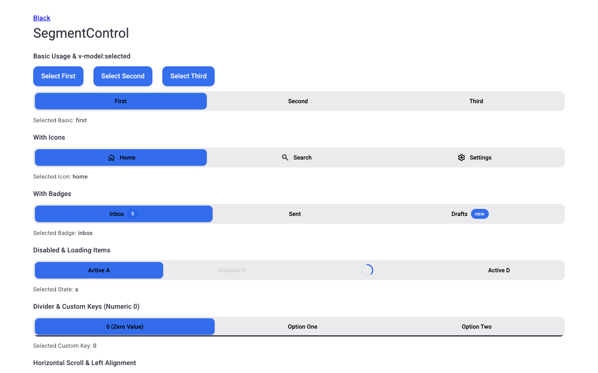
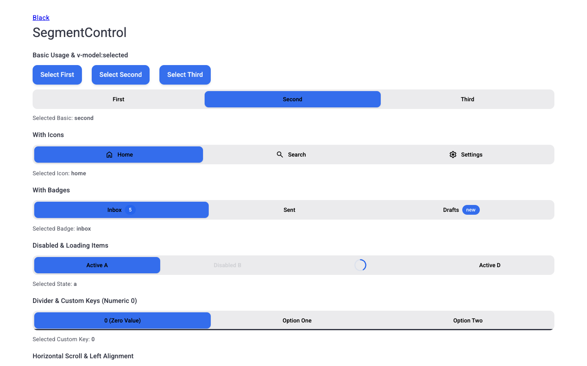
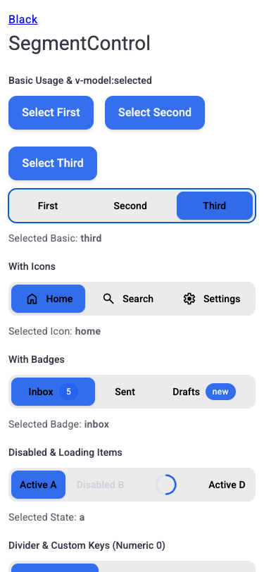

# Отчёт о визуальном тестировании `D1SegmentControl`

- **Компонент:** `D1SegmentControl` (`@dxtmisha/constructor/SegmentControl`)
- **Демо-страница:** `http://localhost:3000/component-segment-control`
- **Дата прогона (UTC):** `2026-11-26T10:20:15Z`
- **Браузер:** Google Chrome Headless (CDP `http://127.0.0.1:9222`)
- **Итоговый статус:** ✅ **6/6 категорий пройдено** (`0` ошибок JS, `0` `console.error`, `0` предупреждений Vue, `0` сетевых ошибок)

---

## 1. Сводная статистика

| Категория | Пройдено | Ошибки | Статус |
| :--- | :---: | :---: | :---: |
| Визуальный рендеринг (`VIS`) | 3/3 | 0 | ✅ |
| Интерактивность (`INT`) | 4/4 | 0 | ✅ |
| Граничные значения (`BND`) | 2/2 | 0 | ✅ |
| Адаптивность (`RSP`) | 4/4 | 0 | ✅ |
| Доступность (`A11Y`) | 1/1 | 0 | ✅ |
| Консоль и сеть (`LOG`) | 1/1 | 0 | ✅ |

---

## 2. Детализация проверок

### 2.1. Визуальный рендеринг (`VIS`)

| ID | Проверка | Ожидаемый результат | Фактический результат | Скриншот / Статус |
| :--- | :--- | :--- | :--- | :---: |
| `TC-VIS-01` | Базовый рендер всех 9 групп демо-страницы | Все 9 экземпляров `.d1-segmentControl` видимы, нулевых размеров нет | `controlsCount: 9`, `zeroSized: 0` |  ✅ |
| `TC-VIS-02` | Дефолтные настройки `horizontalScrollAlign: 'block'` и `horizontalScrollBleed: false`, а также `left` и `divider` | Первый компонент имеет `d1-horizontalScroll--align--block` и не имеет `d1-horizontalScroll--bleed`; присутствуют варианты `--align--left` и `--divider` | `firstHasAlignBlock: true`, `firstHasBleed: false`, `hasLeftAlignControl: true`, `hasDividerControl: true` | ✅ |
| `TC-VIS-03` | Состояния `disabled` и `loading` (`D1Progress`) | Отображаются классы `.d1-segmentControlItem--disabled`, `.d1-segmentControlItem--loading` и внутренний `.d1-progress` | `hasDisabledItem: true`, `hasLoadingItem: true`, `hasLoadingProgress: true` | ✅ |

### 2.2. Интерактивность (`INT`)

| ID | Проверка | Ожидаемый результат | Фактический результат | Скриншот / Статус |
| :--- | :--- | :--- | :--- | :---: |
| `TC-INT-01` | Переключение выбранного сегмента кликом | Второй сегмент получает `aria-selected="true"` и обновляет `v-model:selected` | `afterSecondClick: "true"` |  ✅ |
| `TC-INT-02` | Блокировка клика по `disabled` и `loading` сегментам | Выбранным остаётся первый сегмент, `disabled` и `loading` остаются невыбранными | `activeStillFirst: "true"`, `disabledStillUnselected: "false"`, `loadingStillUnselected: "false"` | ✅ |
| `TC-INT-03` | События `@click` и программный `expose().ids()` | `DemoValue` отображает payload `gamma` и словарь DOM ID для `alpha`..`gamma` | `hasEventPayloadGamma: true`, `hasExposeIdsOutput: true` | ✅ |
| `TC-INT-04` | Жизненный цикл `Toggle Mount` (unmount / remount) | Компонент полностью удаляется из DOM и корректно монтируется повторно без ошибок | `unmountedExists: false`, `remountedExists: true` | ✅ |

### 2.3. Граничные значения и безопасность (`BND`)

| ID | Проверка | Ожидаемый результат | Фактический результат | Скриншот / Статус |
| :--- | :--- | :--- | :--- | :---: |
| `TC-BND-01` | Кастомные ключи `key-value="id"` / `key-label="title"` с числовым `0` и слоты/тег `span` | Элемент с `data-value="0"` выбран (`aria-selected="true"`), метка `"0 (Zero Value)"`; 3 сегмента отрендерены как `` с `data-custom-segment="yes"` | `zeroTabSelected: "true"`, `zeroTabLabel: "0 (Zero Value)"`, `slottedSpanCount: 3` |  ✅ |
| `TC-BND-02` | Защита от XSS, кавычки и мультиязычный Unicode | `` выводится текстом, `` в DOM отсутствует, Unicode (`Привет · Học tiếng Việt · 🚀`) отображается корректно | `xssRenderedAsText: true`, `xssImgInjected: false`, `unicodeRendered: true` | ✅ |

### 2.4. Адаптивность (`RSP`)

| ID | Разрешение | Ожидаемый результат | Фактический результат | Скриншот / Статус |
| :--- | :--- | :--- | :--- | :---: |
| `TC-RSP-01a` | `1920x1080` | `scrollWidth <= clientWidth` | `1920 / 1920` (`overflows: false`) | ✅ |
| `TC-RSP-01b` | `1440x900` | `scrollWidth <= clientWidth` | `1440 / 1440` (`overflows: false`) | ✅ |
| `TC-RSP-01c` | `768x1024` | `scrollWidth <= clientWidth` | `768 / 768` (`overflows: false`) | ✅ |
| `TC-RSP-01d` | `375x812` | `scrollWidth <= clientWidth` | `375 / 375` (`overflows: false`) |  ✅ |

### 2.5. Доступность (`A11Y`)

| ID | Проверка | Ожидаемый результат | Фактический результат | Скриншот / Статус |
| :--- | :--- | :--- | :--- | :---: |
| `TC-A11Y-01` | Роли WAI-ARIA, `aria-disabled` для `disabled`/`loading` и клавиатурная навигация (`End` + `Enter`) | `role="tablist"`, `aria-orientation="horizontal"`, `tabindex="0"`, переключение на 3-й сегмент с клавиатуры, `aria-disabled="true"` на `disabled` и `loading` | `role: "tablist"`, `orientation: "horizontal"`, `tabindex: "0"`, `thirdSelectedAfterKeyboard: "true"`, `loadingAriaDisabled: "true"`, `disabledAriaDisabled: "true"` | ✅ |

### 2.6. Консоль и сеть (`LOG`)

| ID | Проверка | Ожидаемый результат | Фактический результат | Скриншот / Статус |
| :--- | :--- | :--- | :--- | :---: |
| `TC-LOG-01` | Логи браузера, Vue-предупреждения и сетевые запросы | `0` ошибок и предупреждений | `consoleErrors: 0`, `vueWarnings: 0`, `pageErrors: 0`, `networkErrors: 0` | ✅ |

---

## 3. AI-аудит и рекомендации

- **Визуальное качество:** Все 9 сценариев `D1SegmentControl` выглядят аккуратно на десктопе (`1440x900`) и мобильном (`375x812`), без горизонтального переполнения страницы. Исправление `horizontalScrollAlign: 'block' as const` и `horizontalScrollBleed: false` обеспечило ровное заполнение контейнера-«пилюли» без выхода за пределы родительских отступов и полностью устранило предупреждения валидации пропсов Vue.
- **Интеграция `loading`:** Индикатор загрузки (`D1Progress`) корректно отображается поверх сегмента с `loading: true`, скрывает текст, выставляет `aria-disabled="true"` и блокирует переключение выбора кликом.
- **Дефекты:** Критических, визуальных или консольных дефектов не обнаружено.
