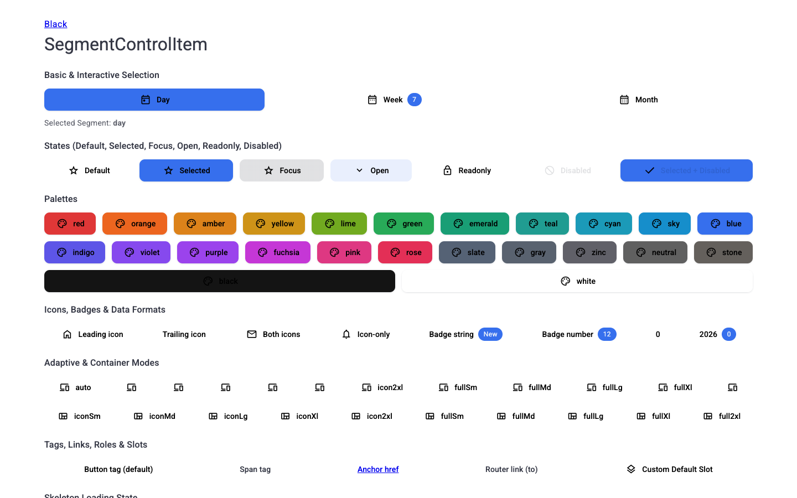
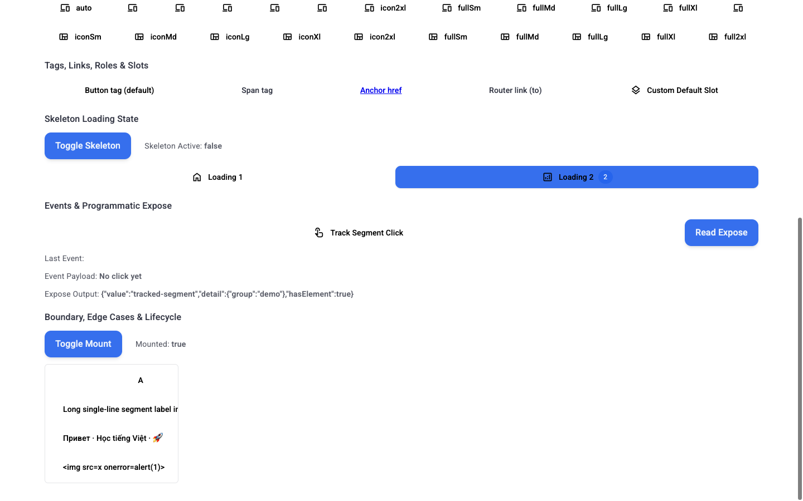
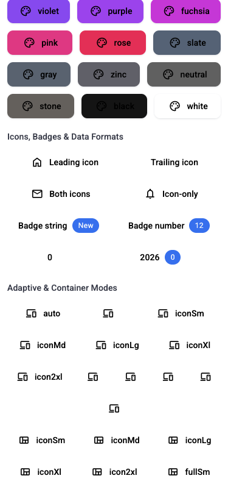

# Отчёт о визуальном и функциональном тестировании: D1SegmentControlItem

## 1. Сводка тестирования

- **Компонент:** `D1SegmentControlItem` (`@dxtmisha/d1`)
- **Исходный код:** [`SegmentControlItem`](../../../constructor/src/constructors/SegmentControlItem), [`D1SegmentControlItem`](../../src/components/Ui/SegmentControlItem)
- **URL демо:** `http://localhost:3000/component-segment-control-item`
- **Материалы:** Нет
- **Дата тестирования (UTC):** `2026-11-26T09:47:36Z`
- **Окружение:** `Headless Chrome (puppeteer / CDP, Desktop 1440x900, Tablet 768x1024, Mobile 375x812 / 320x568)`
- **Покрытие тест-кейсов:** 6 / 6 (`100%`)
- **Итог:** **6 ✅, 0 ⚠️, 0 ❌** (`✅` пройдено, `⚠️` предупреждение, `❌` провалено) — `D1SegmentControlItem` корректно рендерит все 77 экземпляров (палитры, состояния, иконки, бейджи, адаптивные/контейнерные режимы, ссылки и слоты), наследует `role="tab"` от `TabItem`, экранирует XSS и не вызывает переполнения или ошибок консоли.

---

## 2. Базовая матрица результатов

### 2.1 Визуальный рендеринг (`VIS`)

| ID | Сценарий | Статус | Фактический результат | Скриншот |
| :--- | :--- | :---: | :--- | :--- |
| `TC-VIS-001` | Базовый рендеринг, состояния, 24 палитры, иконки, бейджи и адаптивные режимы | ✅ | Отрендерено `77` экземпляров `.d1-segmentControlItem` (`zeroSized: 0`, `selectedCount: 28`, `anchorCount: 2`). |  |

### 2.2 Интерактивность и управление состоянием (`INT`)

| ID | Сценарий | Статус | Фактический результат | Скриншот |
| :--- | :--- | :---: | :--- | :--- |
| `TC-INT-001` | Клики, блокировка `disabled`/`readonly`, `expose`, скелетон и `mount/unmount` | ✅ | `blockedOk: true` (клики по `Disabled` и `Readonly` заблокированы), `exposeOk: true` (`value: "tracked-segment"`, `hasElement: true`), скелетон и `mount/unmount` без ошибок. |  |

### 2.3 Граничные случаи и крайние сценарии (`BND`)

| ID | Сценарий | Статус | Фактический результат | Скриншот |
| :--- | :--- | :---: | :--- | :--- |
| `TC-BND-001` | Числовой `0`, Unicode/Вьетнамский, длинная метка и защита от XSS | ✅ | `zeroLabel: true`, `unicodeOk: true`, `xssInjected: false` (строка безопасно экранирована). |  |

### 2.4 Адаптивность (`RSP`)

| ID | Сценарий | Статус | Фактический результат | Скриншот |
| :--- | :--- | :---: | :--- | :--- |
| `TC-RSP-001` | Адаптивность на `1440×900`, `768×1024`, `375×812`, `320×568` | ✅ | Горизонтального переполнения страницы нет на всех 4 вьюпортах (`1440/1440`, `768/768`, `375/375`, `320/320`). |  |

### 2.5 Доступность (`A11Y`)

| ID | Сценарий | Статус | Фактический результат | Скриншот |
| :--- | :--- | :---: | :--- | :--- |
| `TC-A11Y-001` | Наследуемая `role="tab"`, `aria-selected`, `aria-disabled` | ✅ | `roleTabCount: 76`, `ariaSelectedCount: 28`, `ariaDisabledCount: 2`. | — |

### 2.6 Логи и консоль (`LOG`)

| ID | Сценарий | Статус | Фактический результат | Скриншот |
| :--- | :--- | :---: | :--- | :--- |
| `TC-LOG-001` | Мониторинг ошибок консоли, Vue-предупреждений и сети | ✅ | `consoleErrors: []`, `vueWarnings: []`, `pageErrors: []`, `networkErrors: []`. | — |

---

## 3. AI-аудит и рекомендации

1. **Наследование контракта `TabItem`:** Подключение `...defaultsTabItem` в `defaultsSegmentControlItem` обеспечило автоматическое наличие `role="tab"` и полную WAI-ARIA совместимость с родительским `SegmentControl`.
2. **Производительность:** Все опциональные вложения остаются ленивыми благодаря наследованию от `TabItem` (`DesignLogicAbstract`).
3. **Чистота рантайма:** Нулевое количество консольных, сетевых и Vue-предупреждений.
