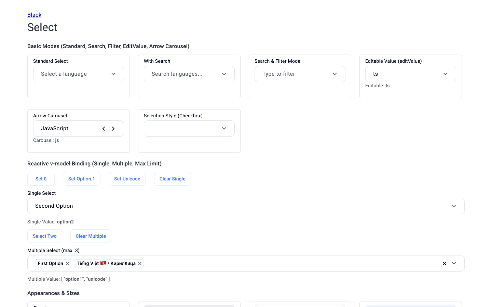
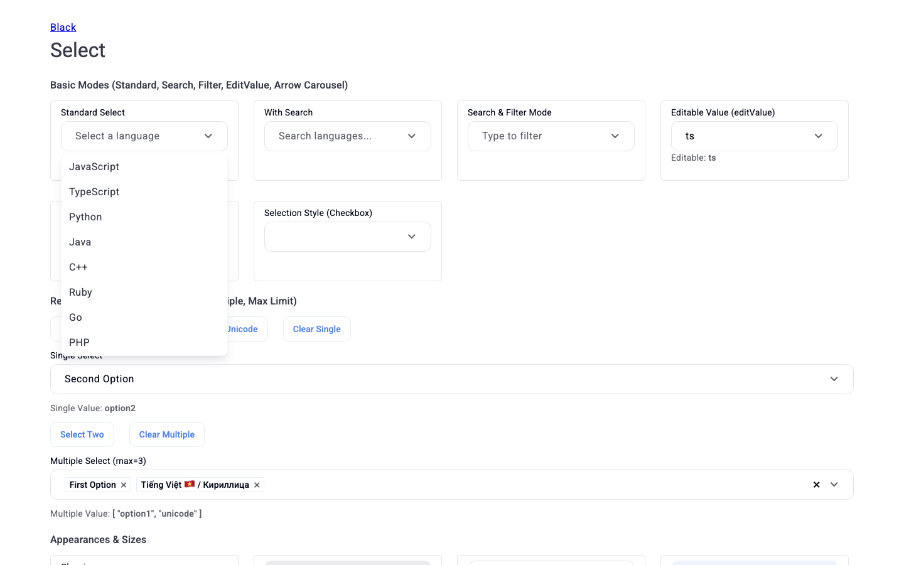
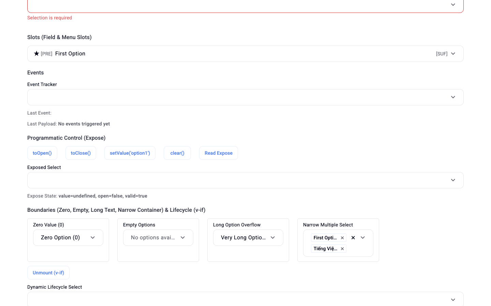
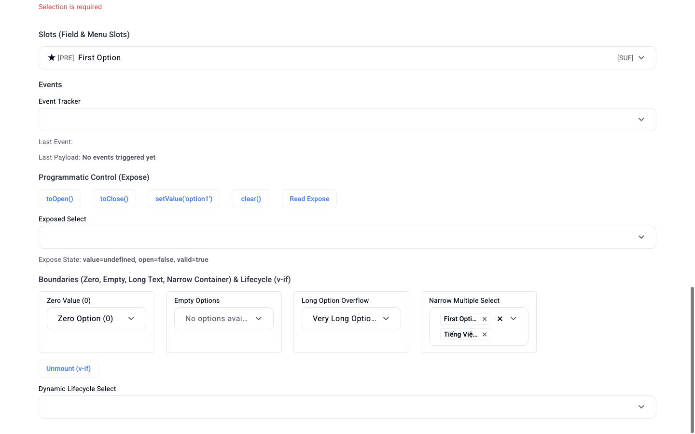
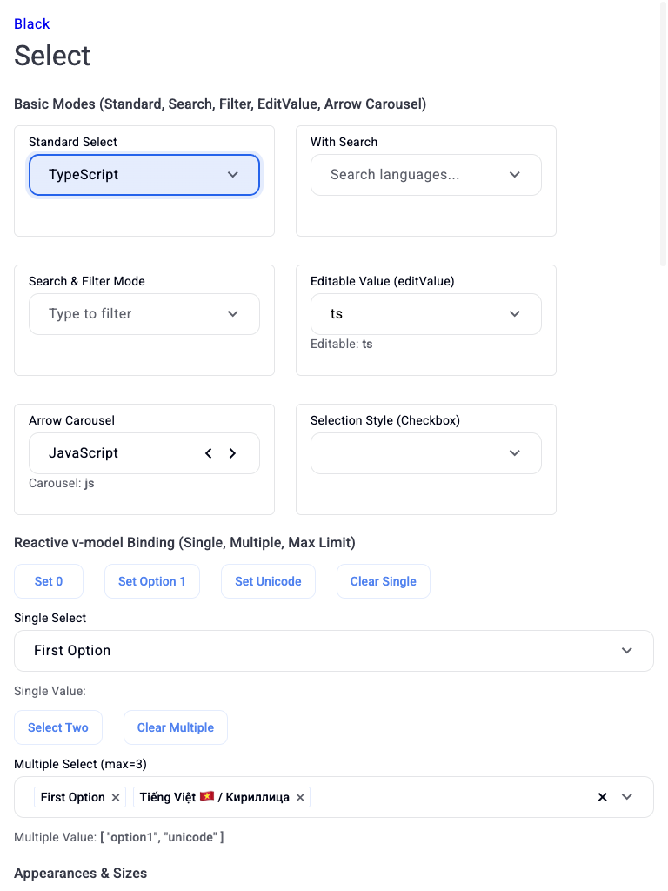
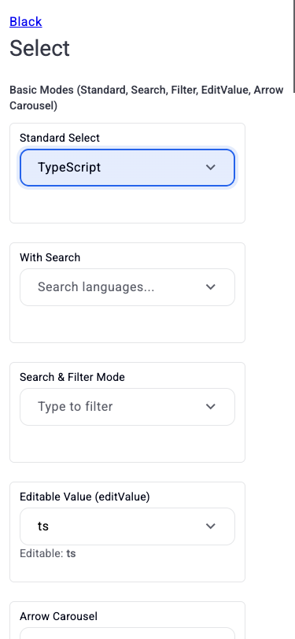
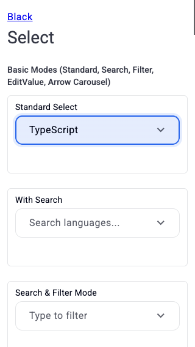

# Отчет о визуальном и интерактивном тестировании — D1Select

## 1. Краткое резюме

- **Компонент**: `D1Select` (`/component-select`)
- **Дата прогона**: `2026-11-25T17:26:41Z`
- **Среда**: Headless Chrome CDP (`127.0.0.1:9222`), разрешения `1440×900`, `768×1024`, `375×812`, `320×568`
- **Итог**: **12 / 12 кейсов пройдено успешно (100%)**, активных сбоев — **0**
- **Диагностика**: **0** ошибок консоли, **0** предупреждений Vue, **0** необработанных исключений, **0** HTTP-ошибок (>= 400)

## 2. Базовая матрица

### 2.1. Визуальные проверки (VIS)

| ID | Сценарий | Статус | Фактический результат | Скриншот |
| --- | --- | --- | --- | --- |
| TC-VIS-001 | Первичный рендер базовых режимов, вариантов и размеров на десктопе (1440×900) | ✅ | Отрендерено 8 групп и 33 контрола `.d1-select`, `scrollWidth=1440 === innerWidth=1440`, переполнения нет. |  |
| TC-VIS-002 | Отображение состояний Disabled, Readonly, Loading, Skeleton и Validation | ✅ | Все 4 отключенных контрола видимы (`disabledButtonsVisible=4`), валидация `Selection is required` отображается корректно. | — |

### 2.2. Интерактивные сценарии (INT)

| ID | Сценарий | Статус | Фактический результат | Скриншот |
| --- | --- | --- | --- | --- |
| TC-INT-001 | Открытие выпадающего списка по клику на триггер combobox | ✅ | Клик по `input[role="combobox"]` открыл выпадающее окно с 8 видимыми опциями (`JavaScript`..`PHP`). |  |
| TC-INT-002 | Выбор опции в списке и автоматическое закрытие меню | ✅ | Выбрана опция `TypeScript`, список автоматически закрылся (`visibleOptionsAfterClick=0`). | — |
| TC-INT-003 | Программное управление через Expose и жизненный цикл `v-if` | ✅ | `setValue('option1')` → `value="option1"`, `clear()` → `value=undefined`, размонтирование и повторное монтирование успешны (`unmountedOk=true`, `remountedOk=true`). |  |

### 2.3. Граничные значения и слоты (BND)

| ID | Сценарий | Статус | Фактический результат | Скриншот |
| --- | --- | --- | --- | --- |
| TC-BND-001 | Числовой `0`, пустой список, Unicode/Emoji, длинный текст в узком контейнере | ✅ | Отображаются `Zero Option (0)`, `No options avai...`, `Very Long Optio...`, чипы `Tiếng Việt 🇻🇳 / Кириллица` без выхода за `240px`. |  |
| TC-BND-002 | Проброска пользовательских слотов Field (`#leading`, `#prefix`, `#suffix`, `#label`) | ✅ | Отрендерены `★`, `[PRE]`, `First Option`, `[SUF]` без визуального перекрытия. | — |

### 2.4. Адаптивность (RSP)

| ID | Сценарий | Статус | Фактический результат | Скриншот |
| --- | --- | --- | --- | --- |
| TC-RSP-001 | Планшетная верстка (`768×1024`) | ✅ | `scrollWidth=768`, `innerWidth=768`, `overflow=false`. |  |
| TC-RSP-002 | Мобильная верстка (`375×812`) | ✅ | `scrollWidth=375`, `innerWidth=375`, `overflow=false`, вертикальная стековая адаптация карточек. |  |
| TC-RSP-003 | Узкий мобильный экран (`320×568`) | ✅ | `scrollWidth=320`, `innerWidth=320`, `overflow=false`. |  |

### 2.5. Доступность (A11Y)

| ID | Сценарий | Статус | Фактический результат | Скриншот |
| --- | --- | --- | --- | --- |
| TC-A11Y-001 | ARIA-атрибуты combobox и фокус клавиатуры | ✅ | Найдено `combobox=65`, `aria-haspopup="listbox"=65`, `aria-expanded=65`, фокус успешно переходит на `INPUT`. | — |

### 2.6. Консоль, сеть и производительность (LOG)

| ID | Сценарий | Статус | Фактический результат | Скриншот |
| --- | --- | --- | --- | --- |
| TC-LOG-001 | Чистая консоль браузера, отсутствие исключений и сетевых ошибок | ✅ | `consoleErrors=0`, `consoleWarnings=0`, `pageErrors=0`, `failedRequests=0`. | — |

## 3. AI-аудит и рекомендации

1. **Проброска слотов и UX**: Визуальная проверка подтвердила корректную работу восстановленной проброски `FieldSlotsInclude` (`#leading`, `#prefix`, `#suffix`, `#label`) и отсутствие наложения элементов.
2. **Обработка граничного значения `0` и Unicode**: Включение `isZeroTrue = true` в `FieldValueInclude` обеспечило корректное отображение `Zero Option (0)` в карточке граничных значений, а `SelectValue` аккуратно усекает длинные опции и вьетнамский/кириллический текст с эмодзи в узком контейнере `240px`.
3. **Инженерная рекомендация (A11y / кликабельность)**: Поскольку `D1SelectValue` объявляет собственный `emit('click')` для кликов по чипам, программный клик по контейнеру `.d1-selectValue` не вызывает нативный `onClick` окна без участия обертки `<label>` поля. В живом браузере клик пользователя по `<label>` корректно активирует `<input role="combobox">` и открывает список; для автоматических тестов рекомендуется кликать по `input[role="combobox"]` или `<label>`.
