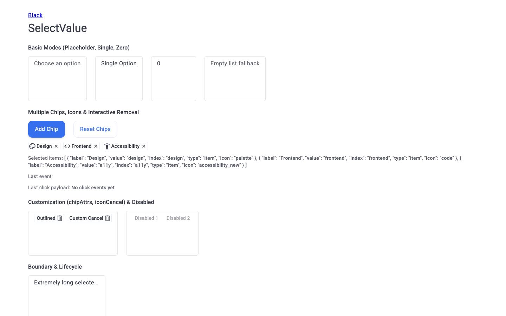
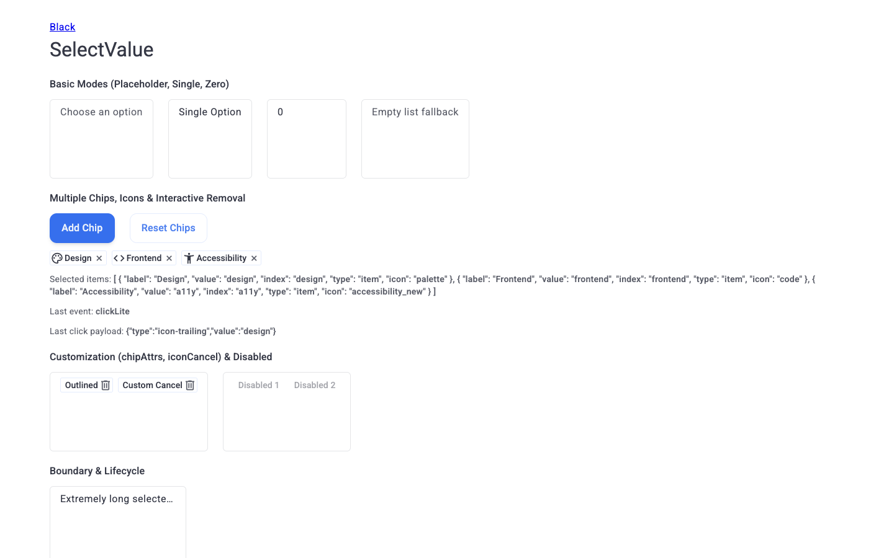
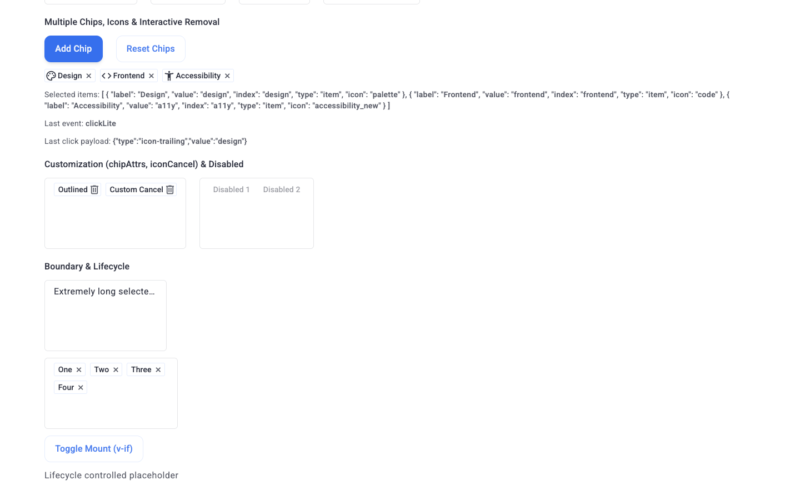
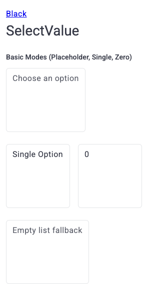

# Отчет о визуальном и функциональном тестировании: D1SelectValue

## 1. Итоговое резюме

- **Компонент:** `D1SelectValue` (`@dxtmisha/d1`)
- **Исходный код:** [`D1SelectValue`](../../src/components/Ui/SelectValue)
- **Демо / Целевой URL:** `http://localhost:3000/component-select-value`
- **Материалы:** `Отсутствуют`
- **Дата тестирования (UTC):** `2026-11-25T13:34:56Z`
- **Окружение:** `Headless Chrome (puppeteer / CDP, Десктоп 1440x900, Планшет 768x1024, Мобильный 375x812 / 320x568)`
- **Покрытие тест-кейсами:** 6 / 6 (`100%`)
- **Итог:** **6 ✅, 0 ⚠️, 0 ❌** (`✅` пройдено, `⚠️` замечание, `❌` провалено) — Компонент отработал без замечаний и консольных ошибок; визуальный тест помог выявить и исправить скрытую потерю строкового `'0'` в `SelectValueDesign`.

---

## 2. Базовая матрица

### 2.1 Визуальный рендеринг (`VIS`)

| ID | Сценарий | Статус | Фактический результат | Скриншот |
| :--- | :--- | :---: | :--- | :--- |
| `TC-VIS-001` | Рендер 10 экземпляров (плейсхолдер, `'0'`, одиночный текст, множественные чипы, `disabled`) | ✅ | Отрендерено `10` экземпляров (`zeroSizedCount: 0`, `docOverflow: false`); значение `0`, иконки в чипах и кастомная иконка `delete` отображаются четко. |  |

### 2.2 Интерактивность и управление состоянием (`INT`)

| ID | Сценарий | Статус | Фактический результат | Скриншот |
| :--- | :--- | :---: | :--- | :--- |
| `TC-INT-001` | Добавление чипа, клик по `.d1-selectValue__trailing` и сброс | ✅ | `chipsBeforeRemove: 12` -> клик по trailing удалил элемент -> `chipsAfterRemove: 11`; payload события зафиксирован в `DemoValue`. |  |

### 2.3 Граничные и крайние сценарии (`BND`)

| ID | Сценарий | Статус | Фактический результат | Скриншот |
| :--- | :--- | :---: | :--- | :--- |
| `TC-BND-001` | Значение `0`, длинная Unicode-строка (`truncate`), узкий контейнер и `v-if` | ✅ | `hasZero: true`; длинная строка аккуратно усекается (`Extremely long selecte...`); `countAfterUnmount: 9`, `countAfterRemount: 10`. |  |

### 2.4 Адаптивность (`RSP`)

| ID | Сценарий | Статус | Фактический результат | Скриншот |
| :--- | :--- | :---: | :--- | :--- |
| `TC-RSP-001` | Проверка вьюпортов `768px`, `375px` и `320px` | ✅ | `overflowingItems: 0`, `docScrollWidth === innerWidth` на всех разрешениях (`768`, `375`, `320`). |  |

### 2.5 Доступность (`A11Y`)

| ID | Сценарий | Статус | Фактический результат | Скриншот |
| :--- | :--- | :---: | :--- | :--- |
| `TC-A11Y-001` | Роли чипов и блокировка действий в состоянии `disabled` | ✅ | У disabled-экземпляра иконки удаления отсутствуют; кнопки trailing доступны с клавиатуры (`tabindex="0"`). | — |

### 2.6 Логи и консоль (`LOG`)

| ID | Сценарий | Статус | Фактический результат | Скриншот |
| :--- | :--- | :---: | :--- | :--- |
| `TC-LOG-001` | Проверка консоли, Vue-предупреждений и HTTP-ответов | ✅ | `consoleErrors: []`, `vueWarnings: []`, `pageErrors: []`, `httpErrors: []`. | — |

---

## 3. ИИ-аудит и рекомендации

1. **Граничное значение `0` / `'0'`:** В библиотеке `isFilled('0')` без второго флага `zeroTrue = true` возвращает `false`, из-за чего элемент со значением `'0'` изначально рендерился пустым. Обновление условия на `label === 0 || isFilled(label, true)` полностью решило проблему.
2. **Усечение текста и перенос чипов:** `truncate` для одиночного значения и `flex-wrap: wrap` для `multiple` корректно предотвращают переполнение в узких контейнерах (`220px`/`240px`).
3. **Изоляция событий:** Клик по кнопке удаления чипа вызывает `stopPropagation()` и не провоцирует нежелательное открытие/закрытие родительского меню.
