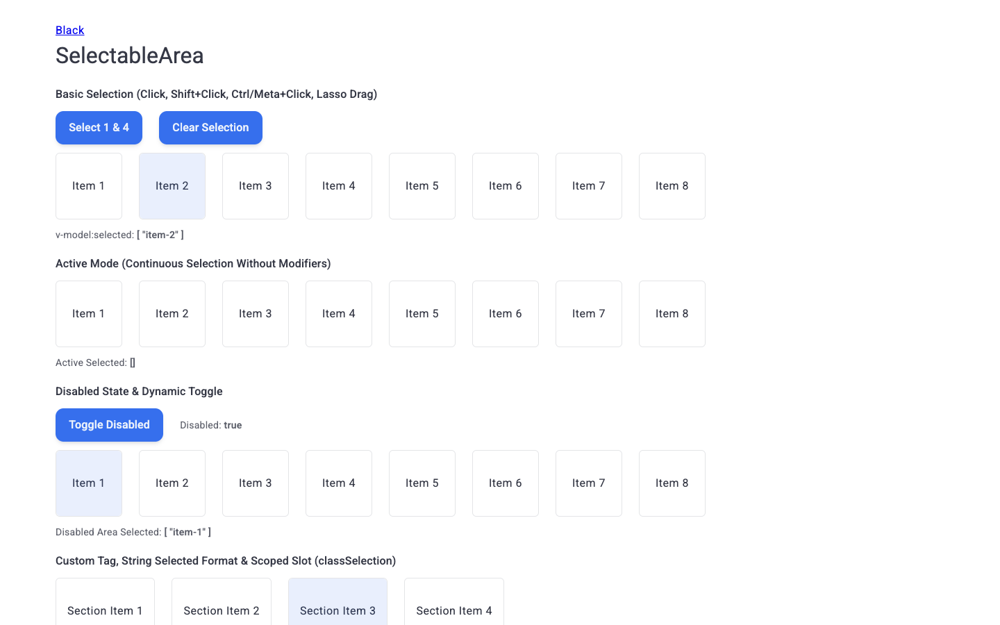
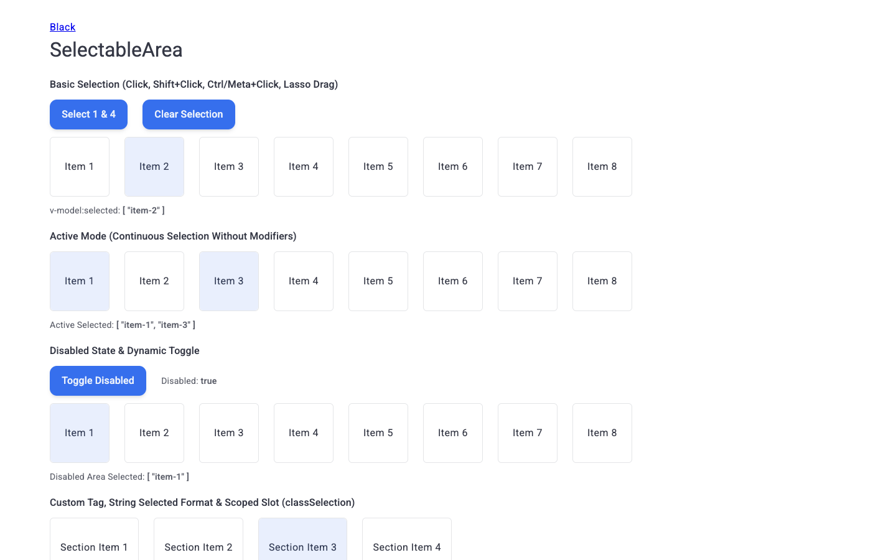
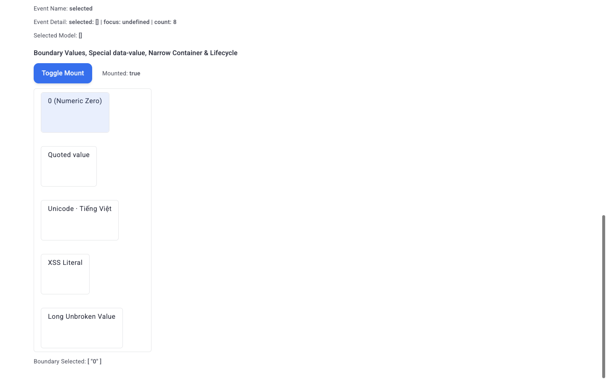
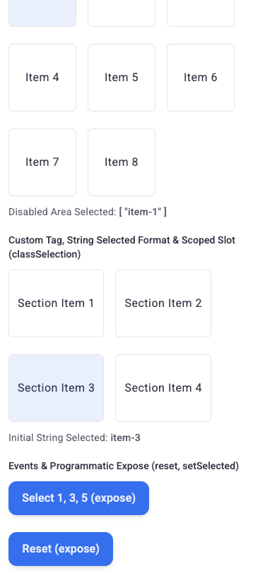

# Отчёт о визуальном и функциональном тестировании: D1SelectableArea

## 1. Сводка тестирования

- **Компонент:** `D1SelectableArea` (`@dxtmisha/d1`)
- **Исходный код:** [`SelectableArea`](../../../constructor/src/constructors/SelectableArea), [`D1SelectableArea`](../../src/components/Ui/SelectableArea)
- **URL демо:** `http://localhost:3000/component-selectable-area`
- **Материалы:** Нет
- **Дата тестирования (UTC):** `2026-11-26T09:16:59Z`
- **Окружение:** `Headless Chrome (puppeteer / CDP, Desktop 1440x900, Tablet 768x1024, Mobile 375x812 / 320x568)`
- **Покрытие тест-кейсов:** 6 / 6 (`100%`)
- **Итог:** **6 ✅, 0 ⚠️, 0 ❌** (`✅` пройдено, `⚠️` предупреждение, `❌` провалено) — `D1SelectableArea` стабильно работает во всех режимах выделения (`basic`, `active`, `disabled`, кастомный `<section>`, `expose`), безопасно обрабатывает спецсимволы в `data-value` и не вызывает переполнения или ошибок консоли.

---

## 2. Базовая матрица результатов

### 2.1 Визуальный рендеринг (`VIS`)

| ID | Сценарий | Статус | Фактический результат | Скриншот |
| :--- | :--- | :---: | :--- | :--- |
| `TC-VIS-001` | Рендеринг 6 областей выделения, начальный выбор и тег `<section>` | ✅ | `areas: 6`, `sectionArea: true`, `selectedItems: 3`; визуальная подсветка выбранных элементов и разметка карточек корректны. |  |

### 2.2 Интерактивность и управление состоянием (`INT`)

| ID | Сценарий | Статус | Фактический результат | Скриншот |
| :--- | :--- | :---: | :--- | :--- |
| `TC-INT-001` | Режим `active`, блокировка `disabled`, `expose` (`setSelected`/`reset`) и `mount/unmount` | ✅ | `afterExposeSelect: true`, `disabledUnchanged: 1` (клик по отключённой области игнорируется), `activeCount: 2` (накопление выбора в `active`), цикл `mount/unmount` без утечек. |  |

### 2.3 Граничные случаи и крайние сценарии (`BND`)

| ID | Сценарий | Статус | Фактический результат | Скриншот |
| :--- | :--- | :---: | :--- | :--- |
| `TC-BND-001` | Специальные `data-value` (`0`, кавычки, Unicode, XSS) без `DOMException` | ✅ | `hasZero: true`, `hasQuoted: true`, `unicodeOk: true`, `xssInjected: false`; выбор элементов со спецсимволами в `data-value` работает без ошибок CSS-селектора. |  |

### 2.4 Адаптивность (`RSP`)

| ID | Сценарий | Статус | Фактический результат | Скриншот |
| :--- | :--- | :---: | :--- | :--- |
| `TC-RSP-001` | Адаптивность на `1440×900`, `768×1024`, `375×812`, `320×568` | ✅ | Нулевое переполнение на всех 4 вьюпортах (`1440/1440`, `768/768`, `375/375`, `320/320`, `overflowing: 0` для всех `6` областей). |  |

### 2.5 Доступность (`A11Y`)

| ID | Сценарий | Статус | Фактический результат | Скриншот |
| :--- | :--- | :---: | :--- | :--- |
| `TC-A11Y-001` | Скрытие декоративного лассо (`aria-hidden`) и `aria-label` на `<section>` | ✅ | `squaresHidden: true` (у всех `.d1-selectableArea__square` установлен `aria-hidden="true"`), `sectionAriaLabel: "Custom section selectable area"`. | — |

### 2.6 Логи и консоль (`LOG`)

| ID | Сценарий | Статус | Фактический результат | Скриншот |
| :--- | :--- | :---: | :--- | :--- |
| `TC-LOG-001` | Проверка `@selected` и чистоты консоли/сети | ✅ | `consoleErrors: []`, `vueWarnings: []`, `pageErrors: []`, `networkErrors: []`. | — |

---

## 3. AI-аудит и рекомендации

1. **Производительность выделения и лассо:** Использование `Set<string>` для сравнения и обновления выделенных элементов и коалесинг `requestAnimationFrame` в `SelectableAreaEvents` обеспечивают плавный INP без лагов на больших списках.
2. **Устойчивость к нестандартным значениям:** Замена `querySelector('[data-value="..."]')` на линейный поиск по `findItems()` полностью устранила риск `DOMException` при наличии кавычек или спецсимволов в `data-value`.
3. **Чистота жизненного цикла:** Отписка слушателей и сброс лассо в `onUnmounted` подтверждены тестом `mount/unmount` без консольных ошибок и предупреждений Vue.
