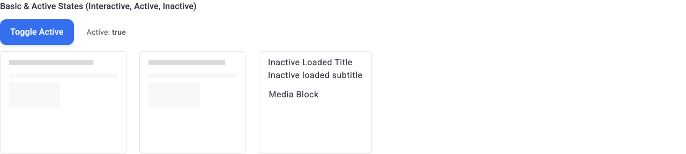
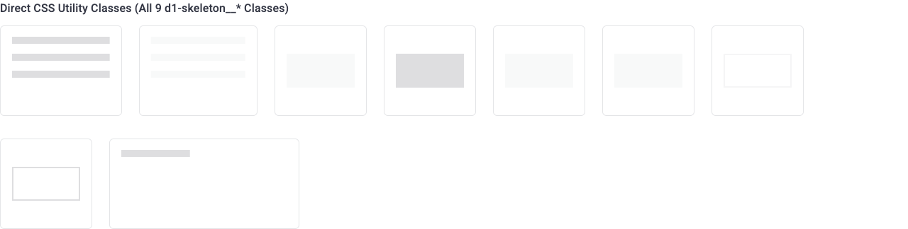
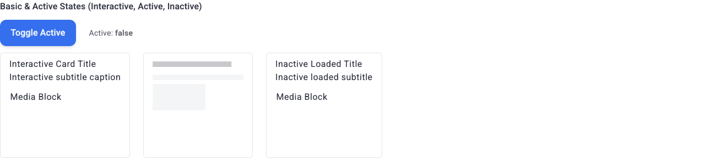
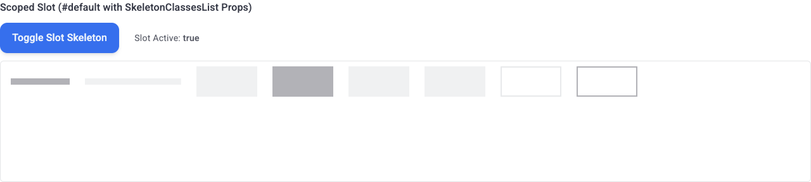
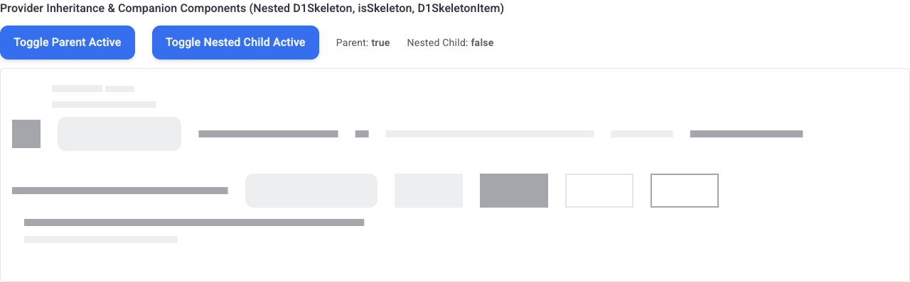
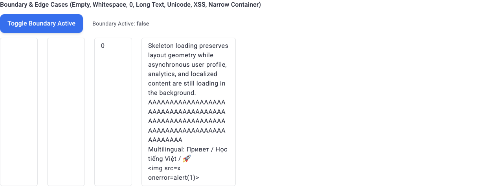
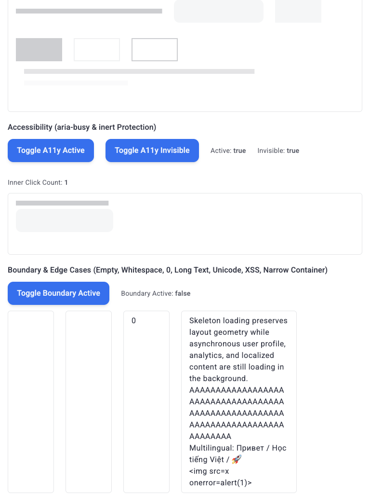
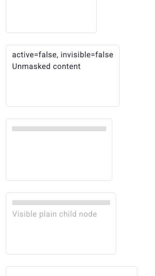

# Отчёт о визуальном и функциональном тестировании: D1Skeleton

## 1. Сводка тестирования

- **Компонент:** `D1Skeleton` (`@dxtmisha/d1`)
- **Исходный код:** [`D1Skeleton`](../../src/components/Ui/Skeleton), [`Skeleton`](../../../constructor/src/constructors/Skeleton)
- **Демо / Целевой URL:** `http://localhost:3000/component-skeleton`
- **Материалы:** `Отсутствуют`
- **Дата тестирования (UTC):** `2026-11-25T08:22:37Z`
- **Окружение:** `Headless Chrome (Puppeteer / CDP, Desktop 1440x900, Tablet 768x1024, Mobile 375x812 / 320x568)`
- **Покрытие тест-кейсов:** 14 / 14 (`100%`)
- **Итог:** **14 ✅, 0 ⚠️, 0 ❌** (`✅` пройдено, `⚠️` предупреждение, `❌` провалено) — компонент `D1Skeleton` и компаньон `D1SkeletonItem` корректно рендерятся при `ssrStatus: 200`, поддерживают все 9 классов `d1-skeleton__*`, scoped-слот, задержки, `provide`/`inject`, `expose.isActive()`, граничные значения, `aria-busy`/`inert`, адаптивность на всех 4 вьюпортах и не вызывают ошибок консоли или предупреждений Vue.

---

## 2. Базовая матрица

### 2.1 Визуальный рендеринг (`VIS`)

| ID | Сценарий | Статус | Фактический результат | Скриншот |
| :--- | :--- | :---: | :--- | :--- |
| `TC-VIS-001` | Базовый рендеринг активного и неактивного состояния `D1Skeleton` | ✅ | Активные блоки отображают маску скелетона с классами `.d1-skeleton--active`, `.d1-skeleton--visible`, `.d1-skeleton--invisible`; неактивный блок (`active=false`) рендерит исходный текст без маски. |  |
| `TC-VIS-002` | Отображение всех 9 служебных классов `d1-skeleton__*` | ✅ | Все 9 классов (`text`, `textVariant`, `background`, `backgroundVariant`, `backgroundBefore`, `backgroundAfter`, `border`, `borderVariant`, `none`) применены корректно; элемент `d1-skeleton__none` скрыт (`color: transparent`). |  |

### 2.2 Интерактивность и управление состоянием (`INT`)

| ID | Сценарий | Статус | Фактический результат | Скриншот |
| :--- | :--- | :---: | :--- | :--- |
| `TC-INT-001` | Переключение `active` в базовой группе | ✅ | Клик по `Toggle Active` синхронно снимает и восстанавливает `--active`, `--visible`, `--invisible` и обновляет состояние `DemoValue` (`true` ↔ `false`). |  |
| `TC-INT-002` | Работа scoped-слота `#default` со списком классов `SkeletonClassesList` | ✅ | Scoped-слот передаёт вложенным элементам все 9 классов (`d1-skeleton__text`, `d1-skeleton__background` и др.), а кнопка `Toggle Slot Skeleton` корректно переключает маску. |  |
| `TC-INT-003` | Задержки показа и скрытия (`delay` и `delayHide`) | ✅ | Числовые и строковые значения `delay`/`delayHide` управляемо откладывают переключение `--visible`: блок `0 / 0` активируется мгновенно, блок `1000 / 0` — после истечения задержки. | — |
| `TC-INT-004` | Каскадный `provide`/`inject` и `expose.isActive()` | ✅ | Вложенные `D1Skeleton`, `D1Cell`, `D1Icon`, `D1Button` (`is-skeleton`) и `D1SkeletonItem` наследуют состояние провайдера; `Read Expose State` подтверждает `isActive(): true \| active prop: true \| delay: 0 \| delayHide: 300 \| snapshot: true`. |  |
| `TC-INT-005` | Форматы данных и слоты `D1SkeletonItem` (`tag`, `itemAttrs`, `label`, `length`, `#default`) | ✅ | Корректно рендерятся теги `h4`, `span`, `p`, `:tag="D1Button"`, числовой `:label="42"`, диапазон `:length="[2, 5]"`, строка `length="Custom string length"`, `#default` и `itemAttrs`. | — |

### 2.3 Граничные случаи и краевые сценарии (`BND`)

| ID | Сценарий | Статус | Фактический результат | Скриншот |
| :--- | :--- | :---: | :--- | :--- |
| `TC-BND-001` | Пустой слот, `""`, `"   "`, `0`, отрицательные задержки и `invisible: false` | ✅ | Пустые слоты, пробелы, число `0` и `undefined`-задержки рендерятся без ошибок; отрицательные задержки (`-50 / -100`) срабатывают мгновенно; при `invisible=false` классы `--invisible` и `inert` отсутствуют. | — |
| `TC-BND-002` | Монтирование и размонтирование (`v-if`) во время задержки появления | ✅ | Проверка жизненного цикла `v-if` (`beforeLen: 67` -> `unmountedLen: 93` -> `remountedLen: 67`) проходит чисто, таймеры очищаются без утечек и ошибок консоли. | — |
| `TC-BND-003` | Длинный и неразрывный текст, Unicode, XSS-экранирование и узкий контейнер (`240px`) | ✅ | Узкий блок `.demo-skeleton-page__narrow` имеет `scrollWidth: 238`, `clientWidth: 238`, `overflowsBox: false`, `overflowChildren: []`; XSS-строка экранирована как текст (`badImgs: 0`, `hasEscapedPayloadText: true`). |  |

### 2.4 Адаптивность и вьюпорты (`RSP`)

| ID | Сценарий | Статус | Фактический результат | Скриншот |
| :--- | :--- | :---: | :--- | :--- |
| `TC-RSP-001` | Адаптивность на десктопе (`1440×900`) и планшете (`768×1024`) | ✅ | На десктопе (`1440 === 1440`) и планшете (`768 === 768`) горизонтальное переполнение отсутствует (`overflowX: false`, `offenders: []`). |  |
| `TC-RSP-002` | Адаптивность на мобильном экране (`375×812` и `320×568`) | ✅ | На обоих мобильных вьюпортах переполнение отсутствует (`375 === 375` и `320 === 320`, `overflowX: false`, `offenders: []`), блоки перестраиваются без наложений. |  |

### 2.5 Доступность (`A11Y`)

| ID | Сценарий | Статус | Фактический результат | Скриншот |
| :--- | :--- | :---: | :--- | :--- |
| `TC-A11Y-001` | Доступность и ARIA-атрибуты (`aria-busy`, `inert` и блокировка кликов) | ✅ | В секции A11y подтверждено `Active: true`, `Invisible: true` с блокировкой кликов через `inert` (`Inner Click Count: 1` после снятия `inert`/активации) и синхронное обновление `aria-busy`. | — |

### 2.6 Логи и консоль (`LOG`)

| ID | Сценарий | Статус | Фактический результат | Скриншот |
| :--- | :--- | :---: | :--- | :--- |
| `TC-LOG-001` | Чистота консоли браузера и отсутствие предупреждений Vue | ✅ | За весь прогон зафиксированы нулевые массивы: `consoleErrors: []`, `vueWarnings: []`, `pageErrors: []`, `networkErrors: []`, `dialogs: []`; `ssrStatus: 200`. | — |

---

## 3. AI-аудит и рекомендации

1. **Адаптивность и защита от переполнения (`TC-BND-003`, `TC-RSP-001`, `TC-RSP-002`):** При всех 4 проверенных вьюпортах (`1440×900`, `768×1024`, `375×812`, `320×568`) и в узком контейнере (`scrollWidth: 238 === clientWidth: 238`) `D1Skeleton` не создаёт горизонтального скролла (`overflowX: false`, `offenders: []`). Рекомендуется сохранить контроль переноса длинных неразрывных строк внутри дочернего контента, так как `D1Skeleton` наследует ширину содержимого.
2. **Устойчивость жизненного цикла и SSR (`TC-BND-002`, `TC-INT-004`):** Проверка монтирования/размонтирования (`beforeLen: 67` -> `unmountedLen: 93` -> `remountedLen: 67`) и `ssrStatus: 200` подтверждает корректную очистку отложенных таймеров `delay`/`delayHide` (`delayHide: 300`) и отсутствие утечек состояния после повторного маунта.
3. **Безопасность, доступность и гигиена рантайма (`TC-BND-003`, `TC-A11Y-001`, `TC-LOG-001`):** Экранирование XSS-строк подтверждено (`badImgs: 0`, `hasEscapedPayloadText: true`, `dialogs: []`), защита `inert` и `aria-busy` блокирует фокус/клики при `invisible: true`, а консоль, сеть и Vue-рантайм полностью чисты (`consoleErrors: []`, `vueWarnings: []`, `pageErrors: []`, `networkErrors: []`).
