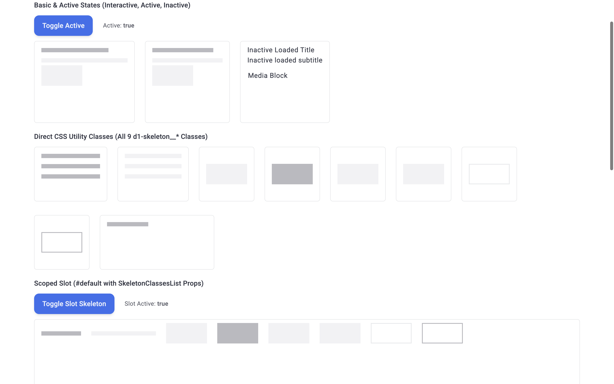
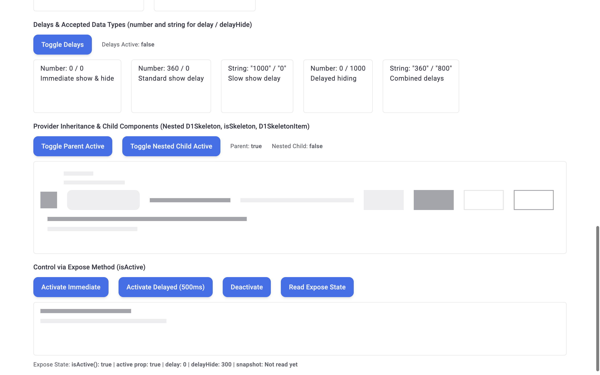
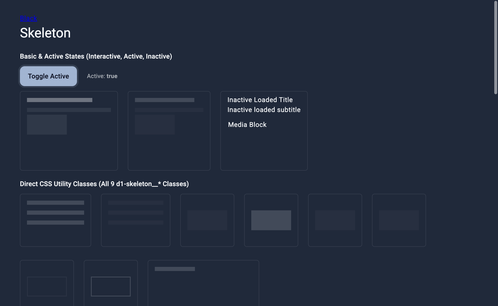
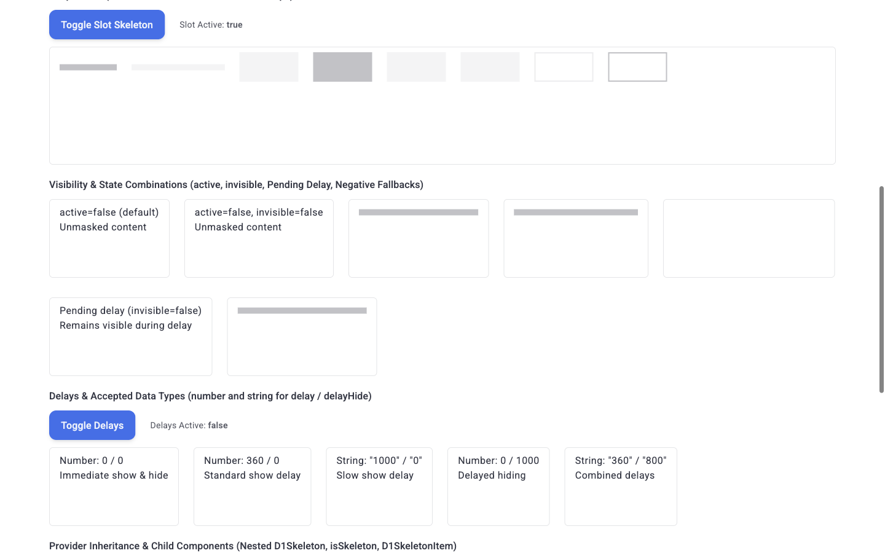
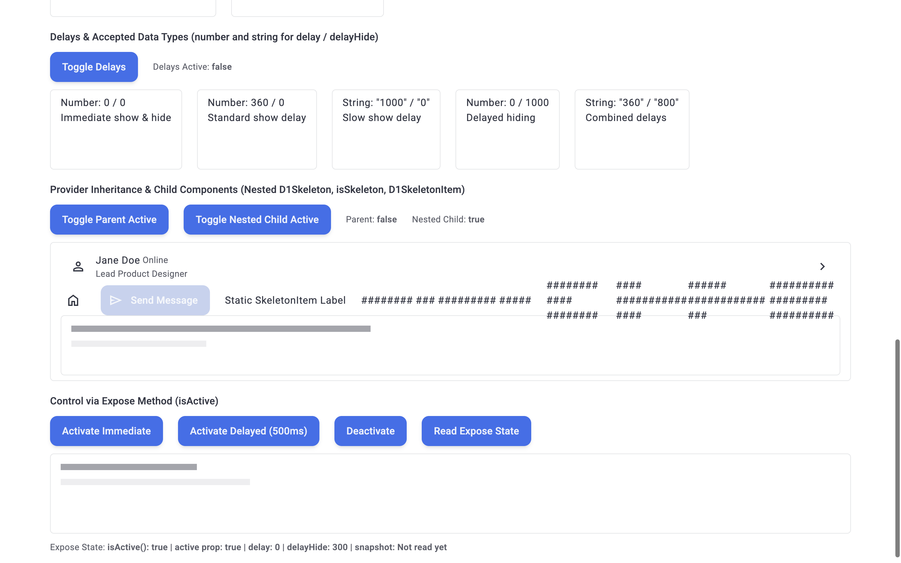
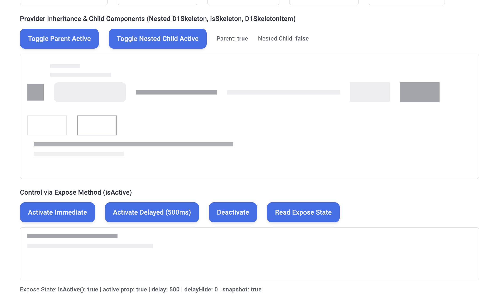
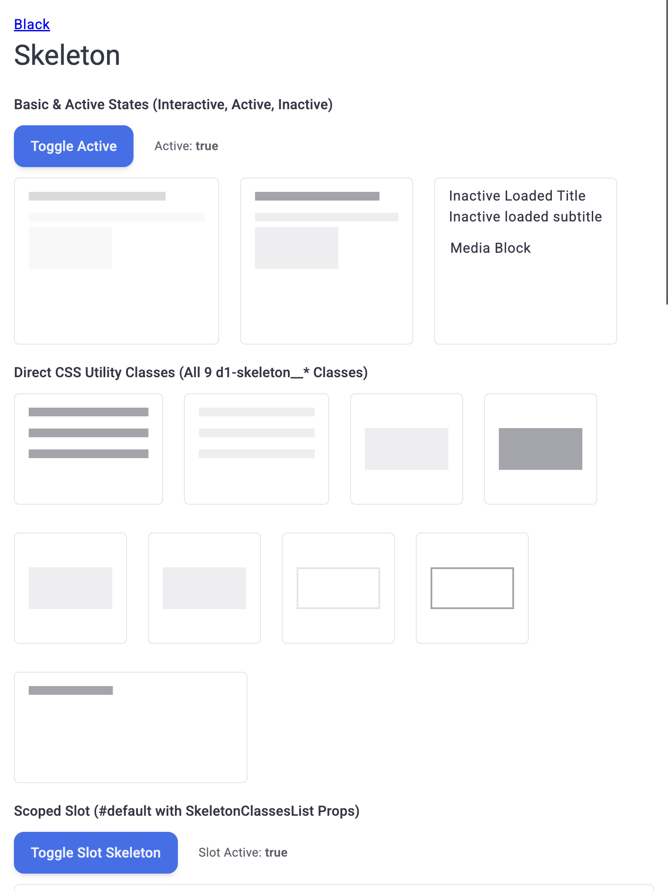
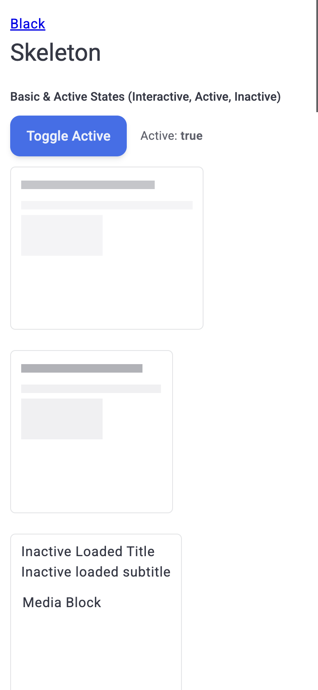

# Отчёт о визуальном и браузерном тестировании: D1Skeleton

- **Сущность**: `D1Skeleton`
- **Исходный код**: [`D1Skeleton`](../../src/components/Ui/Skeleton/D1Skeleton.vue), [`Skeleton`](../../../constructor/src/constructors/Skeleton/Skeleton.ts), [`DemoSkeletonPage`](../../../demo/src/pages/components/DemoSkeletonPage.vue)
- **Целевой URL**: `http://localhost:3000/component-skeleton`
- **Проверенные материалы**: `None` (`node_modules/@dxtmisha/constructor/ai-resources/skeleton.md`)
- **Браузер / Окружение**: `Chrome (CDP / DevTools Protocol), macOS`
- **Дата последнего прогона**: `2026-11-09 08:58`
- **Общий статус**: `✅ PASSED`

---

## 1. Итоговая сводка и метрики

| Метрика | Количество | Доля |
| :--- | :--- | :--- |
| **Всего тест-кейсов** | `20` | `100%` |
| **Успешно (`✅ OK`)** | `20` | `100%` |
| **Провалено (`❌ FAIL`)** | `0` | `0%` |
| **Ошибки / Предупреждения консоли** | `0` | — |

---

## 2. Результаты выполнения тестов (Базовая матрица)

### 2.1. Визуал и дизайн-система (`VIS`)

| ID | Тест-кейс | Статус | Наблюдаемый результат | Доказательство (Скриншот / Консоль) |
| :--- | :--- | :--- | :--- | :--- |
| `TC-VIS-001` | Базовый рендеринг состояний `active=true` и `active=false` и дизайн-токенов | ✅ OK | Активные экземпляры получают классы `.d1-skeleton--active`, `.d1-skeleton--visible`, `.d1-skeleton--invisible`, токены `--d1-skeleton-color: 2, 6, 23`, `--d1-skeleton-backgroundColor: 30, 41, 59` и анимацию `d1-skeleton-animationType1 2.4s linear infinite`. Неактивный экземпляр имеет только `.d1-skeleton` и рендерит обычный текст (`rgba(2, 6, 23, 0.8)`). | [📸 TC-VIS-001](./screenshots/TC-VIS-001.png) |
| `TC-VIS-002` | Отображение всех 9 утилитарных классов `d1-skeleton__*` | ✅ OK | Все 9 классов (`__text`, `__textVariant`, `__background`, `__backgroundVariant`, `__backgroundBefore`, `__backgroundAfter`, `__border`, `__borderVariant`, `__none`) применяют корректные стили: `line-through` толщиной `10.24px` (`0.64 * font-size`), заливку фона/псевдоэлементов `::before`/`::after`, рамки и полное скрытие `__none` (`text-decoration-thickness: 0px`, `color: transparent`). | [📸 TC-VIS-002](./screenshots/TC-VIS-002.png) |
| `TC-VIS-003` | Маскировка дочернего контента и блокирующий оверлей в состоянии `invisible` | ✅ OK | На `.d1-skeleton` устанавливается `position: relative`, а псевдоэлемент `.d1-skeleton--invisible::after` получает `position: absolute; inset: 0px; z-index: 999999`. Дочерние элементы получают прозрачный текст/фон/границу, а вложенные `<svg>` скрываются (`opacity: 0; filter: opacity(0)`). | `DOM: position="relative", ::after={position:"absolute", inset:"0px", zIndex:"999999"}` |
| `TC-VIS-004` | Интеграция с дочерними компонентами (`isSkeleton`) и `D1SkeletonItem` | ✅ OK | `D1Cell`, `D1Icon`, `D1Button` с пропом `isSkeleton` и все 6 вариантов `D1SkeletonItem` (`text`, `textVariant`, `background`, `backgroundVariant`, `border`, `borderVariant`) автоматически получают классы `d1-skeleton__*` и маскируются при активном родителе. | [📸 TC-VIS-004](./screenshots/TC-VIS-004.png) |
| `TC-VIS-005` | Адаптация к тёмной теме (`Dark Mode`) | ✅ OK | При активации `.d1-dark` токены переключаются на светлую палитру (`--d1-skeleton-color: 248, 250, 252`, `--d1-skeleton-backgroundColor: 226, 232, 240`, `textDecorationColor: rgba(248, 250, 252, 0.36)`, `backgroundColor: rgba(226, 232, 240, 0.08)`), обеспечивая чистый контраст на тёмном фоне. | [📸 TC-VIS-005](./screenshots/TC-VIS-005.png) |

#### Визуальные превью (`VIS`)

---

### 2.2. Интерактивность и функциональные состояния (`INT`)

| ID | Тест-кейс | Статус | Наблюдаемый результат | Доказательство (Скриншот / Консоль) |
| :--- | :--- | :--- | :--- | :--- |
| `TC-INT-001` | Интерактивное переключение пропа `active` (`Toggle Active`) | ✅ OK | Клик по `Toggle Active` мгновенно снимает/возвращает классы `.d1-skeleton--active`, `.d1-skeleton--visible`, `.d1-skeleton--invisible` и переключает `aria-busy` между `"false"` и `"true"` только у управляемого экземпляра. | [📸 TC-INT-001](./screenshots/TC-INT-001.png) |
| `TC-INT-002` | Передача классов через scoped-слот `#default` и переключение состояния | ✅ OK | Scoped-слот `#default` передаёт все 9 свойств `SkeletonClassesList` (`classText` .. `classNone`); при переключении `Toggle Slot Skeleton` маскировка корректно снимается и восстанавливается. | [📸 TC-INT-002](./screenshots/TC-INT-002.png) |
| `TC-INT-003` | Комбинации состояний `active`, `invisible` и отложенного показа (`Pending Delay`) | ✅ OK | Проверены все 7 комбинаций: при `delay=60000` и `invisible=true` контент скрывается сразу (`d1-skeleton--invisible`), а при `delay=60000` и `invisible=false` остаётся видимым (`rgba(2, 6, 23, 0.8)`) до истечения задержки. | [📸 TC-INT-003](./screenshots/TC-INT-003.png) |
| `TC-INT-004` | Работа задержек `delay` и `delayHide` с числовыми и строковыми значениями | ✅ OK | При включении (`Delays Active: true`) карточки `0/0` и `0/1000` активируются сразу (`<= 60ms`), `360/0` и `"360"/"800"` — к `460ms`, `"1000"/"0"` — к `1160ms`. При выключении карточки с `delayHide=0` скрываются сразу, а `0/1000` и `"360"/"800"` удерживают `.d1-skeleton--visible` до истечения таймера. | [📸 TC-INT-004](./screenshots/TC-INT-004.png) |
| `TC-INT-005` | Каскадное наследование провайдера (`provide/inject`) и независимая работа вложенного `D1Skeleton` | ✅ OK | При `Parent: true, Nested Child: false` вложенный `D1Skeleton` наследует активность (`d1-skeleton--visible d1-skeleton--invisible`, `aria-busy="true"`). При `Parent: false, Nested Child: true` активируется только вложенный `D1Skeleton`, а родительские элементы отображают контент. | [📸 TC-INT-005](./screenshots/TC-INT-005.png) |
| `TC-INT-006` | Управление и чтение состояния через `expose`-метод `isActive()` | ✅ OK | Метод `skeletonRef.value.isActive()` возвращает `true` в активном режиме и `false` после `Deactivate`; `delay: "500"` и `delayHide: 300` корректно отрабатывают переходы класса `.d1-skeleton--visible`. | [📸 TC-INT-006](./screenshots/TC-INT-006.png) |

#### Визуальные превью (`INT`)

---

### 2.3. Граничные значения и устойчивость (`BND`)

| ID | Тест-кейс | Статус | Наблюдаемый результат | Доказательство (Скриншот / Консоль) |
| :--- | :--- | :--- | :--- | :--- |
| `TC-BND-001` | Обработка отрицательных значений задержек (`delay="-50"`, `delayHide="-100"`) | ✅ OK | Условие `toNumber(delay) <= 0` обрабатывает отрицательные значения без запуска `setTimeout`; карточка мгновенно получает классы `d1-skeleton--visible d1-skeleton--invisible d1-skeleton d1-skeleton--active`. | `DOM: className="d1-skeleton--visible d1-skeleton--invisible d1-skeleton d1-skeleton--active"` |
| `TC-BND-002` | Стресс-тест быстрого многократного переключения состояния (защита от гонки таймеров) | ✅ OK | После 6 быстрых переключений `Toggle Delays` с интервалом 70 мс `clearTimeout(this.timeout)` корректно отменяет промежуточные таймеры; по завершении задержек все 5 карточек приходят в чистое состояние `d1-skeleton`. | `DOM: g4ClassesNow = ["d1-skeleton", "d1-skeleton", "d1-skeleton", "d1-skeleton", "d1-skeleton"]` |
| `TC-BND-003` | Граничные значения контента: длинные строки без пробелов, Unicode/RTL, число `0` и XSS-строки | ✅ OK | Значение `"0"`, многоязычная строка `"Кириллица Tiếng Việt 🚀🔥✨"`, строка из 120 символов `"A"` и строка `` при `dir="rtl"` и `dir="ltr"` рендерятся безопасно (`xssTriggered: false`, `childImgCount: 0`) и маскируются `line-through`. | `Console/DOM: xssTriggered=false, childImgCount=0, activeLineThrough="line-through"` |

---

### 2.4. Адаптивность и вьюпорты (`RSP`)

| ID | Тест-кейс | Статус | Наблюдаемый результат | Доказательство (Скриншот / Консоль) |
| :--- | :--- | :--- | :--- | :--- |
| `TC-RSP-001` | Адаптивность на Desktop (`1440×900`) и Wide Desktop (`1920×1080`) | ✅ OK | На обоих разрешениях `scrollWidth === innerWidth` (`1920px` и `1440px`), горизонтальное переполнение отсутствует (`hasOverflow: false`), все карточки и скелетон-блоки выровнены корректно. | [📸 TC-RSP-001](./screenshots/TC-RSP-001.png) |
| `TC-RSP-002` | Адаптивность на Tablet (`768×1024`) | ✅ OK | На планшетном вьюпорте `scrollWidth === 768` (`hasOverflow: false`), флекс-группы плавно переносят карточки на новые строки без наложений. | [📸 TC-RSP-002](./screenshots/TC-RSP-002.png) |
| `TC-RSP-003` | Адаптивность на Mobile (`375×812`) | ✅ OK | На мобильном вьюпорте `scrollWidth === 375` (`hasOverflow: false`), карточки перестраиваются в колонку, многострочные текстовые скелетоны `.d1-skeleton__text` корректно переносятся по словам. | [📸 TC-RSP-003](./screenshots/TC-RSP-003.png) |

#### Визуальные превью (`RSP`)

---

### 2.5. Доступность и клавиатурная навигация (`A11Y`)

| ID | Тест-кейс | Статус | Наблюдаемый результат | Доказательство (Скриншот / Консоль) |
| :--- | :--- | :--- | :--- | :--- |
| `TC-A11Y-001` | Проверка WAI-ARIA атрибутов (`aria-busy` и `aria-live="polite"`) | ✅ OK | Все 28 экземпляров `.d1-skeleton` на странице имеют `aria-live="polite"` и валидный атрибут `aria-busy` (`"true"` при активной загрузке, включая наследование от родителя, и `"false"` в неактивном состоянии). | `DOM: totalCount=28, allHaveAriaLivePolite=true, allHaveAriaBusyAttr=true` |
| `TC-A11Y-002` | Клавиатурная навигация, `focus-visible` и защита от кликов в режиме скелетона | ✅ OK | Управляющие кнопки получают фокус по `Tab` (`matches(':focus-visible') === true`, `outlineStyle: "solid"`), а псевдоэлемент `.d1-skeleton--invisible::after` (`position: absolute; inset: 0; z-index: 999999`) перекрывает область активного скелетона. | [📸 TC-A11Y-002](./screenshots/TC-A11Y-002.png) |

---

### 2.6. Консоль, события и здоровье среды выполнения (`LOG`)

| ID | Тест-кейс | Статус | Наблюдаемый результат | Доказательство (Скриншот / Консоль) |
| :--- | :--- | :--- | :--- | :--- |
| `TC-LOG-001` | Отсутствие ошибок консоли и предупреждений Vue во время всего цикла тестирования | ✅ OK | За время первичного рендера и всех интерактивных переключений зафиксировано `0` ошибок `console.error`, `0` необработанных исключений и `0` предупреждений `[Vue warn]`. | `Console: 0 errors, 0 Vue warnings, 0 exceptions` |

---

## 3. 💡 AI-аудит: Рекомендации по производительности, скорости и UX

### 3.1. Что работает плохо / Выявленные слабые места
- На текущий момент критических дефектов или сбоев не выявлено — все ранее обнаруженные замечания устранены.

### 3.2. Оптимизация производительности и скорости работы
- Все рекомендации по производительности (`contain: style` и `@include ui.mediaPrefersReducedMotion`) внедрены в [`style.scss`](../../../constructor/src/constructors/Skeleton/style.scss#L85-L92).

### 3.3. Улучшения UX, UI и доступности (A11y)
- Все рекомендации по UX и доступности (`inert` и синхронизация `aria-busy` с `this.visible.value`) внедрены в [`Skeleton.ts`](../../../constructor/src/constructors/Skeleton/Skeleton.ts#L179-L197).

