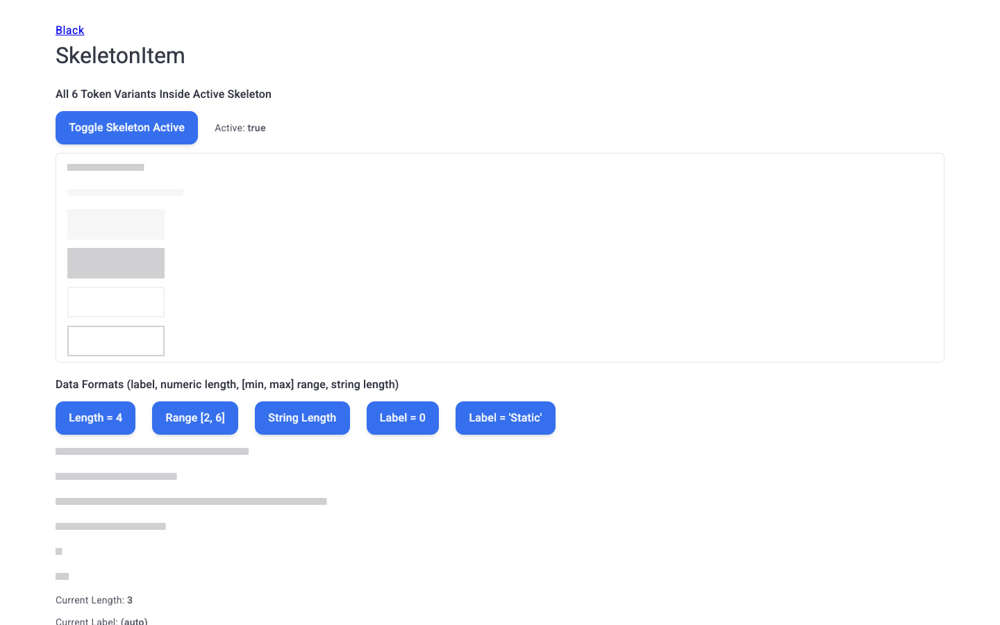
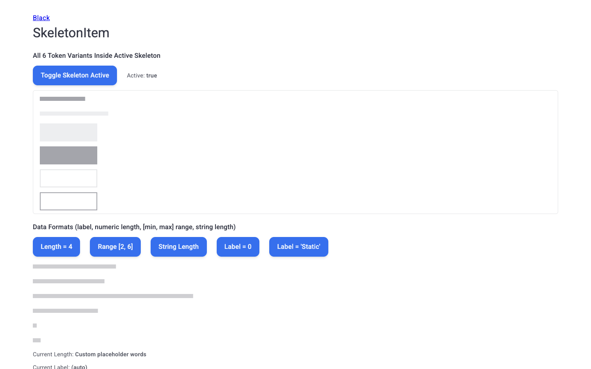
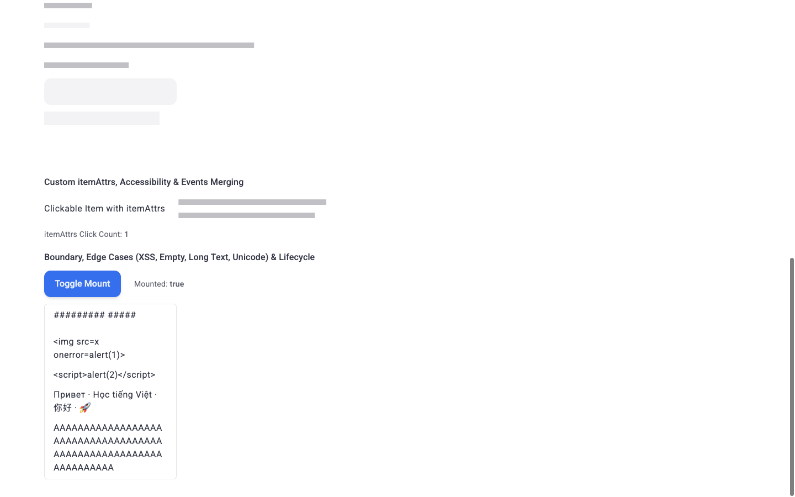
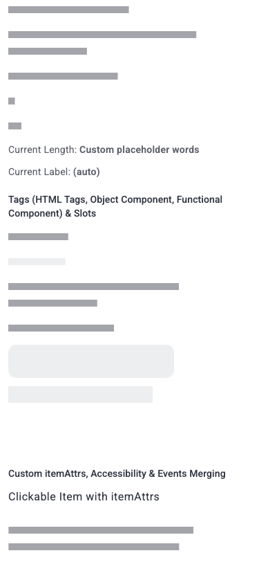

# Отчёт о визуальном и функциональном тестировании: D1SkeletonItem

## 1. Сводка тестирования

- **Компонент:** `D1SkeletonItem` (`@dxtmisha/d1`)
- **Исходный код:** [`SkeletonItem`](../../../constructor/src/constructors/SkeletonItem), [`D1SkeletonItem`](../../src/components/Ui/SkeletonItem)
- **URL демо:** `http://localhost:3000/component-skeleton-item`
- **Материалы:** Нет
- **Дата тестирования (UTC):** `2026-11-26T09:16:59Z`
- **Окружение:** `Headless Chrome (puppeteer / CDP, Desktop 1440x900, Tablet 768x1024, Mobile 375x812 / 320x568)`
- **Покрытие тест-кейсов:** 6 / 6 (`100%`)
- **Итог:** **6 ✅, 0 ⚠️, 0 ❌** (`✅` пройдено, `⚠️` предупреждение, `❌` провалено) — `D1SkeletonItem` корректно рендерит все 6 токенов скелетона, объектные и функциональные Vue-компоненты, безопасно экранирует XSS, сохраняет нулевой `Hydration mismatch` при SSR-гидрации и проходит все 4 вьюпорта без переполнения и ошибок.

---

## 2. Базовая матрица результатов

### 2.1 Визуальный рендеринг (`VIS`)

| ID | Сценарий | Статус | Фактический результат | Скриншот |
| :--- | :--- | :---: | :--- | :--- |
| `TC-VIS-001` | Все 6 токенов скелетона, HTML-теги, объектный и функциональный `tag`-компонент | ✅ | Подтверждены все 6 токенов (`text: 19`, `textVariant: 2`, `background: 3`, `backgroundVariant: 1`, `border: 3`, `borderVariant: 1`), `hasArticleFunctional: true`, `hasSectionObject: true`. |  |

### 2.2 Интерактивность и управление состоянием (`INT`)

| ID | Сценарий | Статус | Фактический результат | Скриншот |
| :--- | :--- | :---: | :--- | :--- |
| `TC-INT-001` | Переключение `active`, форматов `length`/`label`, `itemAttrs.onClick` и `mount/unmount` | ✅ | `labelZeroText: "0"`, `stringLengthText: "Custom placeholder words"`, `clickRecorded: true`; переключение `active` и `mount/unmount` отработали чисто. |  |

### 2.3 Граничные случаи и крайние сценарии (`BND`)

| ID | Сценарий | Статус | Фактический результат | Скриншот |
| :--- | :--- | :---: | :--- | :--- |
| `TC-BND-001` | Экранирование XSS (`label` и `length`), `label: 0`, пустой `length: 0` и Unicode | ✅ | `xssImgInjected: false`, `xssTextPresent: true`, `unicodePresent: true` (`Привет · Học tiếng Việt · 你好 · 🚀`). |  |

### 2.4 Адаптивность (`RSP`)

| ID | Сценарий | Статус | Фактический результат | Скриншот |
| :--- | :--- | :---: | :--- | :--- |
| `TC-RSP-001` | Адаптивность на `1440×900`, `768×1024`, `375×812`, `320×568` | ✅ | Нулевое переполнение на всех 4 вьюпортах (`1440/1440`, `768/768`, `375/375`, `320/320`, `overflowing: 0` для всех `29` элементов). |  |

### 2.5 Доступность (`A11Y`)

| ID | Сценарий | Статус | Фактический результат | Скриншот |
| :--- | :--- | :---: | :--- | :--- |
| `TC-A11Y-001` | `aria-hidden="true"` для декоративных `#`, приоритет `aria-label` и `role="status"` | ✅ | `decorativeAriaHidden: "true"`, `labelledAriaLabel: "Accessible loading heading"`, `labelledAriaHidden: null`, `customRole: "status"`. | — |

### 2.6 Логи и консоль (`LOG`)

| ID | Сценарий | Статус | Фактический результат | Скриншот |
| :--- | :--- | :---: | :--- | :--- |
| `TC-LOG-001` | Проверка отсутствия ошибок консоли, SSR hydration warnings и сетевых сбоев | ✅ | `consoleErrors: []`, `vueWarnings: []` (0 предупреждений гидрации), `pageErrors: []`, `networkErrors: []`. | — |

---

## 3. AI-аудит и рекомендации

1. **Безопасность и SSR-гидрация:** Переход с `innerHTML` на текстовый дочерний узел и стабилизированный через `lengthKey` детерминированный `computed` полностью устранили XSS-вектор, рассинхронизацию SSR-гидрации и мерцание при ре-рендерах.
2. **Полиморфизм и A11y:** Поддержка функциональных и объектных Vue-компонентов в `tag` с ленивым слотом и автоматическое `aria-hidden="true"` для декоративных заглушек `#` обеспечивают чистоту DOM и доступность из коробки.
3. **Производительность:** Минимальный вес DOM, нулевые дочерние конструкторы и отсутствие побочных эффектов гарантируют высокий CLS/INP.
