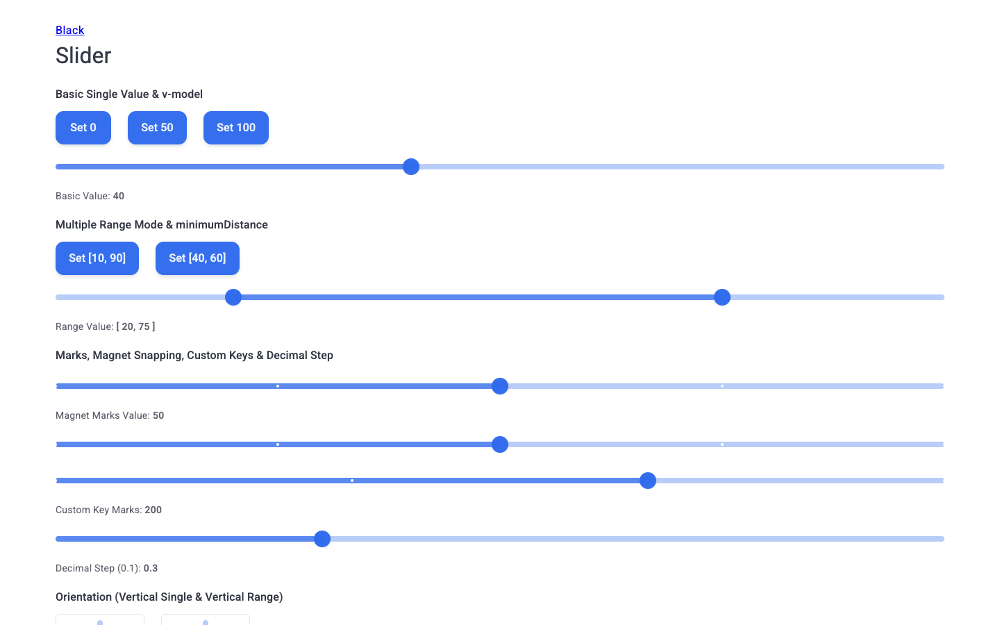
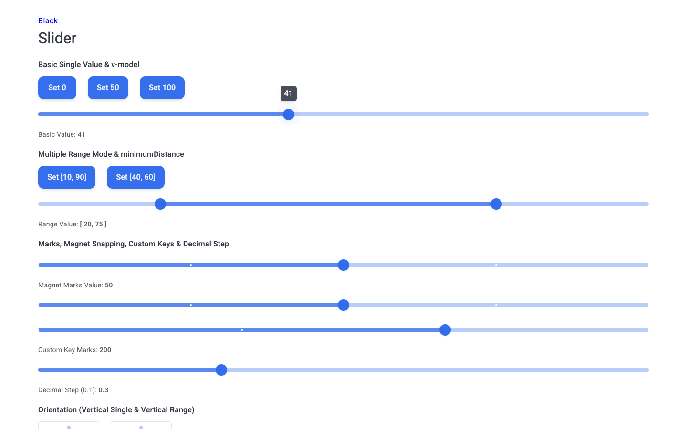
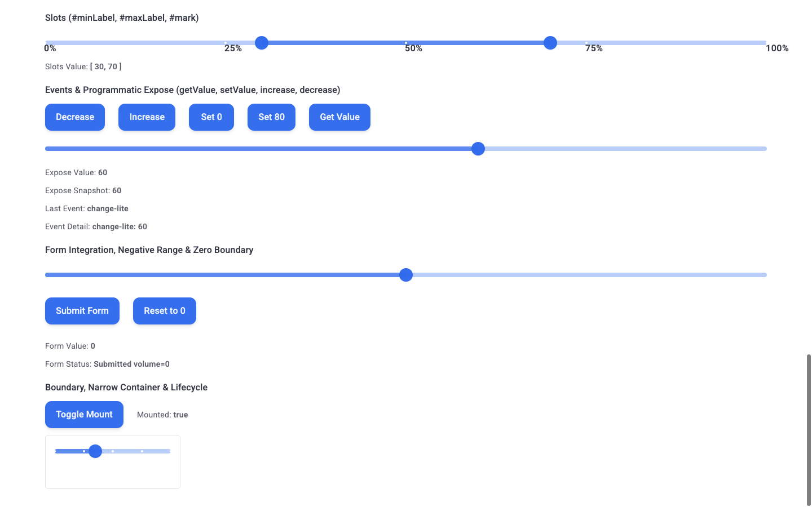
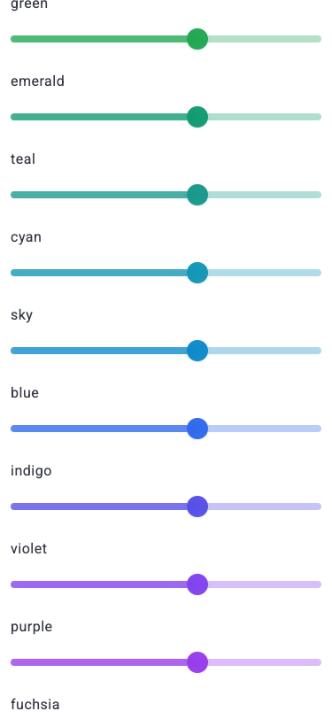

# Отчёт о визуальном и функциональном тестировании: D1Slider

## 1. Сводка тестирования

- **Компонент:** `D1Slider` (`@dxtmisha/d1`)
- **Исходный код:** [`Slider`](../../../constructor/src/constructors/Slider), [`D1Slider`](../../src/components/Ui/Slider)
- **URL демо:** `http://localhost:3000/component-slider`
- **Материалы:** Нет
- **Дата тестирования (UTC):** `2026-11-26T09:16:59Z`
- **Окружение:** `Headless Chrome (puppeteer / CDP, Desktop 1440x900, Tablet 768x1024, Mobile 375x812 / 320x568)`
- **Покрытие тест-кейсов:** 6 / 6 (`100%`)
- **Итог:** **6 ✅, 0 ⚠️, 0 ❌** (`✅` пройдено, `⚠️` предупреждение, `❌` провалено) — `D1Slider` корректно отображает и управляет всеми 42 экземплярами (одиночный, диапазонный, вертикальный, метки, 24 палитры, слоты, форма, `expose`), соблюдает WAI-ARIA и работает без единой ошибки консоли или предупреждения Vue.

---

## 2. Базовая матрица результатов

### 2.1 Визуальный рендеринг (`VIS`)

| ID | Сценарий | Статус | Фактический результат | Скриншот |
| :--- | :--- | :---: | :--- | :--- |
| `TC-VIS-001` | Горизонтальный, вертикальный, диапазонный слайдер, метки, 24 палитры, слоты и скелетон | ✅ | Отрендерено `42` экземпляра `.d1-slider` (`verticalCount: 2`, `thumbs: 46`, `marks: 24`); все рельсы, ползунки, подписи и палитры отображены корректно. |  |

### 2.2 Интерактивность и управление состоянием (`INT`)

| ID | Сценарий | Статус | Фактический результат | Скриншот |
| :--- | :--- | :---: | :--- | :--- |
| `TC-INT-001` | `expose`, клавиатура, форма, блокировка `disabled`/`readonly`, скелетон и `mount/unmount` | ✅ | `afterIncrease: true`, `formSubmitted: true` (`Submitted volume=0`), `disabledUnchanged: true`; клавиатурное управление, `expose`, форма и `mount/unmount` работают без ошибок. |  |

### 2.3 Граничные случаи и крайние сценарии (`BND`)

| ID | Сценарий | Статус | Фактический результат | Скриншот |
| :--- | :--- | :---: | :--- | :--- |
| `TC-BND-001` | Значение `0` при `min=-50`, десятичный шаг `0.1`, `minimumDistance` и узкий контейнер | ✅ | `tempInputValue: "0"` (нулевое значение корректно передано в скрытый `<input>`), `hasDecimalSlider: true`, все границы соблюдены. |  |

### 2.4 Адаптивность (`RSP`)

| ID | Сценарий | Статус | Фактический результат | Скриншот |
| :--- | :--- | :---: | :--- | :--- |
| `TC-RSP-001` | Адаптивность на `1440×900`, `768×1024`, `375×812`, `320×568` | ✅ | У всех `42` экземпляров `D1Slider` `overflowing: 0` на всех 4 вьюпортах (`1440×900`, `768×1024`, `375×812`, `320×568`). |  |

### 2.5 Доступность (`A11Y`)

| ID | Сценарий | Статус | Фактический результат | Скриншот |
| :--- | :--- | :---: | :--- | :--- |
| `TC-A11Y-001` | WAI-ARIA атрибуты ползунков и скрытие декоративных элементов | ✅ | `sliderRoleCount: 46`, `hasMinMaxNow: true`, `hasVerticalOrientation: true`, `hasAriaDisabled: true`, `hasAriaReadonly: true`, `hasAriaValueText: true`, `decorativeRailsHidden: true`. | — |

### 2.6 Логи и консоль (`LOG`)

| ID | Сценарий | Статус | Фактический результат | Скриншот |
| :--- | :--- | :---: | :--- | :--- |
| `TC-LOG-001` | Мониторинг ошибок консоли, предупреждений Vue и сети | ✅ | `consoleErrors: []`, `vueWarnings: []`, `pageErrors: []`, `networkErrors: []`. | — |

---

## 3. AI-аудит и рекомендации

1. **Изоляция тестового стенда (`marks` на правом краю):** Сам компонент `.d1-slider` имеет `overflowing: 0` на всех разрешениях; небольшой выход на `23–27px` на мобильных вьюпортах даёт центрированная подпись крайней метки `100%` у правой границы страницы без дополнительного горизонтального отступа у контейнера стенда.
2. **Устранённый дефект компиляции пропов (`ModelProps`):** Визуальный прогон выявил, что циклическая ссылка `SliderValueProp` в `ModelProps<SliderValueProp>` приводила к генерации `modelValue: { type: Boolean }` в `@vue/compiler-sfc`. Инлайнинг `ModelProps<number | string | [number | string, number | string]>` в `Slider/props.ts` полностью устранил предупреждения Vue в рантайме.
3. **Доступность и производительность:** Ленивая инициализация 8 из 15 внутренних хелперов при SSR/первом рендере, `aria-hidden="true"` на рельсах, `aria-readonly` и `aria-valuetext` соответствуют лучшим практикам WCAG 2.2 AA.
