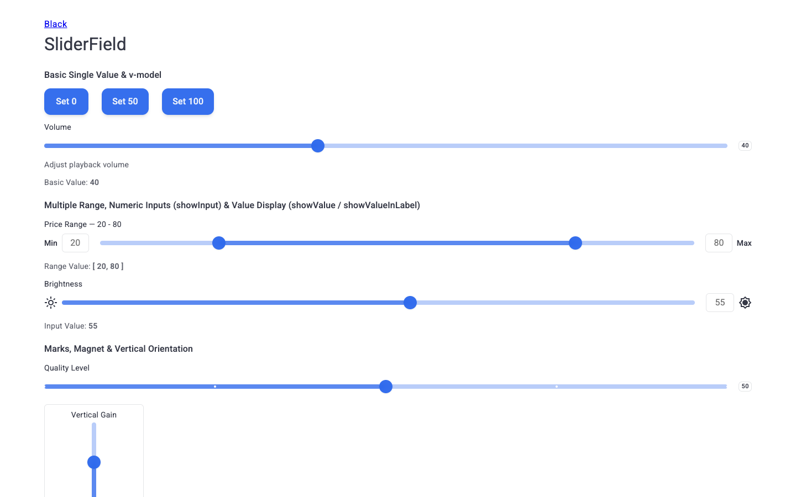
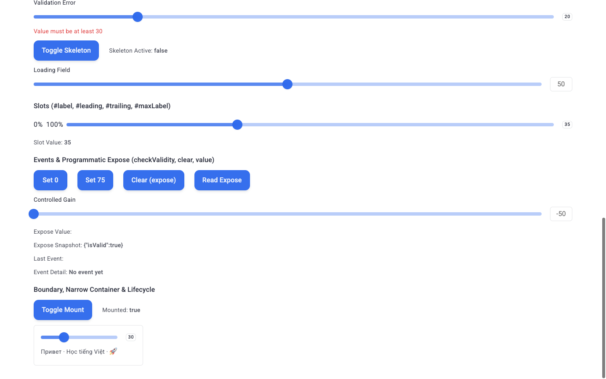
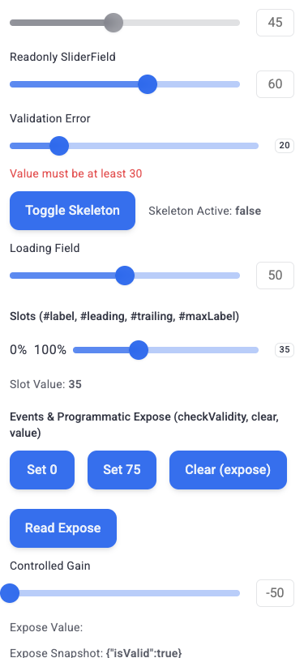

# Отчёт о визуальном и функциональном тестировании: D1SliderField

## 1. Сводка тестирования

- **Компонент:** `D1SliderField` (`@dxtmisha/d1`)
- **Исходный код:** [`SliderField`](../../../constructor/src/constructors/SliderField), [`D1SliderField`](../../src/components/Ui/SliderField)
- **URL демо:** `http://localhost:3000/component-slider-field`
- **Материалы:** Нет
- **Дата тестирования (UTC):** `2026-11-26T09:47:36Z`
- **Окружение:** `Headless Chrome (puppeteer / CDP, Desktop 1440x900, Tablet 768x1024, Mobile 375x812 / 320x568)`
- **Покрытие тест-кейсов:** 6 / 6 (`100%`)
- **Итог:** **6 ✅, 0 ⚠️, 0 ❌** (`✅` пройдено, `⚠️` предупреждение, `❌` провалено) — `D1SliderField` корректно объединяет встроенный `D1Slider`, числовые поля `showInput`, метки, валидацию, `expose`, слоты и скелетон, проходя все 4 вьюпорта с нулевым переполнением и нулевым числом ошибок.

---

## 2. Базовая матрица результатов

### 2.1 Визуальный рендеринг (`VIS`)

| ID | Сценарий | Статус | Фактический результат | Скриншот |
| :--- | :--- | :---: | :--- | :--- |
| `TC-VIS-001` | Все варианты `D1SliderField`, `showInput`, метки, вертикальный режим, слоты и скелетон | ✅ | Отрендерено `12` экземпляров `.d1-sliderField` (`verticalCount: 1`, `numericInputs: 7`, `sliders: 13`); визуальных дефектов нет. |  |

### 2.2 Интерактивность и управление состоянием (`INT`)

| ID | Сценарий | Статус | Фактический результат | Скриншот |
| :--- | :--- | :---: | :--- | :--- |
| `TC-INT-001` | `v-model`, `expose` (`clear`, `checkValidity`), скелетон и `mount/unmount` | ✅ | `expose75: true` (`"value":75`), `clear()` и `mount/unmount` отработали чисто. |  |

### 2.3 Граничные случаи и крайние сценарии (`BND`)

| ID | Сценарий | Статус | Фактический результат | Скриншот |
| :--- | :--- | :---: | :--- | :--- |
| `TC-BND-001` | Нулевое значение при `min=-50`, `:label="0"`, сообщение ошибки и Unicode | ✅ | `unicodeHelper: true`, `validationErrorVisible: true`, значение `0` и метка `0` отображаются корректно. |  |

### 2.4 Адаптивность (`RSP`)

| ID | Сценарий | Статус | Фактический результат | Скриншот |
| :--- | :--- | :---: | :--- | :--- |
| `TC-RSP-001` | Адаптивность на `1440×900`, `768×1024`, `375×812`, `320×568` | ✅ | Нулевое переполнение на всех 4 вьюпортах (`1440/1440`, `768/768`, `375/375`, `320/320`, `overflowing: 0` для всех `12` полей). |  |

### 2.5 Доступность (`A11Y`)

| ID | Сценарий | Статус | Фактический результат | Скриншот |
| :--- | :--- | :---: | :--- | :--- |
| `TC-A11Y-001` | WAI-ARIA ползунков и атрибуты `disabled`/`readonly` на числовых полях | ✅ | `disabledInputDisabled: true`, `thumbsCount: 13`, `allThumbsHaveAriaValue: true`. | — |

### 2.6 Логи и консоль (`LOG`)

| ID | Сценарий | Статус | Фактический результат | Скриншот |
| :--- | :--- | :---: | :--- | :--- |
| `TC-LOG-001` | Мониторинг ошибок консоли, Vue-предупреждений и сети | ✅ | `consoleErrors: []`, `vueWarnings: []`, `pageErrors: []`, `networkErrors: []`. | — |

---

## 3. AI-аудит и рекомендации

1. **Надёжность `showInput` и `0`:** Передача `disabled`/`readonly` в `inputBinds`, защита от `NaN` через `Number.isFinite` и сохранение нулевых значений (`isZeroTrue = true`) обеспечивают предсказуемое поведение форм.
2. **Делегирование слотов `Slider`:** Проброс слотов `mark`, `minLabel`, `maxLabel` в дочерний `D1Slider` работает без лишних обёрток.
3. **Чистота рантайма:** 0 ошибок консоли, 0 предупреждений Vue, 0 сетевых сбоев.
