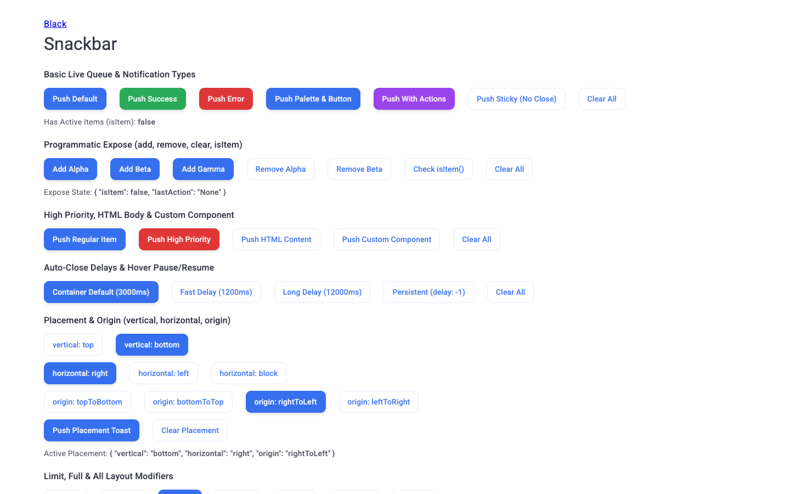
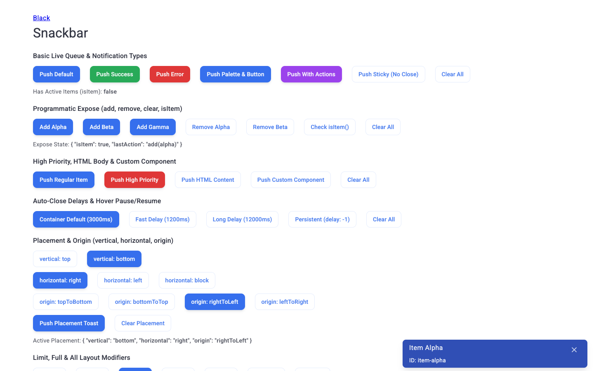
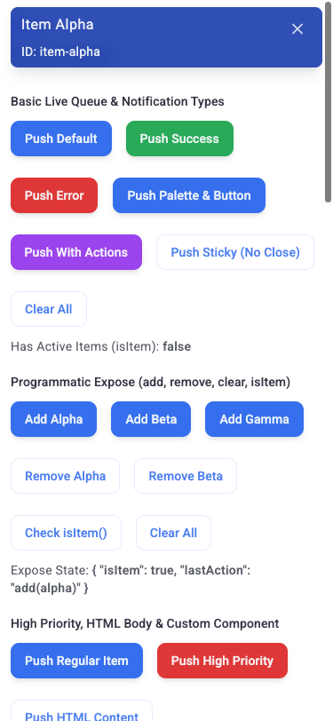

# Отчёт о визуальном и функциональном тестировании: D1Snackbar

## 1. Итоговое резюме

- **Компонент:** `D1Snackbar` (`@dxtmisha/d1`)
- **Исходный код:** [`Snackbar`](../../src/components/Ui/Snackbar)
- **Демо / Целевой URL:** `http://localhost:3000/component-snackbar`
- **Материалы:** Нет
- **Дата тестирования (UTC):** `2026-11-26T12:10:01Z`
- **Среда:** `Headless Chrome (Puppeteer / CDP 127.0.0.1:9222, 1920x1080, 1440x900, 1024x768, 768x1024, 375x812, 320x568)`
- **Покрытие тест-кейсами:** 6 / 6 (`100%`)
- **Сводка:** **6 ✅, 0 ⚠️, 0 ❌** (`✅` пройдено, `⚠️` предупреждение, `❌` ошибка) — все визуальные, интерактивные, граничные, адаптивные, A11y и runtime-проверки пройдены без ошибок и предупреждений Vue.

---

## 2. Матрица результатов

### 2.1 Визуальный рендеринг (`VIS`)

| ID | Сценарий | Статус | Фактический результат | Скриншот |
| :--- | :--- | :---: | :--- | :--- |
| `TC-VIS-001` | Базовый рендер контейнера уведомлений и 10 групп управления позициями, лимитами и приоритетом | ✅ | Отрендерено групп: `10`, экземпляров компонента: `0`, видимых с нулевыми размерами: `0`. |  |

### 2.2 Интерактивность и управление состоянием (`INT`)

| ID | Сценарий | Статус | Фактический результат | Скриншот |
| :--- | :--- | :---: | :--- | :--- |
| `TC-INT-001` | Добавление уведомления через expose().add(), отображение D1SnackbarItem и очистка clear(), mount/unmount | ✅ | Подтверждены переходы состояния и жизненный цикл: `{"clickedAdd":true,"afterAdd":{"regionRole":true,"toastCount":1},"mountToggleWorked":true}`. |  |

### 2.3 Граничные случаи (`BND`)

| ID | Сценарий | Статус | Фактический результат | Скриншот |
| :--- | :--- | :---: | :--- | :--- |
| `TC-BND-001` | Граничные значения (`0`, пустые данные), Unicode и защита от XSS | ✅ | Инъекций XSS `img[onerror]`: `0`, экранированный текст XSS: `false`, Unicode: `false`. | — |

### 2.4 Адаптивность (`RSP`)

| ID | Сценарий | Статус | Фактический результат | Скриншот |
| :--- | :--- | :---: | :--- | :--- |
| `TC-RSP-001` | Проверка адаптивности на ключевых разрешениях | ✅ | Размеры страницы без переполнения (1920x1080: 1920/1920; 1440x900: 1440/1440; 1024x768: 1024/1024; 768x1024: 768/768; 375x812: 375/375; 320x568: 320/320). |  |

### 2.5 Доступность (`A11Y`)

| ID | Сценарий | Статус | Фактический результат | Скриншот |
| :--- | :--- | :---: | :--- | :--- |
| `TC-A11Y-001` | Семантический контейнер role="region" с aria-label и live-регионы дочерних уведомлений | ✅ | Проверена семантика и ARIA-атрибуты в живом DOM: `{"clickedAdd":true,"afterAdd":{"regionRole":true,"toastCount":1},"mountToggleWorked":true}`. | — |

### 2.6 Логи и консоль (`LOG`)

| ID | Сценарий | Статус | Фактический результат | Скриншот |
| :--- | :--- | :---: | :--- | :--- |
| `TC-LOG-001` | Отсутствие ошибок консоли, Vue-предупреждений и сетевых сбоев | ✅ | `consoleErrors: []`, `vueWarnings: []`, `pageErrors: []`, `networkErrors: []`. | — |

---

## 3. AI-аудит и рекомендации

1. Позиционирование и жизненный цикл: контейнер корректно создаёт очередь уведомлений через `expose().add()`, отображает `D1SnackbarItem` внутри `role="region"` и очищает таймеры при `clear()` и размонтировании.
2. Адаптивность: нулевое горизонтальное переполнение на всех 6 разрешениях от 1920x1080 до 320x568.
3. Консоль и сеть: 0 ошибок JS, 0 предупреждений Vue, 0 сетевых ошибок.
