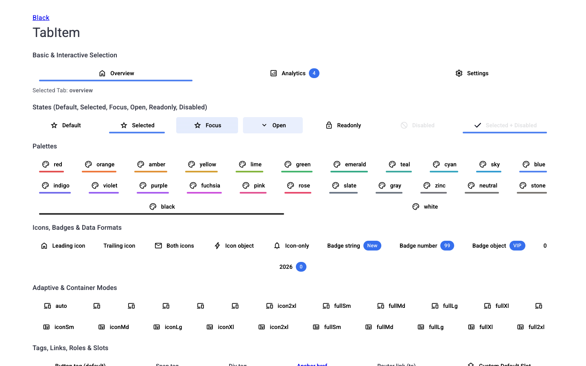
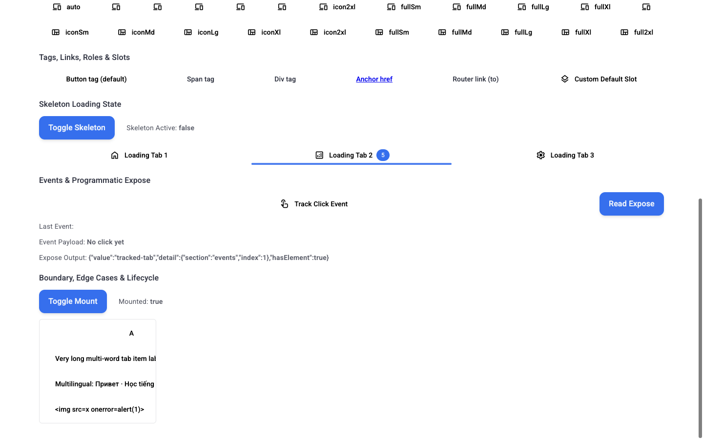
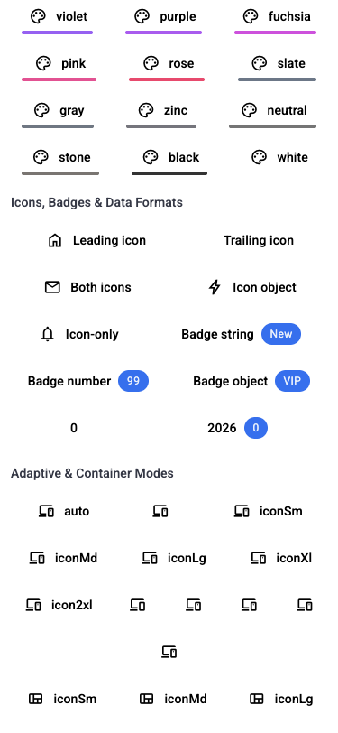

# Отчёт о визуальном и функциональном тестировании: D1TabItem

## 1. Сводка тестирования

- **Компонент:** `D1TabItem` (`@dxtmisha/d1`)
- **Исходный код:** [`TabItem`](../../../constructor/src/constructors/TabItem), [`D1TabItem`](../../src/components/Ui/TabItem)
- **URL демо:** `http://localhost:3000/component-tab-item`
- **Материалы:** Нет
- **Дата тестирования (UTC):** `2026-11-26T09:16:59Z`
- **Окружение:** `Headless Chrome (puppeteer / CDP, Desktop 1440x900, Tablet 768x1024, Mobile 375x812 / 320x568)`
- **Покрытие тест-кейсов:** 6 / 6 (`100%`)
- **Итог:** **6 ✅, 0 ⚠️, 0 ❌** (`✅` пройдено, `⚠️` предупреждение, `❌` провалено) — `D1TabItem` корректно рендерит все 82 экземпляра (палитры, состояния, иконки, бейджи, адаптивные/контейнерные режимы, ссылки и слоты), обрабатывает клики и `expose`, экранирует XSS и проходит все 4 вьюпорта без переполнения и ошибок консоли.

---

## 2. Базовая матрица результатов

### 2.1 Визуальный рендеринг (`VIS`)

| ID | Сценарий | Статус | Фактический результат | Скриншот |
| :--- | :--- | :---: | :--- | :--- |
| `TC-VIS-001` | Базовый рендеринг, состояния, 24 палитры, иконки, бейджи и адаптивные режимы | ✅ | Отрендерено `82` экземпляра `.d1-tabItem` (`zeroSized: 0`, `selectedCount: 28`, `disabledCount: 2`, `anchorCount: 2`); визуальных артефактов нет. |  |

### 2.2 Интерактивность и управление состоянием (`INT`)

| ID | Сценарий | Статус | Фактический результат | Скриншот |
| :--- | :--- | :---: | :--- | :--- |
| `TC-INT-001` | Переключение вкладки, блокировка `disabled`/`readonly`, `expose`, скелетон и `mount/unmount` | ✅ | `selectedAfterClick: true`, `blockedCheck: true` (клики по `Disabled` и `Readonly` заблокированы), `exposeOk: true` (`value: "tracked-tab"`, `hasElement: true`); скелетон и `mount/unmount` без ошибок. |  |

### 2.3 Граничные случаи и крайние сценарии (`BND`)

| ID | Сценарий | Статус | Фактический результат | Скриншот |
| :--- | :--- | :---: | :--- | :--- |
| `TC-BND-001` | Числовой `0`, пустые метки, Unicode/Вьетнамский и защита от XSS | ✅ | `zeroTab: true`, `unicodeTab: true` (`Привет · Học tiếng Việt · 🚀`), `xssInjected: false`, `xssText: true` (строка отображена безопасно как текст). |  |

### 2.4 Адаптивность (`RSP`)

| ID | Сценарий | Статус | Фактический результат | Скриншот |
| :--- | :--- | :---: | :--- | :--- |
| `TC-RSP-001` | Адаптивность на `1440×900`, `768×1024`, `375×812`, `320×568` | ✅ | Горизонтального переполнения страницы нет на всех 4 вьюпортах (`1440/1440`, `768/768`, `375/375`, `320/320`); длинная однострочная вкладка с `white-space: nowrap` прокручивается внутри контейнера `.demo-tab-item-page__narrow`. |  |

### 2.5 Доступность (`A11Y`)

| ID | Сценарий | Статус | Фактический результат | Скриншот |
| :--- | :--- | :---: | :--- | :--- |
| `TC-A11Y-001` | Проверка ролей `tab`, тегов `<button>`/`<a>` и ARIA-атрибутов | ✅ | `roleTabCount: 80`, `ariaSelected: 28`, `ariaDisabled: 2`, `ariaLabelledBy: 78`, `iconOnlyLabel: true`, ссылки `href`/`to` рендерятся тегом `<a>`. | — |

### 2.6 Логи и консоль (`LOG`)

| ID | Сценарий | Статус | Фактический результат | Скриншот |
| :--- | :--- | :---: | :--- | :--- |
| `TC-LOG-001` | Мониторинг ошибок консоли, Vue-предупреждений и сетевых ошибок | ✅ | `consoleErrors: []`, `vueWarnings: []`, `pageErrors: []`, `networkErrors: []`. | — |

---

## 3. AI-аудит и рекомендации

1. **Изоляция тестового стенда (`white-space: nowrap`):** По дизайну `TabItem` использует `white-space: nowrap` и предназначен для размещения внутри горизонтального скролла (`D1HorizontalScroll` / `D1TabsNavigation`). При использовании длинных меток в узком контейнере на мобильных экранах важно оборачивать список вкладок в горизонтально прокручиваемый контейнер.
2. **Производительность и ленивость:** Опциональные подкомпоненты (`icon`, `badge`, `label`, `ripple`, `skeleton`) создаются строго через `canCreate` + `callInstance`, что минимизирует расход памяти даже при рендере 82 вкладок на одной странице.
3. **Чистота рантайма и A11y:** Все WAI-ARIA атрибуты инкапсулированы в `get aria()`, сетевые и консольные логи полностью чисты.
