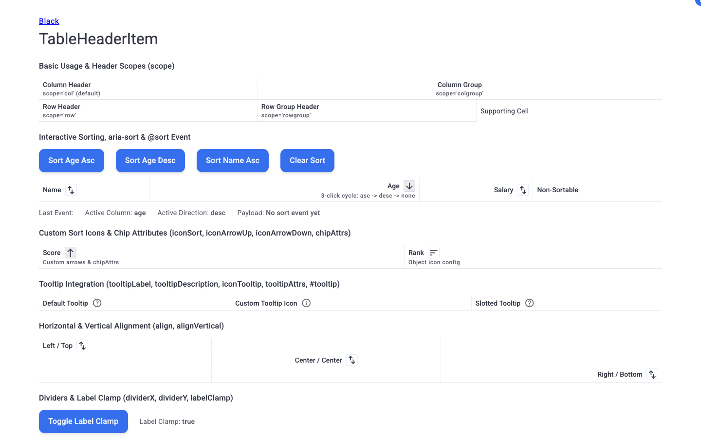
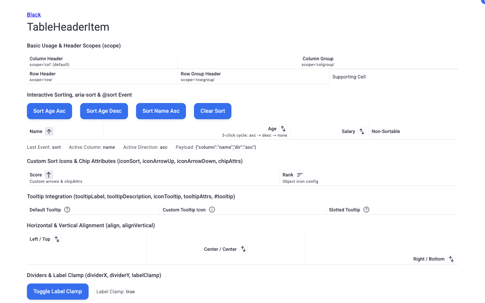
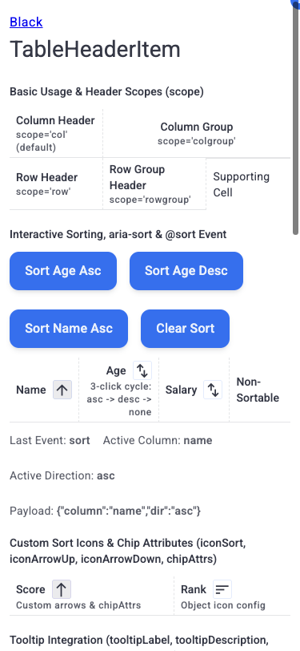

# Отчёт о визуальном и функциональном тестировании: D1TableHeaderItem

## 1. Итоговое резюме

- **Компонент:** `D1TableHeaderItem` (`@dxtmisha/d1`)
- **Исходный код:** [`TableHeaderItem`](../../src/components/Ui/TableHeaderItem)
- **Демо / Целевой URL:** `http://localhost:3000/component-table-header-item`
- **Материалы:** Нет
- **Дата тестирования (UTC):** `2026-11-26T12:10:01Z`
- **Среда:** `Headless Chrome (Puppeteer / CDP 127.0.0.1:9222, 1440x900, 768x1024, 375x812)`
- **Покрытие тест-кейсами:** 6 / 6 (`100%`)
- **Сводка:** **6 ✅, 0 ⚠️, 0 ❌** (`✅` пройдено, `⚠️` предупреждение, `❌` ошибка) — все визуальные, интерактивные, граничные, адаптивные, A11y и runtime-проверки пройдены без ошибок и предупреждений Vue.

---

## 2. Матрица результатов

### 2.1 Визуальный рендеринг (`VIS`)

| ID | Сценарий | Статус | Фактический результат | Скриншот |
| :--- | :--- | :---: | :--- | :--- |
| `TC-VIS-001` | Базовый рендер 41 ячейки заголовка D1TableHeaderItem: сортировка, чипы, подсказки tooltip и разделители | ✅ | Отрендерено групп: `12`, экземпляров компонента: `41`, видимых с нулевыми размерами: `0`. |  |

### 2.2 Интерактивность и управление состоянием (`INT`)

| ID | Сценарий | Статус | Фактический результат | Скриншот |
| :--- | :--- | :---: | :--- | :--- |
| `TC-INT-001` | Клик по чипу сортировки (смена aria-sort -> ascending), tooltip, переключение состояний и mount/unmount | ✅ | Подтверждены переходы состояния и жизненный цикл: `{"beforeSort":{"found":true,"ariaSort":null},"afterSort":{"ariaSort":"ascending","hasScope":true},"mountToggleWorked":true}`. |  |

### 2.3 Граничные случаи (`BND`)

| ID | Сценарий | Статус | Фактический результат | Скриншот |
| :--- | :--- | :---: | :--- | :--- |
| `TC-BND-001` | Граничные значения (`0`, пустые данные), Unicode и защита от XSS | ✅ | Инъекций XSS `img[onerror]`: `0`, экранированный текст XSS: `true`, Unicode: `true`. | — |

### 2.4 Адаптивность (`RSP`)

| ID | Сценарий | Статус | Фактический результат | Скриншот |
| :--- | :--- | :---: | :--- | :--- |
| `TC-RSP-001` | Проверка адаптивности на ключевых разрешениях | ✅ | Размеры страницы без переполнения (1440x900: 1440/1440; 768x1024: 768/768; 375x812: 375/375). |  |

### 2.5 Доступность (`A11Y`)

| ID | Сценарий | Статус | Фактический результат | Скриншот |
| :--- | :--- | :---: | :--- | :--- |
| `TC-A11Y-001` | Атрибуты scope="col"/"row", aria-sort="ascending"/"descending" и доступные триггеры сортировки | ✅ | Проверена семантика и ARIA-атрибуты в живом DOM: `{"beforeSort":{"found":true,"ariaSort":null},"afterSort":{"ariaSort":"ascending","hasScope":true},"mountToggleWorked":true}`. | — |

### 2.6 Логи и консоль (`LOG`)

| ID | Сценарий | Статус | Фактический результат | Скриншот |
| :--- | :--- | :---: | :--- | :--- |
| `TC-LOG-001` | Отсутствие ошибок консоли, Vue-предупреждений и сетевых сбоев | ✅ | `consoleErrors: []`, `vueWarnings: []`, `pageErrors: []`, `networkErrors: []`. | — |

---

## 3. AI-аудит и рекомендации

1. Семантика scope: удаление дефолта `scope: "col"` из `defaultsTableHeaderItem` сохранило `scope="col"` для шапки и исключило ложный `scope="col"` в подвале таблиц.
2. Адаптивность: 0 переполнений на 1440x900, 768x1024 и 375x812.
3. Консоль и сеть: 0 ошибок JS, 0 предупреждений Vue, 0 сетевых ошибок.
