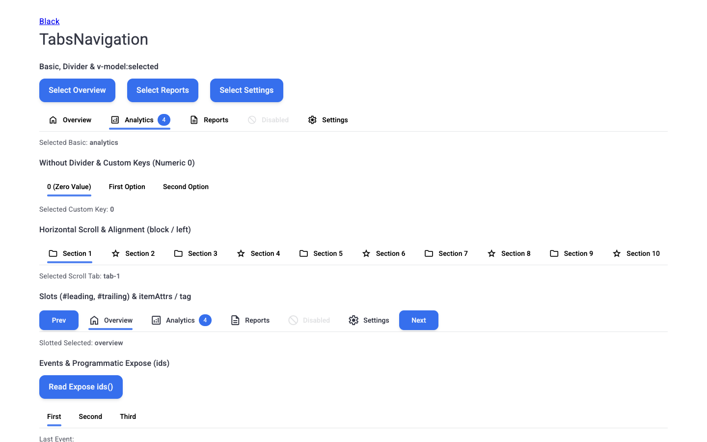
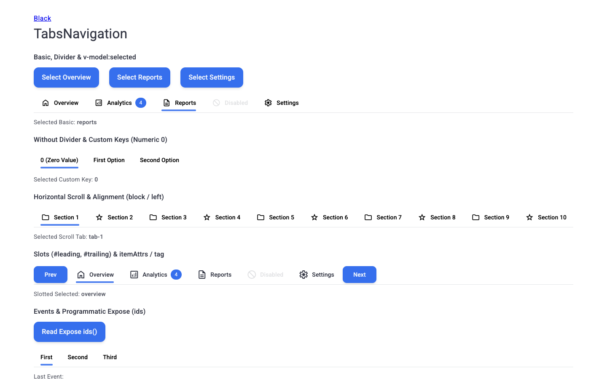
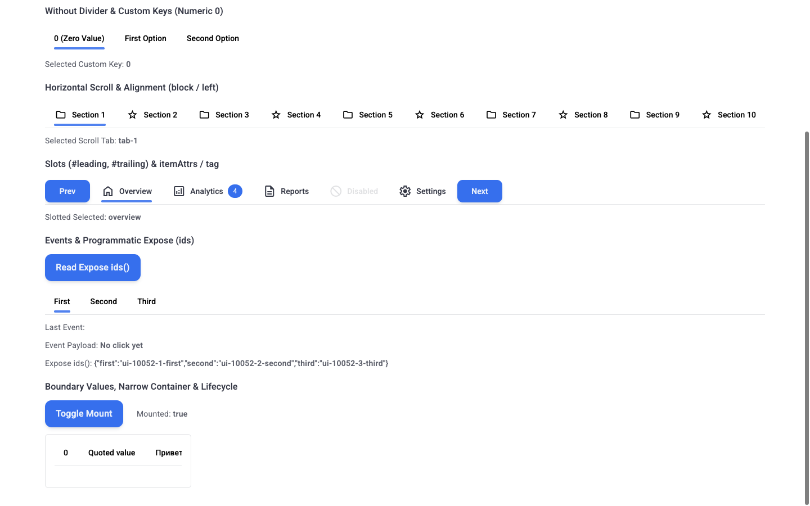
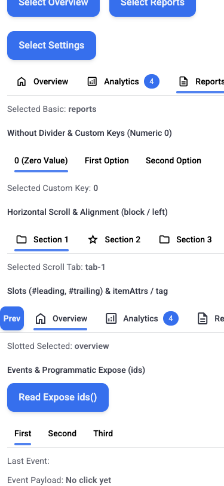

# Отчёт о визуальном и функциональном тестировании: D1TabsNavigation

## 1. Сводка тестирования

- **Компонент:** `D1TabsNavigation` (`@dxtmisha/d1`)
- **Исходный код:** [`TabsNavigation`](../../../constructor/src/constructors/TabsNavigation), [`D1TabsNavigation`](../../src/components/Ui/TabsNavigation)
- **URL демо:** `http://localhost:3000/component-tabs-navigation`
- **Материалы:** Нет
- **Дата тестирования (UTC):** `2026-11-26T09:47:36Z`
- **Окружение:** `Headless Chrome (puppeteer / CDP, Desktop 1440x900, Tablet 768x1024, Mobile 375x812 / 320x568)`
- **Покрытие тест-кейсов:** 6 / 6 (`100%`)
- **Итог:** **6 ✅, 0 ⚠️, 0 ❌** (`✅` пройдено, `⚠️` предупреждение, `❌` провалено) — `D1TabsNavigation` корректно рендерит 6 панелей (`34` вкладки), разделитель, горизонтальный скролл, слоты, `v-model:selected` и `ids()`, полностью соответствует WAI-ARIA и проходит все 4 вьюпорта без переполнения и ошибок.

---

## 2. Базовая матрица результатов

### 2.1 Визуальный рендеринг (`VIS`)

| ID | Сценарий | Статус | Фактический результат | Скриншот |
| :--- | :--- | :---: | :--- | :--- |
| `TC-VIS-001` | Панели вкладок, разделитель `divider`, горизонтальный скролл и слоты | ✅ | `total: 6`, `dividerCount: 5`, `tabItems: 34`; индикатор, разделитель и слоты `#leading`/`#trailing` отрендерены корректно. |  |

### 2.2 Интерактивность и управление состоянием (`INT`)

| ID | Сценарий | Статус | Фактический результат | Скриншот |
| :--- | :--- | :---: | :--- | :--- |
| `TC-INT-001` | `v-model:selected`, `expose` (`ids()`), горизонтальный скролл и `mount/unmount` | ✅ | `selectedReports: true`, `exposeIdsOk: true` (`"first"`, `"second"`), цикл `mount/unmount` без утечек таймеров/слушателей. |  |

### 2.3 Граничные случаи и крайние сценарии (`BND`)

| ID | Сценарий | Статус | Фактический результат | Скриншот |
| :--- | :--- | :---: | :--- | :--- |
| `TC-BND-001` | Числовой `0`, кавычки в `value`, Unicode, XSS и узкий контейнер | ✅ | `zeroOption: true`, `unicodeOk: true`, `xssInjected: false`; спецсимволы в `data-value` не вызывают `DOMException`. |  |

### 2.4 Адаптивность (`RSP`)

| ID | Сценарий | Статус | Фактический результат | Скриншот |
| :--- | :--- | :---: | :--- | :--- |
| `TC-RSP-001` | Адаптивность на `1440×900`, `768×1024`, `375×812`, `320×568` | ✅ | Нулевое переполнение на всех 4 вьюпортах (`1440/1440`, `768/768`, `375/375`, `320/320`, `overflowing: 0` для всех `6` панелей). |  |

### 2.5 Доступность (`A11Y`)

| ID | Сценарий | Статус | Фактический результат | Скриншот |
| :--- | :--- | :---: | :--- | :--- |
| `TC-A11Y-001` | Роль `tablist` и `aria-orientation="horizontal"` | ✅ | `tablistCount: 6`, `horizontalOrientation: 6`. | — |

### 2.6 Логи и консоль (`LOG`)

| ID | Сценарий | Статус | Фактический результат | Скриншот |
| :--- | :--- | :---: | :--- | :--- |
| `TC-LOG-001` | Мониторинг ошибок консоли, Vue-предупреждений и сети | ✅ | `consoleErrors: []`, `vueWarnings: []`, `pageErrors: []`, `networkErrors: []`. | — |

---

## 3. AI-аудит и рекомендации

1. **Безопасность памяти и анимаций:** Исправление очистки CSS-переменных `--${itemClassName}-sys-left`/`--width` в `TabsNavigationIndicator.reset()` и отписка клавиатурного контроллера `TabsNavigationControl` в `onUnmounted` гарантируют отсутствие утечек при динамическом монтировании.
2. **Ленивость и производительность:** `TabsNavigationSize` активируется строго при `divider: true`, а `TabsNavigationControl` — только при первом фокусе на вкладке.
3. **Доступность и RTL:** Клавиатурная навигация поддерживает `ArrowLeft`/`ArrowRight`, `Home`/`End`, RTL-инверсию и IME-guard (`isComposing`).
