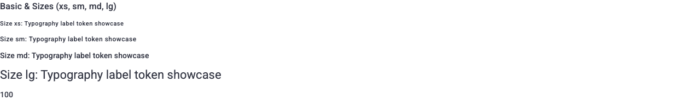
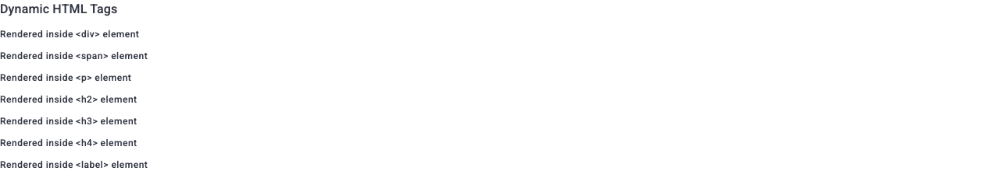
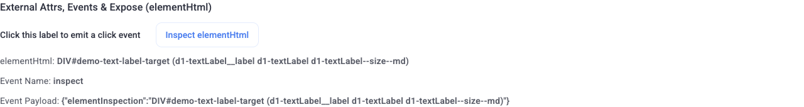
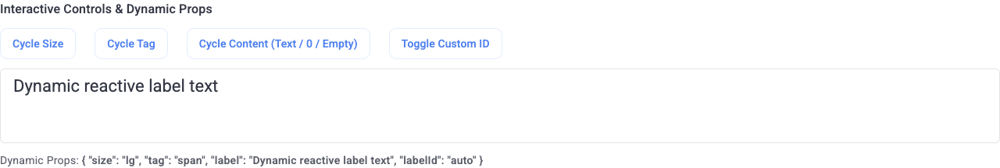
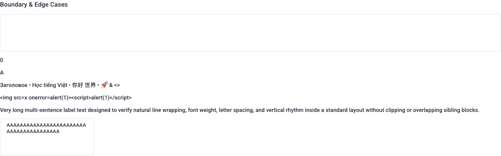
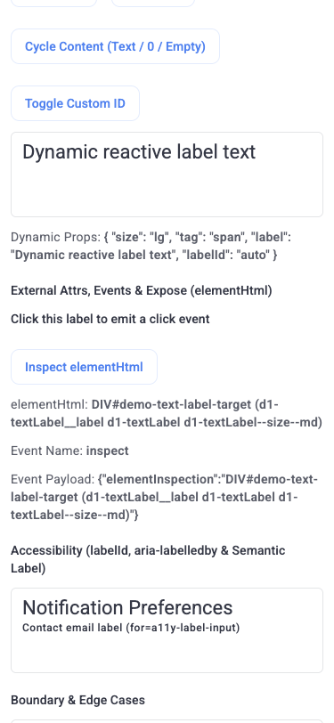

# Отчёт о визуальном и функциональном тестировании: D1TextLabel

## 1. Сводка тестирования

- **Компонент:** `D1TextLabel` (`@dxtmisha/d1`, конструктор `@dxtmisha/constructor`)
- **Исходный код:** [`D1TextLabel`](../../src/components/Ui/TextLabel), [`TextLabel`](../../../../packages/constructor/src/constructors/TextLabel), [`DemoTextLabelPage`](../../../demo/src/pages/components/DemoTextLabelPage.vue)
- **Демо / целевой URL:** `http://localhost:3000/component-text-label`
- **Материалы:** `Нет`
- **Дата тестирования (UTC):** `2026-11-26T14:10:41Z`
- **Окружение:** `Headless Chrome (Puppeteer / CDP, Desktop 1440x900, Tablet 768x1024, Mobile 375x812 / 320x568)`
- **Покрытие тест-кейсов:** 10 / 10 (`100%`)
- **Сводка:** **10 ✅, 0 ⚠️, 0 ❌** (`✅` пройдено, `⚠️` предупреждение, `❌` провалено) — `D1TextLabel` прошёл все визуальные, интерактивные, граничные (пустой DOM, `0`, `240px`, Unicode, XSS), адаптивные (включая `320×568`), ARIA и рантайм-проверки без ошибок и предупреждений.

---

## 2. Базовая матрица

### 2.1 Визуальный рендеринг (`VIS`)

| ID | Сценарий | Статус | Фактический результат | Скриншот |
| :--- | :--- | :---: | :--- | :--- |
| `TC-VIS-001` | Шкала размеров (`xs`, `sm`, `md`, `lg`), числовое значение и токены | ✅ | Все 4 размера рендерятся с монотонной прогрессией (`xs`: `11px/16px/500`, `sm`: `12px/16px/500`, `md`: `14px/20px/500`, `lg`: `22px/28px/400`), классами `.d1-textLabel__label` и `.d1-textLabel--size--*`; число `100` отображается корректно. |  |
| `TC-VIS-002` | Динамические HTML-теги (`div`, `span`, `p`, `h2`, `h3`, `h4`, `label`) и слоты | ✅ | Все 7 тегов точно совпали с ожидаемым списком (`tagsMatch: true`); слот `default` и комбинированный рендер корректно отображают вложенные `<strong>` и `<em>`. |  |

### 2.2 Интерактивность и управление состоянием (`INT`)

| ID | Сценарий | Статус | Фактический результат | Скриншот |
| :--- | :--- | :---: | :--- | :--- |
| `TC-INT-001` | Внешние атрибуты (`mergeProps`), `@click` и `expose().elementHtml` | ✅ | Клик зафиксировал `Event Name: click` и payload `{"source":"demo-text-label-interactive"}`; `Inspect elementHtml` вернул `DIV#demo-text-label-target (d1-textLabel__label d1-textLabel d1-textLabel--size--md)`. |  |
| `TC-INT-002` | Реактивное переключение `size`, `tag`, `label` (текст / `0` / пусто) и `labelId` | ✅ | Переключения обновили `DIV#demo-dynamic-label-id` (`md`) -> `SPAN#ui-10029` (`lg`) -> текст `0` -> пустой DOM (`exists: false`) -> восстановление текста (`exists: true`). |  |
| `TC-INT-003` | Условное монтирование и размонтирование (`v-if`) | ✅ | Переключение `Toggle Mount` чисто удаляет и восстанавливает `[data-testid="demo-text-label-lifecycle"]` (`true -> false -> true`). | — |

### 2.3 Граничные случаи и крайние сценарии (`BND`)

| ID | Сценарий | Статус | Фактический результат | Скриншот |
| :--- | :--- | :---: | :--- | :--- |
| `TC-BND-001` | Пустые и пробельные строки (нулевой DOM) и SSR | ✅ | SSR возвращает `status: 200`, `hasBaseClass: true`, `hasSubClass: true`; для `""` и `"   "` в `.demo-text-label-empty-box` отрендерено `0` элементов `.d1-textLabel`. | — |
| `TC-BND-002` | Числовой `0`, Unicode/Emoji, XSS и узкий контейнер `240px` | ✅ | `0` и `Заголовок • Học tiếng Việt • 你好 世界 • 🚀 & <>` отображаются полностью, XSS-строка экранирована (`xssBadNodes: 0`), узкий контейнер `240px` не переполняется (`scrollWidth: 238 === clientWidth: 238`, `narrowOverflows: false`). |  |

### 2.4 Адаптивность (`RSP`)

| ID | Сценарий | Статус | Фактический результат | Скриншот |
| :--- | :--- | :---: | :--- | :--- |
| `TC-RSP-001` | Вьюпорты `1440×900`, `768×1024`, `375×812`, `320×568` | ✅ | На всех 4 разрешениях `scrollWidth === innerWidth` (`1440/1440`, `768/768`, `375/375`, `320/320`), `overflowX: false`, `offenders: []`. |  |

### 2.5 Доступность (`A11Y`)

| ID | Сценарий | Статус | Фактический результат | Скриншот |
| :--- | :--- | :---: | :--- | :--- |
| `TC-A11Y-001` | Связь `aria-labelledby`, `labelId`, `<h3>` и `<label for="...">` | ✅ | Подтверждены `#a11y-label-heading` (`headingTag: H3`), связанный `[role="region"][aria-labelledby="a11y-label-heading"]` (`hasRegionLink: true`) и `label[for="a11y-label-input"]` (`hasFormLabel: true`, `formLabelHasBaseClass: true`). | — |

### 2.6 Логи и консоль (`LOG`)

| ID | Сценарий | Статус | Фактический результат | Скриншот |
| :--- | :--- | :---: | :--- | :--- |
| `TC-LOG-001` | Проверка консоли и сетевых запросов | ✅ | `consoleErrors: []`, `vueWarnings: []`, `pageErrors: []`, `networkErrors: []`, `dialogs: []`. | — |

---

## 3. AI-аудит и рекомендации

1. **Ленивый рендер и нулевой DOM-оверхед:** При пустых и пробельных значениях `label` без слота `LabelInclude` не создаётся (`canCreate`), а в DOM не попадают пустые узлы (`emptyCount: 0`), при этом числовой `0` отображается корректно.
2. **Контракт `mergeProps`, семантика тегов и `expose().elementHtml`:** Передача внешних атрибутов (`for`, `aria-label`, `@click`, `data-testid`) сохраняет базовые классы `.d1-textLabel`, `.d1-textLabel__label` и модификаторы размеров, а динамическая смена тегов (`div` -> `span`, `h2`–`h4`, `label`) работает стабильно с обновлением `elementHtml`.
3. **Чистота SSR и рантайма:** Страница чисто проходит серверный рендеринг (`status: 200`), гидратацию и адаптацию до `320×568` без единой ошибки консоли, Vue-предупреждения или горизонтального переполнения.
