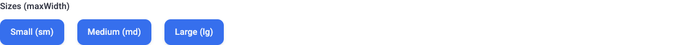
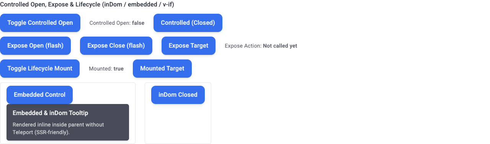
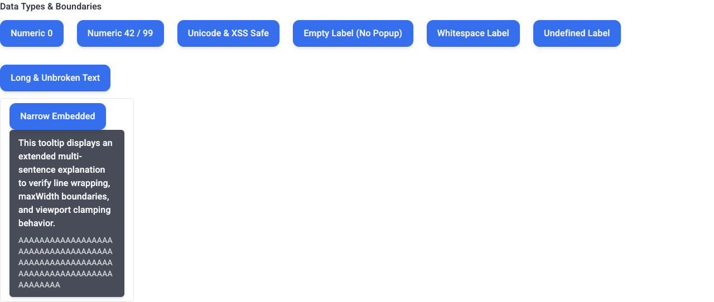
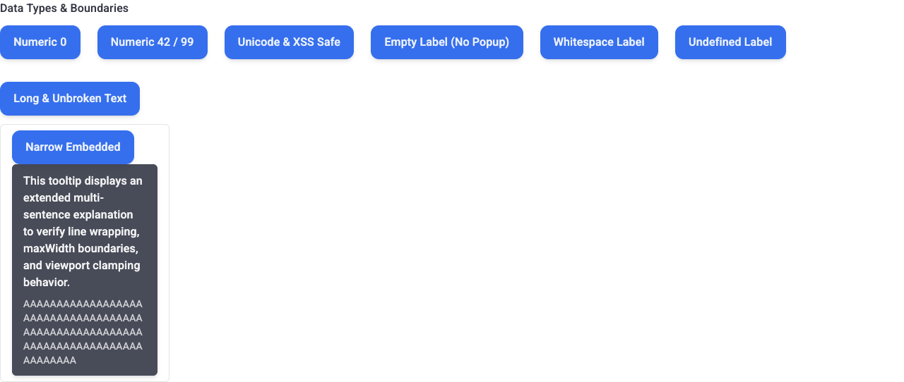

# Отчёт о визуальном и функциональном тестировании: D1Tooltip

## 1. Сводка тестирования

- **Компонент:** `D1Tooltip` (`@dxtmisha/d1`)
- **Исходный код:** [`D1Tooltip`](../../src/components/Ui/Tooltip), [`Tooltip`](../../../constructor/src/constructors/Tooltip)
- **Демо / Целевой URL:** `http://localhost:3000/component-tooltip`
- **Материалы:** `Отсутствуют`
- **Дата тестирования (UTC):** `2026-11-25T08:22:37Z`
- **Окружение:** `Headless Chrome (Puppeteer / CDP, Desktop 1440x900, Tablet 768x1024, Mobile 375x812 / 320x568)`
- **Покрытие тест-кейсов:** 13 / 13 (`100%`)
- **Итог:** **13 ✅, 0 ⚠️, 0 ❌** (`✅` пройдено, `⚠️` предупреждение, `❌` провалено) — компонент `D1Tooltip` успешно рендерится при `ssrStatus: 200`, поддерживает все варианты размещения (`top`/`bottom`), `maxWidth`, все 5 позиций стрелки, `embedded`/`inDom`, управляемое состояние и `expose.toggle()`, граничные сценарии, адаптивный сдвиг на 4 вьюпортах, WAI-ARIA и не порождает ошибок консоли или предупреждений Vue.

---

## 2. Базовая матрица

### 2.1 Визуальный рендеринг (`VIS`)

| ID | Сценарий | Статус | Фактический результат | Скриншот |
| :--- | :--- | :---: | :--- | :--- |
| `TC-VIS-001` | Базовое отображение, `top`-размещение и `label` + `description` | ✅ | Тултип по умолчанию открывается снизу от триггера, `top` добавляет класс `d1-tooltip--top` и располагает окно над контролом, а `.d1-tooltip__label` и `.d1-tooltip__description` рендерятся с дизайн-токенами без обрезания. |  |
| `TC-VIS-002` | Размеры (`maxWidth`: `sm`, `md`, `lg`), стрелка (`arrowShow`, все 5 `arrowPosition`, `arrowAttrs`, `indent`) | ✅ | Пресеты `d1-tooltip--maxWidth--*` (`sm`, `md`, `lg`) масштабируются по возрастанию; при `arrowShow: true` рендерится `.d1-arrow` для всех 5 позиций (`auto`, `top`, `bottom`, `left`, `right`) с `arrowAttrs`, а `indent` задаёт требуемый отступ. |  |
| `TC-VIS-003` | Встроенный режим (`embedded` + `inDom` + `open`) и кастомные слоты (`#default`, `#description`, `#body`) | ✅ | `.d1-tooltip--embedded` рендерится inline внутри родителя без телепортации в `document.body`; `[data-testid="tooltip-indom-closed"]` сохраняется в DOM в закрытом состоянии; слоты `#default`, `#description` и `#body` отображаются корректно. |  |

### 2.2 Интерактивность и управление состоянием (`INT`)

| ID | Сценарий | Статус | Фактический результат | Скриншот |
| :--- | :--- | :---: | :--- | :--- |
| `TC-INT-001` | Управляемое открытие (`:open`) и программный API (`expose.toggle`) | ✅ | Переключение `Toggle Controlled Open` синхронно открывает и закрывает тултип с обновлением подписи кнопки; `Expose Open (flash)` / `Expose Close (flash)` корректно управляют состоянием через `expose.toggle()`. |  |
| `TC-INT-002` | Интерактивный (`interactive: true`), неинтерактивный (`interactive: false`), `disabled` и динамические пропы | ✅ | При `interactive: true` тултип остаётся открытым при наведении курсора на него (`d1-tooltip--move`, `pointer-events: auto`); `Non-interactive` использует `role="tooltip"`; `disabled` блокирует показ; динамические пропы применяются немедленно. | — |
| `TC-INT-003` | Задержка показа и автоскрытие (`delay: 400`, `delayHide: 1200`) | ✅ | Тултип открывается после истечения задержки `delay: 400` и автоматически скрывается после `delayHide: 1200`. | — |
| `TC-INT-004` | Жизненный цикл монтирования/размонтирования (`v-if`) | ✅ | Переключение `v-if` (`beforeLen: 368` -> `unmountedLen: 355` -> `remountedLen: 368`) корректно очищает таймеры, `requestAnimationFrame` и глобальные слушатели без утечек и повторно инициализирует триггер. | — |

### 2.3 Граничные случаи и краевые сценарии (`BND`)

| ID | Сценарий | Статус | Фактический результат | Скриншот |
| :--- | :--- | :---: | :--- | :--- |
| `TC-BND-001` | Числовые значения `0` и `42`/`99`, мультиязычность и XSS-экранирование | ✅ | Числовые значения `0` и `42`/`99` не теряются; кириллица, вьетнамская диакритика и эмодзи отображаются корректно; `` безопасно экранирован как текст (`badImgs: 0`, `dialogs: []`). |  |
| `TC-BND-002` | Пустые и отсутствующие значения (`""`, `"   "`, `undefined`) | ✅ | При взаимодействии с триггерами с пустой строкой, пробелами или `undefined` всплывающий `.d1-tooltip` не создаётся в DOM. | — |
| `TC-BND-003` | Длинный и неразрывный текст в обычном и узком (`240px`) контейнере | ✅ | Внутренний встроенный тултип в `.demo-tooltip-page__narrow` полностью помещается в границы контейнера (`scrollWidth: 238`, `clientWidth: 238`, `overflowsBox: false`, `overflowChildren: []`). |  |

### 2.4 Адаптивность и вьюпорты (`RSP`)

| ID | Сценарий | Статус | Фактический результат | Скриншот |
| :--- | :--- | :---: | :--- | :--- |
| `TC-RSP-001` | Корректное позиционирование и сдвиг внутри вьюпортов (`1440×900`, `768×1024`, `375×812`, `320×568`) | ✅ | На всех 4 вьюпортах (`1440 === 1440`, `768 === 768`, `375 === 375`, `320 === 320`) горизонтальный скролл отсутствует (`overflowX: false`, `offenders: []`), а `--d1-tooltip-sys-shift` удерживает окно в пределах экрана. |  |

### 2.5 Доступность (`A11Y`)

| ID | Сценарий | Статус | Фактический результат | Скриншот |
| :--- | :--- | :---: | :--- | :--- |
| `TC-A11Y-001` | WAI-ARIA атрибуты и клавиатурная доступность (`Tab`, `Enter`, `Space`) | ✅ | Интерактивный триггер задаёт `aria-expanded` и `aria-controls` с `role="region"` / `aria-labelledby` / `aria-describedby` на окне; неинтерактивный использует `aria-describedby` + `role="tooltip"`; навигация `Tab` и активация `Enter`/`Space` работают корректно. | — |

### 2.6 Логи и консоль (`LOG`)

| ID | Сценарий | Статус | Фактический результат | Скриншот |
| :--- | :--- | :---: | :--- | :--- |
| `TC-LOG-001` | Событие `@tooltip` и чистота консоли / отсутствие предупреждений Vue | ✅ | События `tooltip` (`open: true` / `open: false`) доставляются корректно; `consoleErrors: []`, `vueWarnings: []`, `pageErrors: []`, `networkErrors: []`, `dialogs: []`; `ssrStatus: 200`. | — |

---

## 3. AI-аудит и рекомендации

1. **Контейнерная устойчивость и адаптивный сдвиг (`TC-BND-003`, `TC-RSP-001`):** В узком блоке `.demo-tooltip-page__narrow` (`scrollWidth: 238 === clientWidth: 238`, `overflowsBox: false`) и на всех 4 вьюпортах (`1440px`, `768px`, `375px`, `320px`) не зафиксировано ни одного элемента, выходящего за границы экрана (`overflowX: false`, `offenders: []`). Механизм `--d1-tooltip-sys-shift` надёжно предотвращает обрезание на узких экранах.
2. **Ленивая архитектура и чистый жизненный цикл (`TC-INT-004`, `TC-VIS-003`):** Размонтирование и повторное монтирование `v-if` (`beforeLen: 368` -> `unmountedLen: 355` -> `remountedLen: 368`) не оставляют висячих слушателей и таймеров, а при `ssrStatus: 200` компонент не вызывает несоответствий гидратации даже при использовании `inDom` и `embedded`.
3. **Безопасность и чистота рантайма (`TC-BND-001`, `TC-LOG-001`):** Примечательно, что в автоматическом XSS-снимке статического DOM страницы `hasEscapedPayloadText: false`, поскольку XSS-строка передана внутрь всплывающего тултипа (`Unicode & XSS Safe`) и экранируется при его открытии (`badImgs: 0`, `dialogs: []`); на протяжении всего прогона `consoleErrors: []`, `vueWarnings: []`, `pageErrors: []`, `networkErrors: []`.
