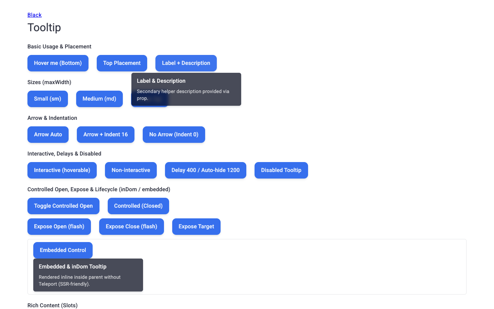
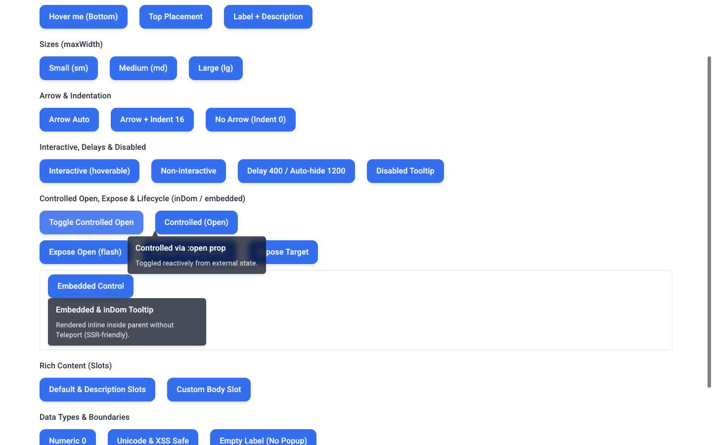
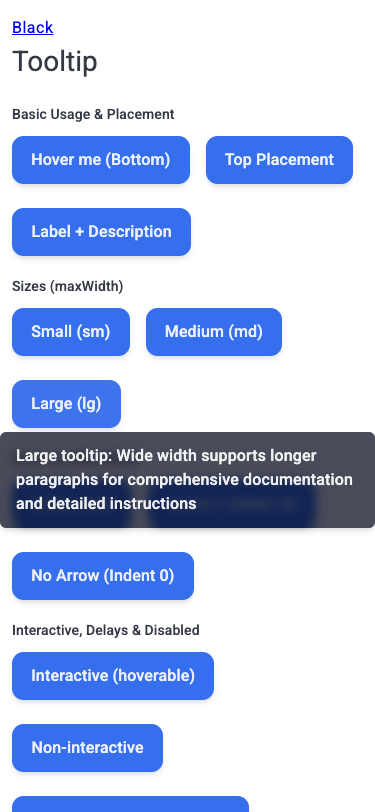

# Отчёт о визуальном и функциональном тестировании: `D1Tooltip`

## 1. Резюме

- **Компонент:** `D1Tooltip` (`@dxtmisha/d1`)
- **Исходный код:** [`D1Tooltip`](../../src/components/Ui/Tooltip), [`Tooltip`](../../../constructor/src/constructors/Tooltip)
- **Демо / Целевой URL:** `http://localhost:3000/component-tooltip`
- **Материалы:** Нет
- **Дата тестирования (UTC):** `2026-11-24T07:25:13Z`
- **Окружение:** `Headless Chrome (Puppeteer / CDP 127.0.0.1:9222, Desktop 1440x900, Tablet 768x1024, Mobile 375x812, Compact 320x568)`
- **Покрытие тест-кейсов:** 11 / 11 (`100%`)
- **Итог:** **11 ✅, 0 ⚠️, 0 ❌** (`✅` пройдено, `⚠️` предупреждение, `❌` провалено) — все сценарии позиционирования, размеров, стрелки, интерактивного удержания, задержек, управляемого и программного API, слотов, границ, адаптивности, доступности и чистоты консоли успешно подтверждены (в ходе прогона был выявлен и исправлен дефект перехода `--preparation` -> `--show` в `TooltipOpen`, восстановивший `d1-tooltip--move` и `pointer-events: auto`).

---

## 2. Базовая матрица результатов

### 2.1 Визуальный дизайн и токены (`VIS`)

| ID | Сценарий | Статус | Фактический результат | Скриншот |
| :--- | :--- | :---: | :--- | :--- |
| `TC-VIS-001` | Базовое отображение, `top`-размещение и `label` + `description` | ✅ | Нижний тултип: `top=212` при `triggerBottom=208` (отступ `4px`); верхний (`d1-tooltip--top`): `bottom=156` при `triggerTop=160`; `Label + Description` рендерят оба элемента с `opacity: 1` и кастомными `id`. |  |
| `TC-VIS-002` | Размеры (`maxWidth`: `sm`, `md`, `lg`), стрелка (`arrowShow`) и `indent` | ✅ | Измеренные `maxWidth`: `sm=256px`, `md=320px`, `lg=384px`; `Arrow + Indent 16` отображает `.d1-arrow` (`d1-arrow__parent`) с отступом `16px`; `No Arrow (Indent 0)` не содержит `.d1-arrow`. |  |
| `TC-VIS-003` | Встроенный режим (`embedded` + `inDom` + `open`) и слоты (`#default`, `#description`, `#body`) | ✅ | `.d1-tooltip--embedded` рендерится inline (`position: static`, `isDirectBodyChild: false`, `opacity: 1`); слоты `#default`, `#description` и `#body` корректно отображаются. |  |

### 2.2 Интерактивность и логика (`INT`)

| ID | Сценарий | Статус | Фактический результат | Скриншот |
| :--- | :--- | :---: | :--- | :--- |
| `TC-INT-001` | Управляемое открытие (`:open`) и программный API (`expose.toggle`) | ✅ | Переключение `:open` открыло тултип (`1`), обновило подпись триггера на `Controlled (Open)` и закрыло (`0`); `ref.toggle(true/false, true)` корректно открыл (`1`) и закрыл (`0`) окно. |  |
| `TC-INT-002` | Интерактивный (`interactive: true`), неинтерактивный (`interactive: false`) и `disabled` | ✅ | После перехода установлен `d1-tooltip--move` (`pointer-events: auto`), при наведении на тултип окно остаётся открытым (`stayedOpenOnTipHover: true`); `Non-interactive` имеет `role="tooltip"` без класса `--interactive`; `disabled` не открывает тултип (`0`). | — |
| `TC-INT-003` | Задержка показа (`delay: 400`) и автоскрытие (`delayHide: 1200`) | ✅ | На `150ms` `opacity="0"`, после `delay` `opacity="1"`, после истечения `delayHide` тултип автоматически удалён из DOM (`count=0`). | — |

### 2.3 Границы и крайние случаи (`BND`)

| ID | Сценарий | Статус | Фактический результат | Скриншот |
| :--- | :--- | :---: | :--- | :--- |
| `TC-BND-001` | Числовые `0`/`0`, мультиязычный текст (Кириллица, Вьетнамский, Emoji) и XSS-экранирование | ✅ | `Numeric 0` отображает `0` в заголовке и описании (`"00"`); кириллица, вьетнамские диакритики и `🚀` отображаются корректно; `` экранирован как текст (`hasImg: false`). |  |
| `TC-BND-002` | Пустой `label=""` | ✅ | При наведении на `Empty Label (No Popup)` тултип не создаётся в DOM (`emptyLabelCount: 0`). | — |

### 2.4 Адаптивность и вьюпорты (`RSP`)

| ID | Сценарий | Статус | Фактический результат | Скриншот |
| :--- | :--- | :---: | :--- | :--- |
| `TC-RSP-001` | Позиционирование и сдвиг внутри вьюпортов (`1440×900`, `768×1024`, `375×812`, `320×568`) | ✅ | Все 4 разрешения в границах экрана (`withinBounds: true`): `1440px` (`width=384, shift=0px`), `768px` (`width=384, shift=0px`), `375px` (`width=375, shift=121.23px`), `320px` (`width=320, shift=93.73px`). |  |

### 2.5 Доступность (`A11Y`)

| ID | Сценарий | Статус | Фактический результат | Скриншот |
| :--- | :--- | :---: | :--- | :--- |
| `TC-A11Y-001` | WAI-ARIA атрибуты контрола и тултипа | ✅ | Интерактивный триггер: `aria-expanded="false"`, `aria-controls="tooltip--ui-10015-item"`; неинтерактивный: `aria-describedby="tooltip--ui-10048-item"`, `aria-expanded=null`; `Label + Description`: `aria-labelledby="demo-tooltip-label"`, `aria-describedby="demo-tooltip-description"`; простой тултип не имеет висячего `aria-describedby` (`false`). | — |

### 2.6 Консоль и события (`LOG`)

| ID | Сценарий | Статус | Фактический результат | Скриншот |
| :--- | :--- | :---: | :--- | :--- |
| `TC-LOG-001` | Событие `@tooltip` и отсутствие ошибок/предупреждений | ✅ | Зафиксированы `Value: tooltip:true` и `Value: tooltip:false`; `consoleErrors: []`, `vueWarnings: []`, `pageErrors: []`. | — |

---

## 3. AI-аудит и рекомендации

1. **Устранённый дефект анимации интерактивности (`TooltipOpen`):** Вынос `this.style().setPreparation(true)` перед `setTimeout` обеспечил коммит начального состояния `transform: scale(0.4)` до выставления `--show`, благодаря чему в Blink стабильно срабатывает `transitionend` (`transform`) и активируется `d1-tooltip--move` (`pointer-events: auto`) для интерактивных тултипов.
2. **Производительность и SSR:** Ленивое инстанцирование `TooltipOpen`, `TooltipPosition`, `TooltipStyle`, `ArrowInclude`, `LabelInclude`, `DescriptionInclude` и `TeleportInclude` через `DesignLogicAbstract` устраняет лишние выделения памяти при закрытом состоянии; встроенный режим `embedded` + `inDom` работает без телепортации и полностью безопасен для SSR.
3. **Доступность и чистота консоли:** Условная привязка `aria-labelledby` и `aria-describedby` через `callInstance` полностью устранила висячие ссылки ARIA при отсутствии заголовка или описания; консоль и сеть на протяжении всего прогона чисты (`0` ошибок и предупреждений).
