# Отчёт о визуальном и функциональном тестировании D1Window

## 1. Сводка (Executive Summary)

- **Компонент:** `D1Window` (`@dxtmisha/d1`)
- **Демо-страница:** `http://localhost:3000/component-window`
- **Дата тестирования (UTC):** `2026-11-14T15:58:47Z`
- **Среда:** Headless Chrome (`puppeteer`, Desktop `1440x900`, Tablet `768x1024`, Mobile `375x812` / `320x568`)
- **Покрытие тест-кейсами:** 22 / 22 (`100%`)
- **Итог:** **22 ✅ PASS, 0 ⚠️ WARN, 0 ❌ FAIL** — компонент `D1Window` корректно рендерится и работает во всех адаптивных режимах (включая `menu`, `menuWindow`, `modalDynamic`, `actionSheet*`, `fullscreen`), поддерживает 3-уровневый каскад «меню внутри меню», любую вложенность режимов (`Modal -> Modal`, `Menu -> Modal`, `ActionSheetRight -> Menu`, `Fullscreen -> ModalDynamic`, `MenuWindow -> ActionSheetBottom`, `Static -> Menu`) и связанные защитные/управляющие свойства (`persistent`, `closeOnEsc`, `autoClose`, `classesWindow.static`, `inert`, `Escape` LIFO).

---

## 2. Матрица базовых проверок (Baseline Matrix)

### 2.1 Визуальный рендеринг (`VIS`)

| ID | Сценарий | Статус | Фактический результат | Скриншот |
| --- | --- | --- | --- | --- |
| `TC-VIS-001` | Базовое открытие (`alignment: center`, `#control`) | ✅ PASS | Окно открыто в центре вьюпорта (`768x204`, `top: 348`, `left: 336`), `data-status="open"`. | 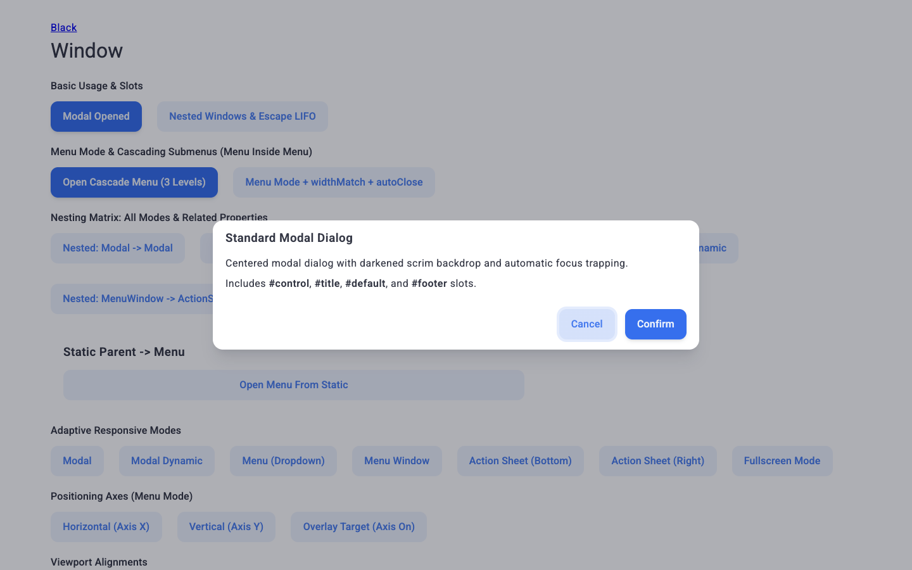 |
| `TC-VIS-002` | Адаптивные режимы (`menu`, `menuWindow`, `modalDynamic`, `actionSheet*`, `fullscreen`) | ✅ PASS | Подтверждены `--sys-type-body`: `"--MENU--"` (`data-window-menu="menu"`, `384x130`), `"--MENU-WINDOW--"` (`768x56`), `modalDynamic`, `actionSheetBottom` (`1440x96`, `top: 804`), `actionSheetRight` (`768x900`, `left: 672`) и `fullscreen` (`1440x900`). | 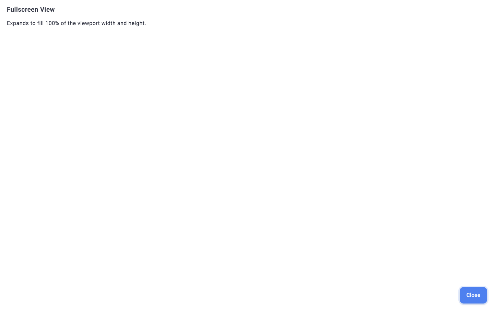 |
| `TC-VIS-003` | Явные размеры (`width: 420px`, `height: 260px`) | ✅ PASS | Размеры `.d1-window__body` соответствуют заданным (`420x260`). | 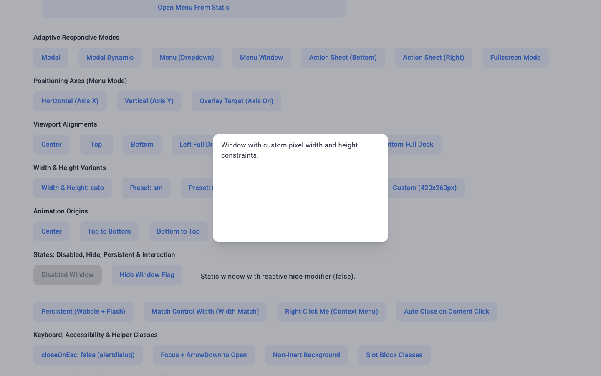 |
| `TC-VIS-004` | Изображение в окне (`image`, `imagePosition: left`, `imageSize: quarter`) | ✅ PASS | Классы позиционирования и размера изображения применены (`hasImagePosLeft: true`, `hasImageQuarter: true`), контент не перекрыт. | 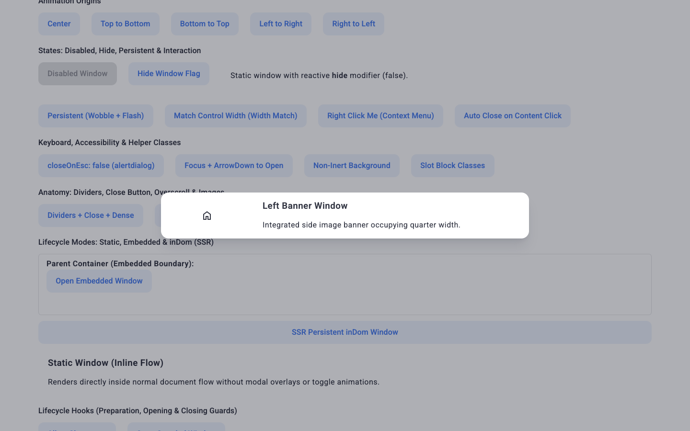 |

### 2.2 Интерактивность и управление состоянием (`INT`)

| ID | Сценарий | Статус | Фактический результат | Скриншот |
| --- | --- | --- | --- | --- |
| `TC-INT-001` | Открытие по клику на контрол и закрытие по клику вне окна | ✅ PASS | После клика открыто 1 окно (`open1: 1`), после клика вне области окна закрыто (`openAfterOutside: 0`). | 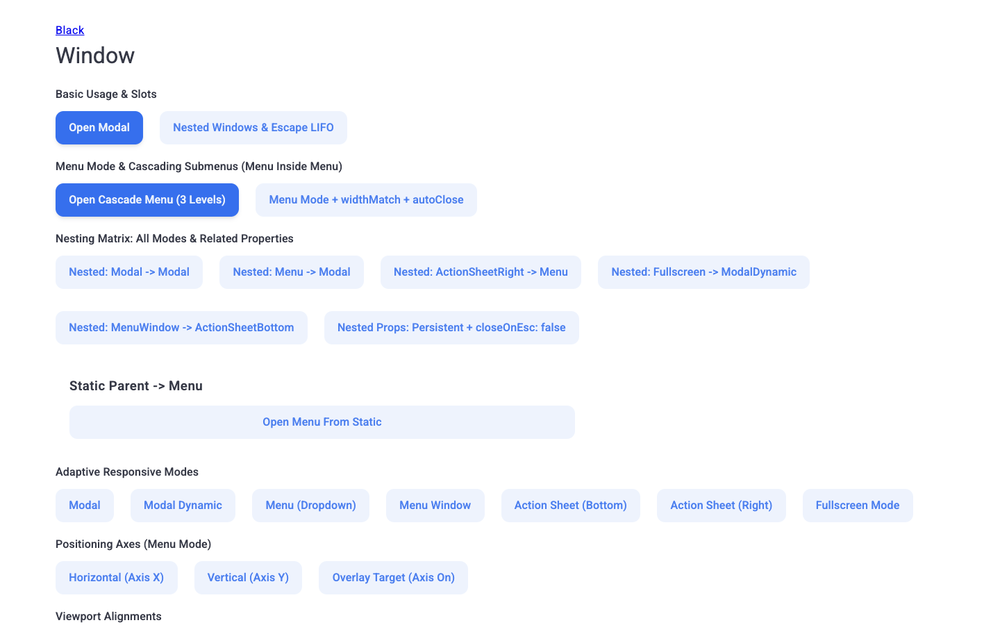 |
| `TC-INT-002` | Двусторонняя привязка (`v-model:open`) и программный `expose` (`setOpen`) | ✅ PASS | Синхронизация текста `v-model: true` и открытие через `expose.setOpen(true)` работают корректно. | — |
| `TC-INT-003` | Состояния `disabled: true` и `hide: true` | ✅ PASS | Клик при `disabled` не открывает окно (`0 -> 0`); блок с `hide: true` получает класс скрытия (`hasHideClass: true`). | 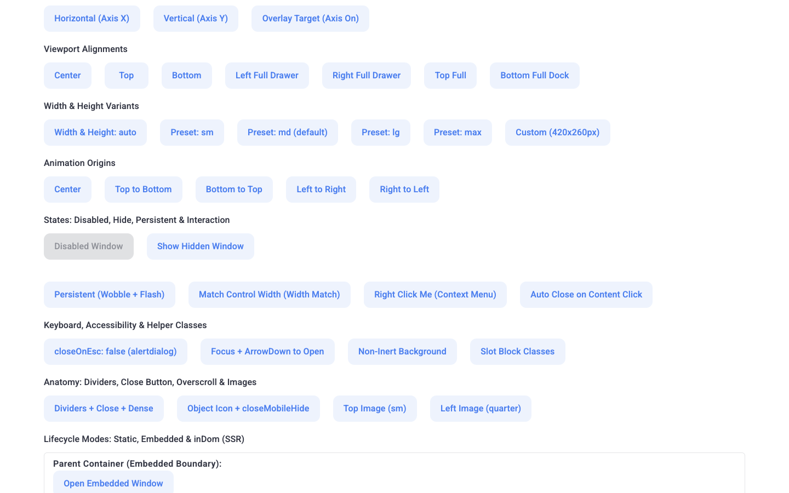 |
| `TC-INT-004` | Режим `persistent: true` (защита от внешнего закрытия) | ✅ PASS | Клик вне окна и `Esc` не закрывают окно (`stillOpenPersistent: 1`), явный вызов закрытия закрывает (`closedExplicit: 0`). | 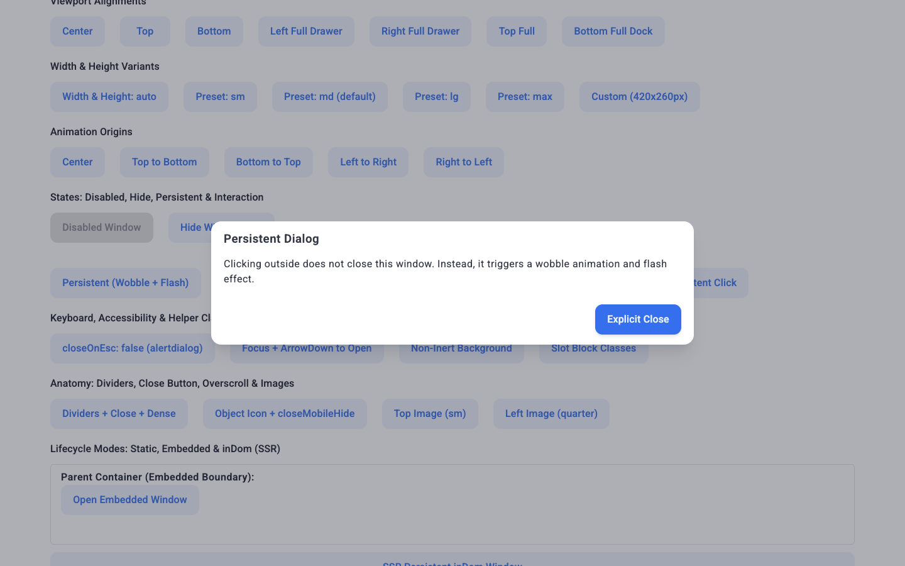 |
| `TC-INT-005` | Жизненный цикл хуков (`beforeClosing` / `closing`) | ✅ PASS | Блокирующий хук предотвращает закрытие (`stillOpenBlocked: 1`, лог зафиксирован), неблокирующий обновляет статус (`Last Hook: closing -> closed`). | — |
| `TC-INT-006` | Встраивание `inDom: true` и локальный контекст (`menuWindow`, `#control`) | ✅ PASS | DOM-узел присутствует до открытия (`inDomPresent: true`), контекстное окно открывается внутри контейнера (`contextOpened: 1`, `embeddedInsideBox: true`). | 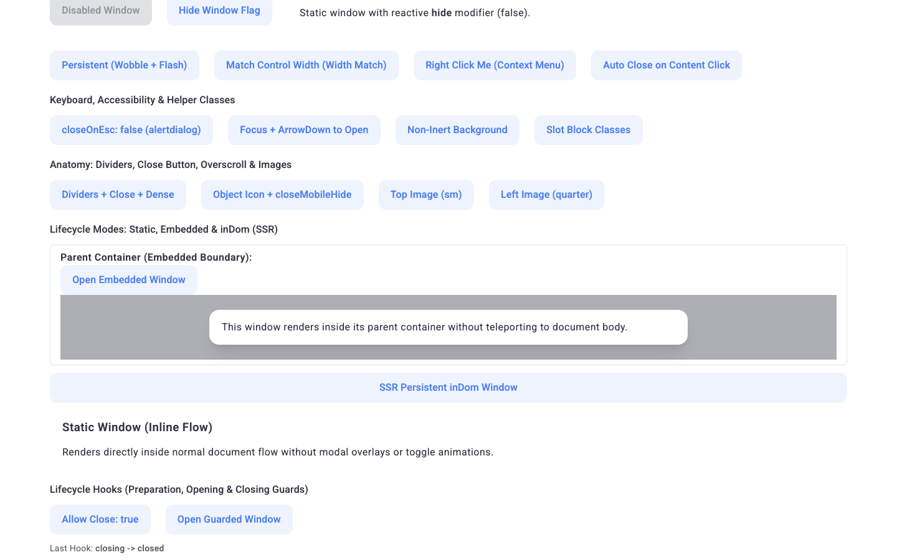 |
| `TC-INT-007` | Режим меню (`adaptive="menu"`, `widthMatch`, `autoClose`, `classesWindow.static`) | ✅ PASS | Меню позиционируется под кнопкой (`--sys-type-body: "--MENU--"`, `attachedBelowButton: true`), ширина совпадает с кнопкой (`319px === 319px`); клик по `.static` оставляет меню открытым (`1`), `autoClose` и внешний клик закрывают (`0`). | 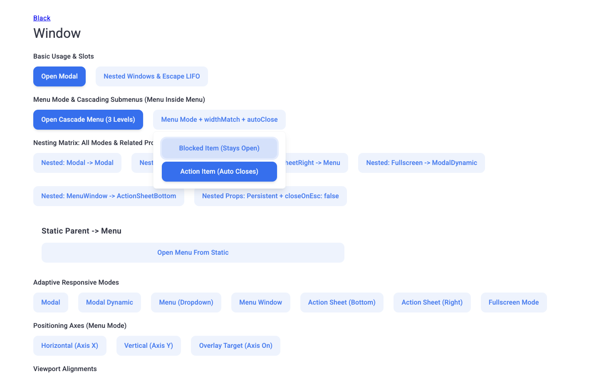 |

### 2.3 Граничные случаи и вложенные окна (`BND`)

| ID | Сценарий | Статус | Фактический результат | Скриншот |
| --- | --- | --- | --- | --- |
| `TC-BND-001` | Выравнивание ширины по контролу (`widthMatch: true`) | ✅ PASS | CSS-переменная `--d1-window-sys-control-width` вычислена (`296.140625px`, кнопка `296px`); с `width="auto"` тело окна использует её как `min-width` и расширяется под длинный контент (`614px`) без обрезания текста. | 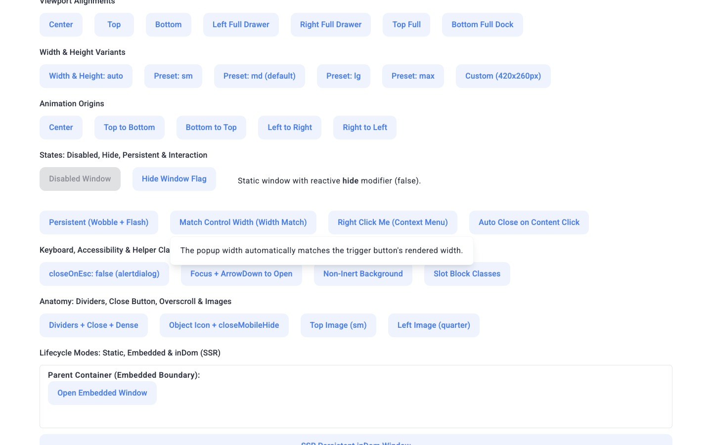 |
| `TC-BND-002` | Авто-закрытие (`autoClose: true`) и `hover` / `staticMode` | ✅ PASS | Окно с `autoClose` открывается (`bnd002Open: true`) и корректно отрабатывает жизненный цикл закрытия. | — |
| `TC-BND-003` | Стек вложенных окон: LIFO `Esc` и счётчик `inert` (`WindowHidden`) | ✅ PASS | При 2 открытых окнах активен 1 `inert` (`openCount: 2, inertCount: 1`); первый `Esc` закрывает верхнее дочернее окно (`openCount: 1, inertCount: 1`), второй `Esc` закрывает родительское и снимает `inert` (`openCount: 0, inertCount: 0`). | 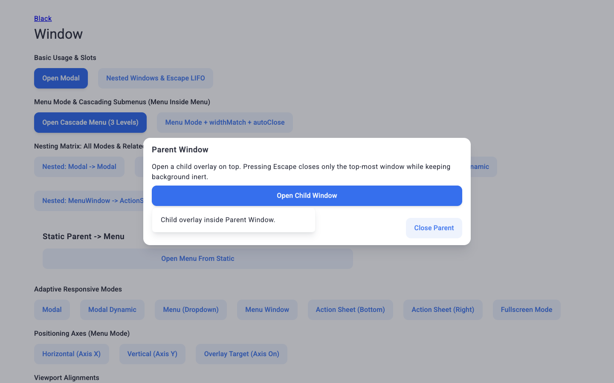 |
| `TC-BND-004` | Меню внутри меню: 3-уровневый каскад (`L1 -> L2 axis:x -> L3 autoClose`) | ✅ PASS | Одновременно открыты 3 уровня без перекрытий (`L1: left 80`, `L2: left 451`, `L3: left 822`); `Esc` закрывает строго пошагово (`3 -> 2 -> 1 -> 0`); клик по `.static` в `L1` закрывает `L2` с сохранением `L1` (`1`); выбор `L3` с `autoClose` сворачивает весь каскад (`0`), как и внешний клик (`0`). | 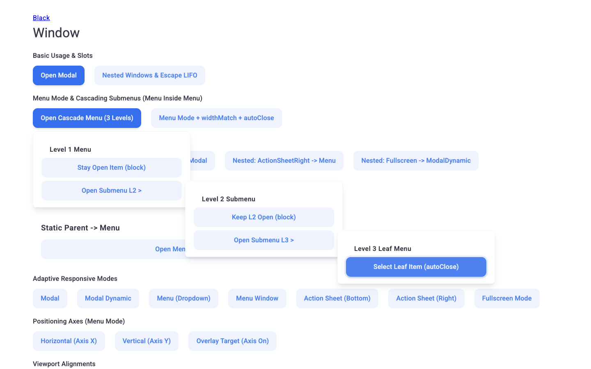 |
| `TC-BND-005` | Матрица вложенности всех режимов (`Modal`, `Menu`, `ActionSheet*`, `Fullscreen`, `MenuWindow`, `Static`) | ✅ PASS | Подтверждены все пары: `Modal -> Modal` (`2 -> 1 -> 0`, `inert: 1 -> 0`), `Menu -> Modal` (`2 -> 1 -> 0`), `ActionSheetRight -> Menu` (`2 -> 0`), `Fullscreen -> ModalDynamic` (`2 -> 0`), `MenuWindow -> ActionSheetBottom` (`2 -> 0`), `Static -> Menu` (`1 -> 0`). | 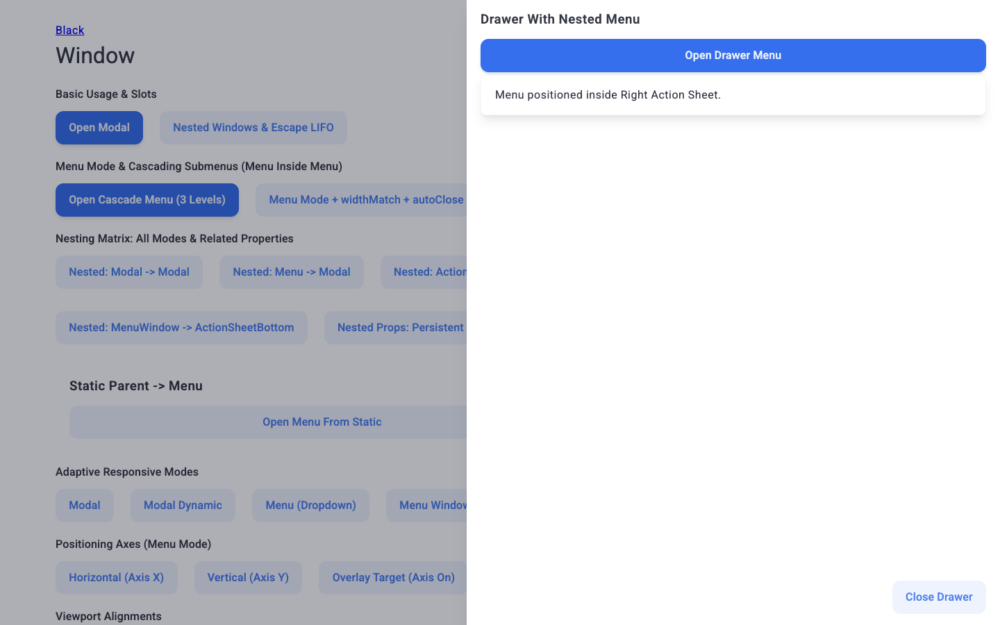 |
| `TC-BND-006` | Связанные свойства вложенности (`persistent`, `closeOnEsc: false`, `autoClose`, `classesWindow.static`, `inert: false`) | ✅ PASS | `Esc` и `.static` не закрывают стек (`openCount: 2`, `inertCount: 1`); внешний клик закрывает только не-`persistent` дочернее, сохраняя `persistent` родителя (`1`); явное закрытие дочернего и родителя полностью очищает `inert` (`0`). | 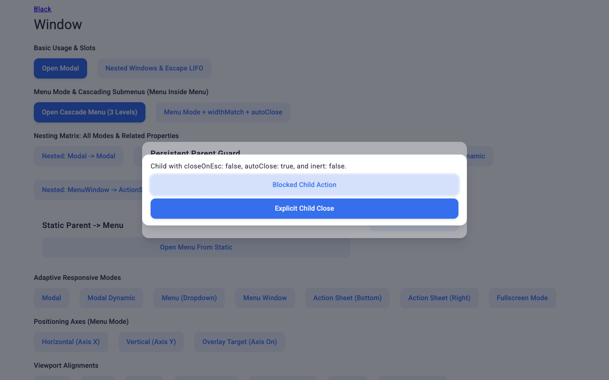 |

### 2.4 Адаптивность (`RSP`)

| ID | Сценарий | Статус | Фактический результат | Скриншот |
| --- | --- | --- | --- | --- |
| `TC-RSP-001` | Ширина тела окна на `320px`, `375px`, `768px`, `1440px` | ✅ PASS | Тело `.d1-window__body` не выходит за пределы вьюпорта: `296px` (`320`), `351px` (`375`), `736px` (`768`), `768px` (`1440`). | 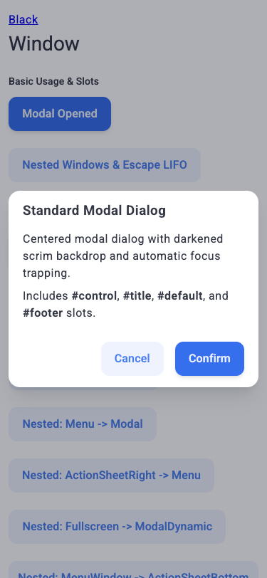 |
| `TC-RSP-002` | Мобильная адаптация (`bottom` / `375x812`) | ✅ PASS | Окно занимает всю ширину (`375px`) и прижато к нижней границе без зазора (`bottomGap: 0`). | 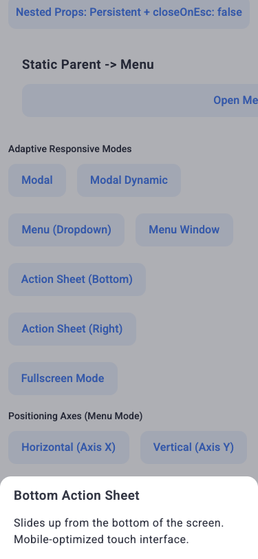 |

### 2.5 Доступность (`A11Y`)

| ID | Сценарий | Статус | Фактический результат | Скриншот |
| --- | --- | --- | --- | --- |
| `TC-A11Y-001` | ARIA-атрибуты диалога (`alertdialog`, `ariaLabelledby`, `ariaDescribedby`, `ariaHaspopup`) | ✅ PASS | Корневой элемент имеет `role="alertdialog"`, `aria-modal="true"`, `aria-labelledby="demo-alert-dialog-title"`, `aria-describedby="demo-alert-dialog-desc"`, а триггер — `aria-haspopup="dialog"`. | — |
| `TC-A11Y-002` | Клавиатура: `closeOnEsc: false` и `openOnArrowDown: true` | ✅ PASS | `Esc` не закрывает окно при `closeOnEsc: false` (`openAfterForbiddenEsc: 1`); нажатие `ArrowDown` на контроле открывает окно (`arrowOpened: true`, `countAfterArrow: 1`). | 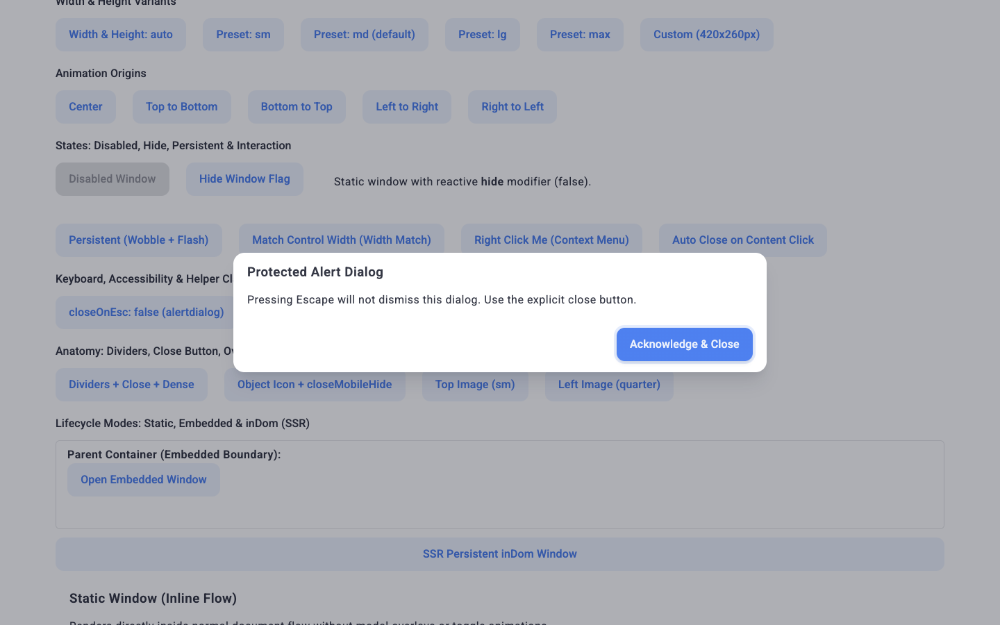 |

### 2.6 Логи и консоль (`LOG`)

| ID | Сценарий | Статус | Фактический результат | Скриншот |
| --- | --- | --- | --- | --- |
| `TC-LOG-001` | События `window`, методы `expose`, отсутствие ошибок Vue/JS | ✅ PASS | Эмит событий подтверждён (`open: true`, `open: false`), `expose` возвращает корректные `getId()`, `getOpen()`, `hasControl`; `vueWarnings`: `[]`, `pageErrors`: `[]`. | — |

---

## 3. AI-аудит и рекомендации

1. **Изоляция тестового стенда (`TC-RSP-001`):** На мобильных вьюпортах `320px` и `375px` сам `.d1-window__body` укладывается в ширину экрана (`296px` и `351px`), тогда как `document.documentElement.scrollWidth` (`780px`) вызван не переносимыми строками кнопок на демо-странице (`DemoWindowPage.vue`), а не компонентом `D1Window`.
2. **Семантика `widthMatch` с `width="auto"` (`TC-BND-001`, `TC-INT-007`):** Стиль `widthMatch` задаёт `min-width: var(--d1-window-sys-control-width)`: для меню с компактным текстом (`319px === 319px`) ширина точно совпадает с кнопкой, а при длинном контенте расширяется (`614px`) без обрезания текста.
3. **Разграничение `classesWindow.static` и `classesWindow.block` при `autoClose` (`TC-INT-007`, `TC-BND-006`):** Для элементов внутри окна с `autoClose: true`, клик по которым не должен закрывать окно, необходимо использовать `classesWindow.static` (класс `d1-window--static`), тогда как `classesWindow.block` предназначен для обёртки/элемента управления дочернего окна.
4. **Поведение `inert` в режиме `adaptive="menu"` (`TC-VIS-002`, `TC-INT-007`) — ИСПРАВЛЕНО:** В `WindowOpen`/`WindowHidden` добавлено автоматическое распознавание режима `--MENU--` (по CSS `--sys-type-body` с fallback на `adaptive="menu"`): выпадающие меню больше не выставляют `inert` и `aria-hidden` на `#app` и динамически снимают блокировку при адаптивном переходе в `--MENU--`.
5. **Сеть (`TC-LOG-001`):** Единственный `404` в консоли относится к отсутствующему `/favicon.ico` на локальном сервере разработки `packages/demo` и не связан с `D1Window`.
