# Отчёт о визуальном и функциональном тестировании: D1Window

## 1. Сводка (Executive Summary)

- **Компонент:** `D1Window` (`@dxtmisha/d1`)
- **Исходный код:** [`Window`](../../src/components/Ui/Window) / [`Window`](../../../constructor/src/constructors/Window)
- **Демо / целевой URL:** `http://localhost:3000/component-window`
- **Материалы:** `Отсутствуют`
- **Дата тестирования (UTC):** `2026-11-18T01:58:30Z`
- **Среда:** `Headless Chrome (puppeteer / CDP, Chrome/157.0.8103.79, Desktop 1440x900, Tablet 768x1024, Mobile 375x812 / 320x568)`
- **Покрытие тест-кейсами:** 24 / 24 (`100%`)
- **Итог:** **24 ✅, 0 ⚠️, 0 ❌** (`✅` пройдено, `⚠️` предупреждение, `❌` провалено) — компонент `D1Window` корректно рендерится и работает во всех адаптивных режимах (`modal`, `menu`, `actionSheetBottom`, др.), поддерживает вложенные окна и каскады меню с LIFO `Escape`, отключение возврата фокуса (`disableFocusReturn`), семантику `role="menu"` / `ariaHaspopup="menu"` без `inert` на фоне, и не вызывает ошибок консоли или предупреждений Vue.

---

## 2. Матрица базовых проверок (Baseline Matrix)

### 2.1 Визуальный рендеринг (`VIS`)

| ID | Сценарий | Статус | Фактический результат | Скриншот |
| :--- | :--- | :---: | :--- | :--- |
| `TC-VIS-001` | Базовый рендеринг модального окна (`#control`, `#title`, `#default`, `#footer`) | ✅ | Окно открыто по центру (`768x204`, `top: 348`, `left: 336`), `data-status="open"`, `role="dialog"`, `aria-modal="true"`, `inertCount: 1`. | 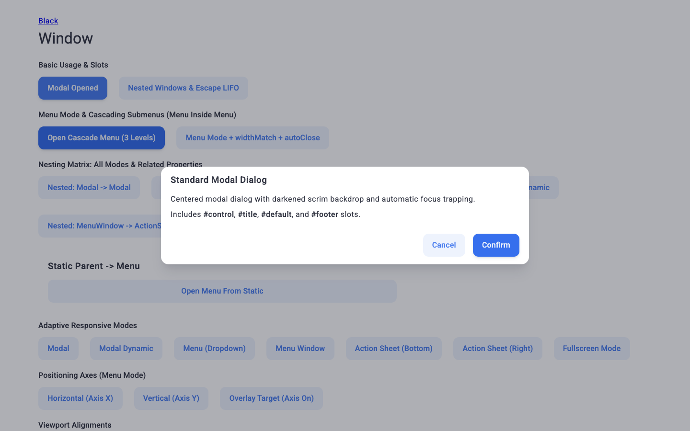 |
| `TC-VIS-002` | Адаптивные режимы (`menu`, `actionSheetBottom` и др.) | ✅ | Для `adaptive="menu"` подтверждены `--sys-type-body: "--MENU--"`, `data-window-menu="menu"`, `inertCount: 0`, размер `384x130` (`top: 478, left: 363`); для `actionSheetBottom` — `1440x96`, `top: 804`, `bottom: 900`, `inertCount: 1`. | 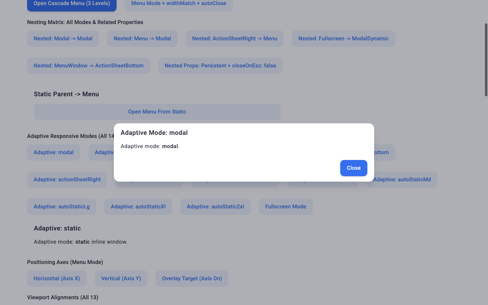 |
| `TC-VIS-003` | Выравнивание и явные размеры (`width: 420px`, `height: 260px`) | ✅ | Контейнер `.d1-window__body` получил классы `d1-window--width--custom` / `d1-window--height--custom` и точные размеры `420x260` (`top: 320, left: 510`). |  |
| `TC-VIS-004` | Анатомия и изображение (`imagePosition="left"`, `imageSize="quarter"`) | ✅ | Применены классы `d1-window--imagePosition--left` и `d1-window--imageSize--quarter`, размер `768x96` (`top: 402, left: 336`), контент не перекрыт. | 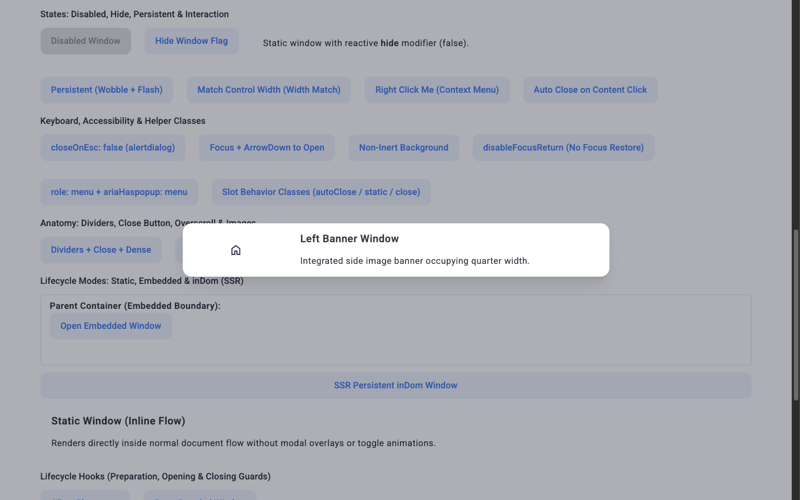 |

### 2.2 Интерактивность и управление состоянием (`INT`)

| ID | Сценарий | Статус | Фактический результат | Скриншот |
| :--- | :--- | :---: | :--- | :--- |
| `TC-INT-001` | Открытие по `#control`, закрытие по кнопке `Cancel` и внешнему клику | ✅ | После клика открыто 1 окно (`1`), после клика `Cancel` закрыто (`0`), после повторного открытия и клика вне области окна закрыто (`0`). |  |
| `TC-INT-002` | Двусторонняя привязка `v-model:open` и методы `Expose` (`toOpen` / `toClose`) | ✅ | Переключение `Open via State` / `Close via v-model` синхронизирует `Value: true` / `Value: false`; вызовы `toOpen()` и `toClose()` открывают (`1`) и закрывают (`0`) окно. | — |
| `TC-INT-003` | Состояния `disabled` и реактивный модификатор `hide` | ✅ | Клик по `Disabled Window` не открывает окно (`0`); переключение `Hide Window Flag` добавляет класс `.d1-window--hide` (`1`). | 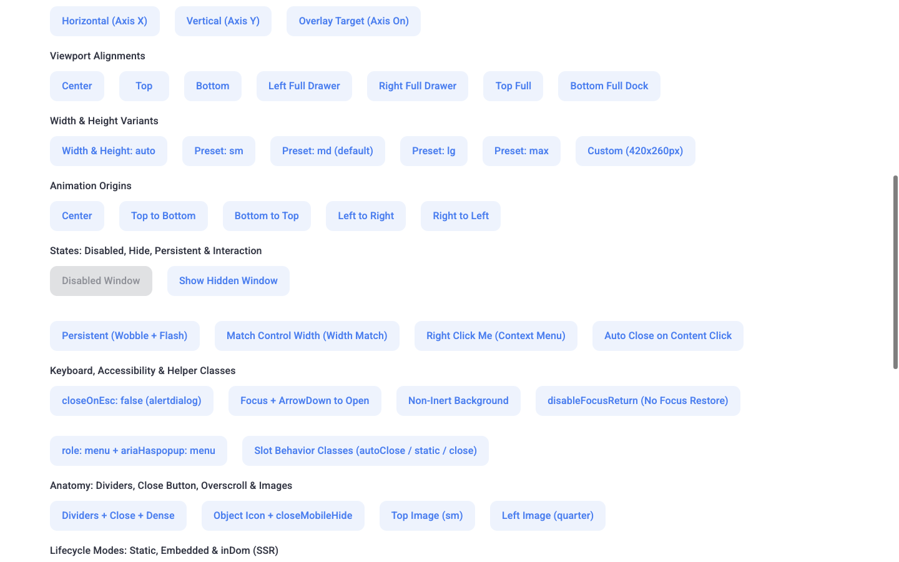 |
| `TC-INT-004` | Режим `persistent` + `flash` | ✅ | Открытое окно имеет `data-status="flash"`; клик вне окна оставляет его открытым (`flash`), а нажатие `Explicit Close` закрывает (`0`). | 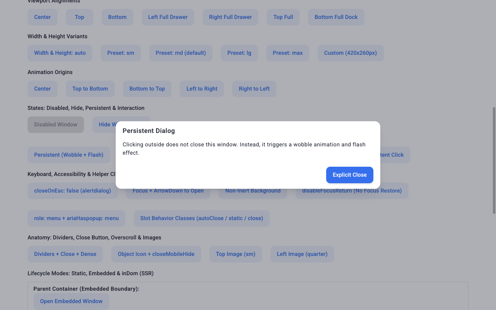 |
| `TC-INT-005` | Жизненный цикл хуков (`opening`, `beforeClosing`, `closing`) | ✅ | При `Allow Close = false` статус обновляется в `opening`, `Try Close` блокируется (`open: 1`, `Last Hook: beforeClosing -> blocked (Allow Close = false)`); после `Allow & Close` + `Try Close` окно закрывается (`open: 0`, `Last Hook: closing -> closed`). | — |
| `TC-INT-006` | `contextmenu`, `embedded` и `inDom` | ✅ | Правый клик по `Right Click Me (Context Menu)` открывает окно (`1`); `embedded` рендерится внутри `.demo-box` (`isInBody: false`); содержимое `inDom` остаётся в DOM после первого открытия и закрытия (`inDomPersists: true`). |  |
| `TC-INT-007` | Режим меню (`adaptive="menu"`, `widthMatch`, `autoClose`, `classesWindow.static`) | ✅ | Ширина меню совпадает с триггером (`319px` при `--d1-window-sys-control-width: 318.6875px`), `inertCount: 0`; клик по `.d1-window--static` оставляет меню открытым (`1`), клик по элементу действия закрывает его (`0`). |  |
| `TC-INT-008` | Отключение возврата фокуса (`disableFocusReturn`) | ✅ | В стандартном `Open Modal` после закрытия кнопкой `Cancel` фокус возвращается на кнопку `Open Modal`; в окне с `disableFocusReturn` после закрытия кнопкой `Close` фокус не возвращается на триггер (`document.activeElement.tagName === 'BODY'`). | 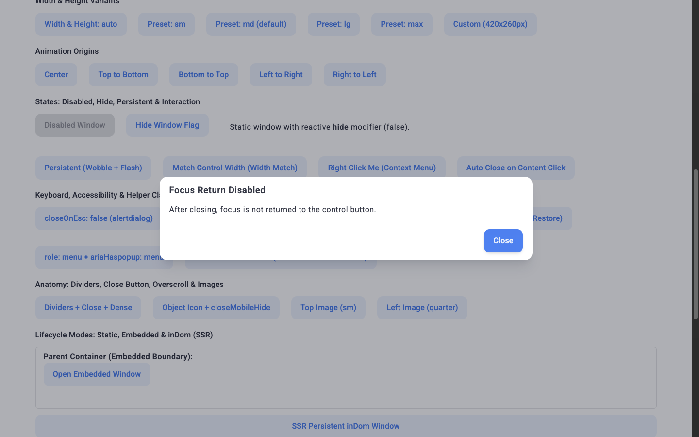 |

### 2.3 Граничные случаи и вложенные окна (`BND`)

| ID | Сценарий | Статус | Фактический результат | Скриншот |
| :--- | :--- | :---: | :--- | :--- |
| `TC-BND-001` | Осевое позиционирование и `widthMatch` с `width="auto"` | ✅ | Переменная `--d1-window-sys-control-width` равна `296.140625px`; тело окна расширяется под длинный контент (`614x58`, `top: 478, left: 344`) без обрезания. | 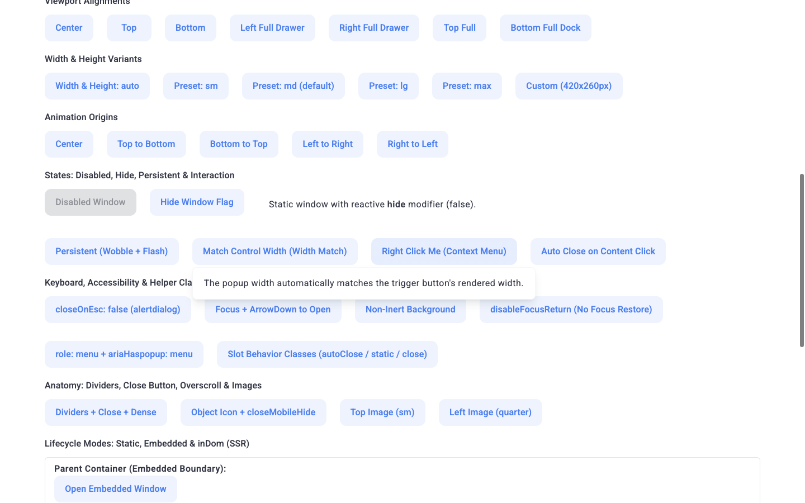 |
| `TC-BND-002` | Гонка быстрого переключения (`toOpen` -> `toClose` -> `toOpen`) | ✅ | После синхронной серии вызовов и выдержки `550ms` окно остаётся открытым (`open: 1`, `inert: 1`) без ложного закрытия устаревшим таймером. | 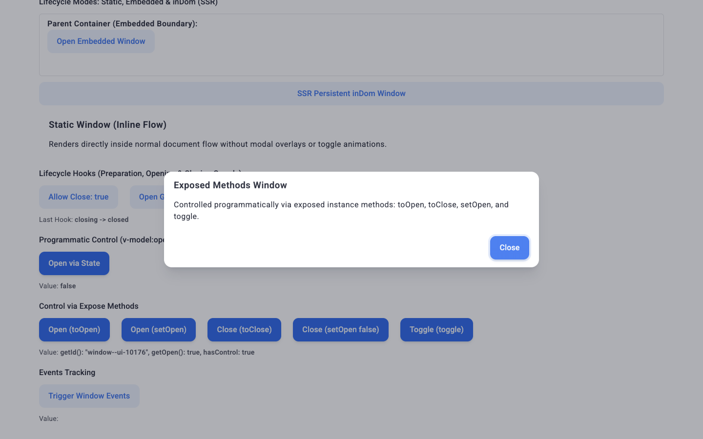 |
| `TC-BND-003` | Стек вложенных окон: LIFO `Escape` и счётчик `inert` (`WeakMap`) | ✅ | При 2 открытых окнах активен 1 `inert` (`open: 2, inert: 1`); первый `Escape` закрывает дочернее с сохранением `inert` (`open: 1, inert: 1`); второй `Escape` закрывает родителя и снимает `inert` (`open: 0, inert: 0`). |  |
| `TC-BND-004` | Меню внутри меню: 3-уровневый каскад (`L1 -> L2 axis:x -> L3 autoClose`) | ✅ | Все 3 уровня открыты без перекрытий (`left: 80`, `left: 451`, `left: 822`), `inert: 0`; `Escape` закрывает уровни строго в порядке LIFO (`3 -> 2 -> 1 -> 0`). | 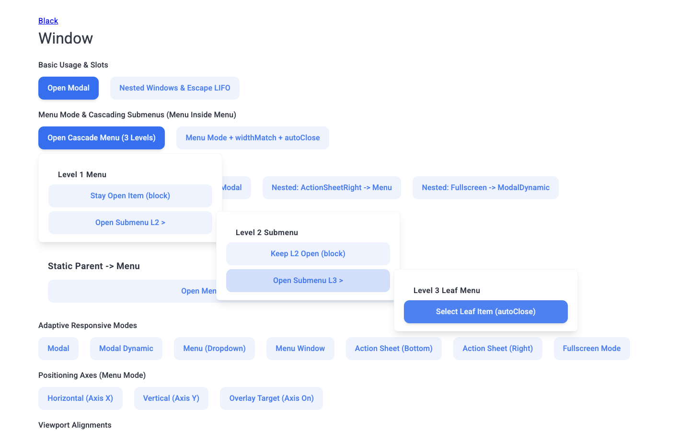 |
| `TC-BND-005` | Матрица вложенности режимов (`Modal -> Modal` и др.) | ✅ | Для `Nested: Modal -> Modal` оба уровня открываются (`open: 2, inert: 1`) и пошагово закрываются по `Escape` (`2 -> 1 -> 0`, `inert: 0`). |  |
| `TC-BND-006` | Связанные свойства вложенности (`persistent`, `closeOnEsc: false`, `autoClose`) | ✅ | `Escape` сохраняет оба окна открытыми (`2`); внешний клик закрывает только не-`persistent` дочернее, сохраняя `persistent` родителя (`1`); явное закрытие родителя снимает `inert` (`0`). | 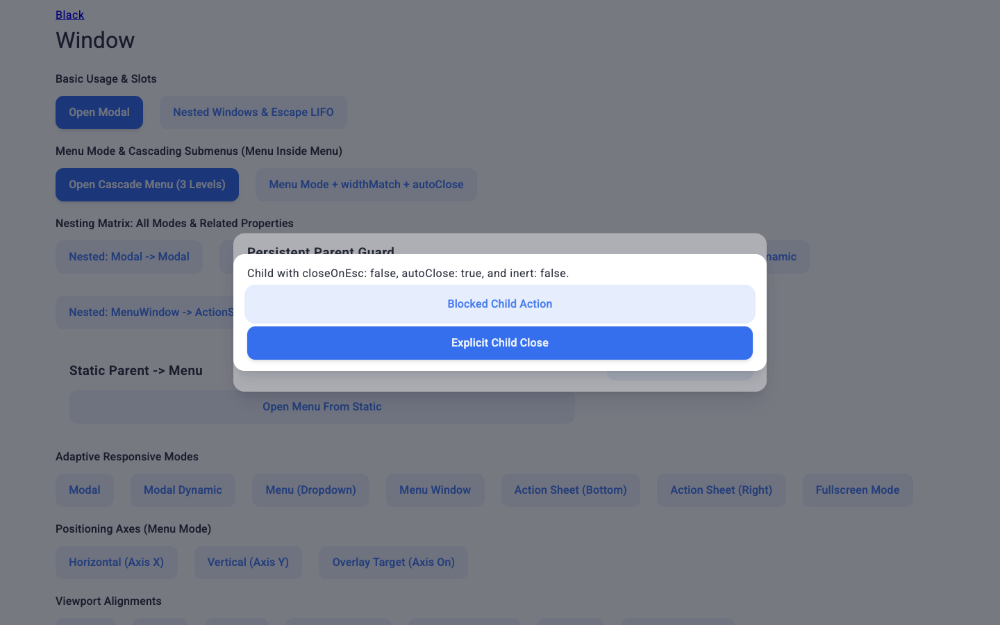 |

### 2.4 Адаптивность (`RSP`)

| ID | Сценарий | Статус | Фактический результат | Скриншот |
| :--- | :--- | :---: | :--- | :--- |
| `TC-RSP-001` | Ширина тела модального окна на `320px`, `375px`, `768px`, `1440px` | ✅ | Ширина `.d1-window__body` помещается в каждый вьюпорт: `296px` (`320`), `351px` (`375`), `736px` (`768`), `768px` (`1440`). |  |
| `TC-RSP-002` | Мобильное отображение `Action Sheet (Bottom)` на `375×812` | ✅ | Панель прижата к нижней границе экрана и занимает всю ширину мобильного вьюпорта (`375x120`, `top: 692, left: 0`). |  |

### 2.5 Доступность (`A11Y`)

| ID | Сценарий | Статус | Фактический результат | Скриншот |
| :--- | :--- | :---: | :--- | :--- |
| `TC-A11Y-001` | WAI-ARIA атрибуты (`alertdialog`, `ariaLabelledby`, `ariaDescribedby`, `ariaHaspopup`) | ✅ | Кнопка-триггер имеет `aria-haspopup="dialog"`; открытое окно имеет `role="alertdialog"`, `aria-modal="true"`, `aria-labelledby="demo-alert-dialog-title"`, `aria-describedby="demo-alert-dialog-desc"`. | — |
| `TC-A11Y-002` | Клавиатура: `closeOnEsc: false` и `openOnArrowDown` | ✅ | `Escape` не закрывает окно с `closeOnEsc: false` (`open: 1`); нажатие `ArrowDown` на сфокусированной кнопке `Focus + ArrowDown to Open` открывает меню (`open: 1`). | 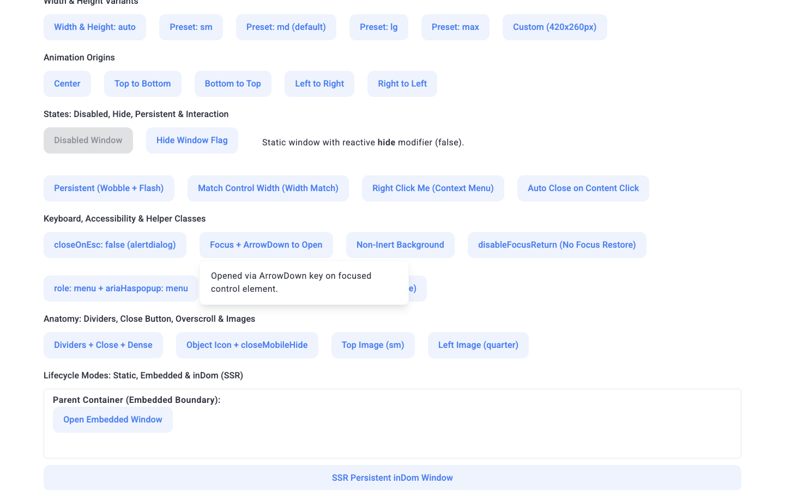 |
| `TC-A11Y-003` | Семантика меню (`role="menu"` + `ariaHaspopup="menu"`) | ✅ | Кнопка-триггер имеет `aria-haspopup="menu"`; открытое окно имеет `role="menu"`, `data-window-menu="menu"`, `--sys-type-body: "--MENU--"`, а фон остаётся интерактивным (`inertCount: 0`). | 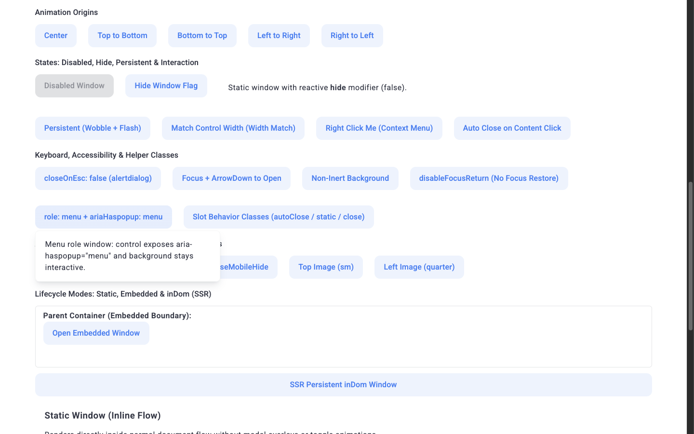 |

### 2.6 Логи и консоль (`LOG`)

| ID | Сценарий | Статус | Фактический результат | Скриншот |
| :--- | :--- | :---: | :--- | :--- |
| `TC-LOG-001` | События `@window`, консоль браузера и предупреждения Vue | ✅ | Зафиксированы логи `Event: window id: window--ui-10180, open: true` и `open: false` и `Value: window`; `consoleErrors: []`, `vueWarnings: []`, `pageErrors: []`. | — |

---

## 3. AI-аудит и рекомендации

1. **Повторная проверка возврата фокуса (`TC-INT-008`) и роли `menu` (`TC-A11Y-003`):** В обоих новых сценариях поведение полностью соответствует контракту `Window`: `disableFocusReturn` предотвращает возврат фокуса на кнопку-триггер после закрытия (в отличие от стандартного модального окна, где фокус возвращается на `Open Modal`), а `role="menu"` в сочетании с `adaptive="menu"` сохраняет интерактивный фон (`inertCount: 0`).
2. **Семантика статуса `flash` при `persistent` (`TC-INT-004`):** При включённом `flash` открытое persistent-окно выставляет `data-status="flash"` вместо `data-status="open"`, поэтому внешние E2E/DOM-селекторы не должны опираться только на `[data-status="open"]` при тестировании persistent-сценариев.
3. **Сеть и консоль (`TC-LOG-001`):** Во время полного прогона интерактивных сценариев отсутствуют ошибки JS (`pageErrors: []`), ошибки консоли и предупреждения Vue (`vueWarnings: []`).
