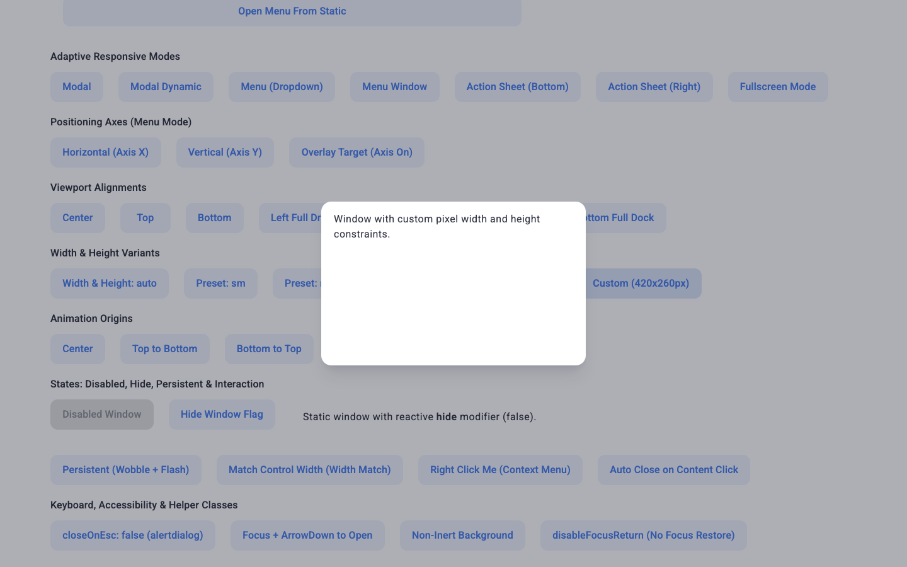
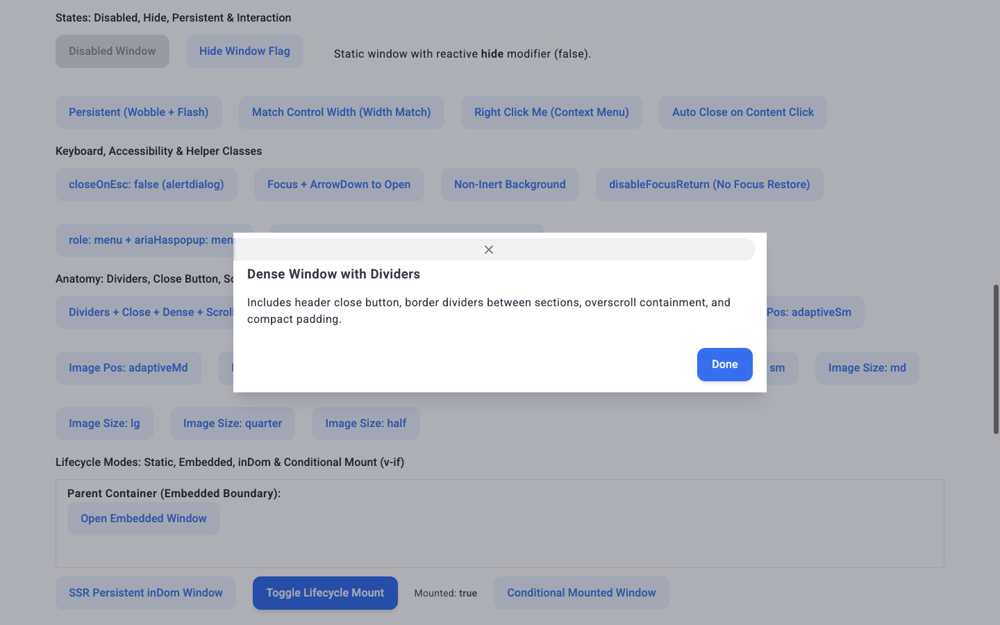
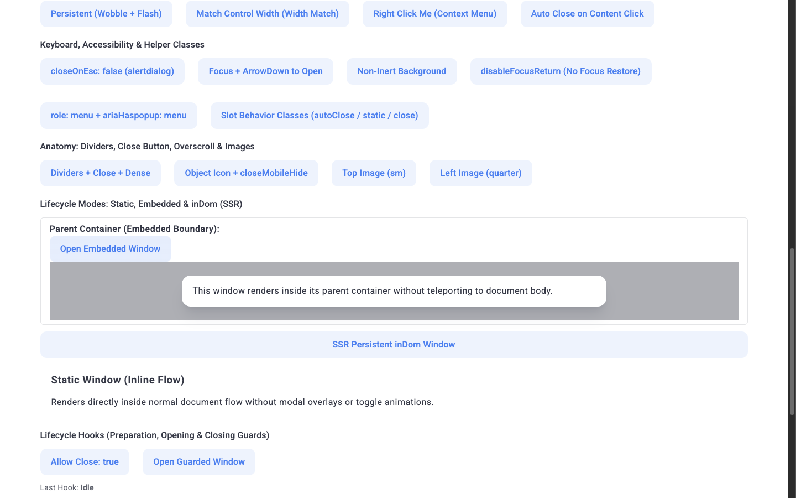
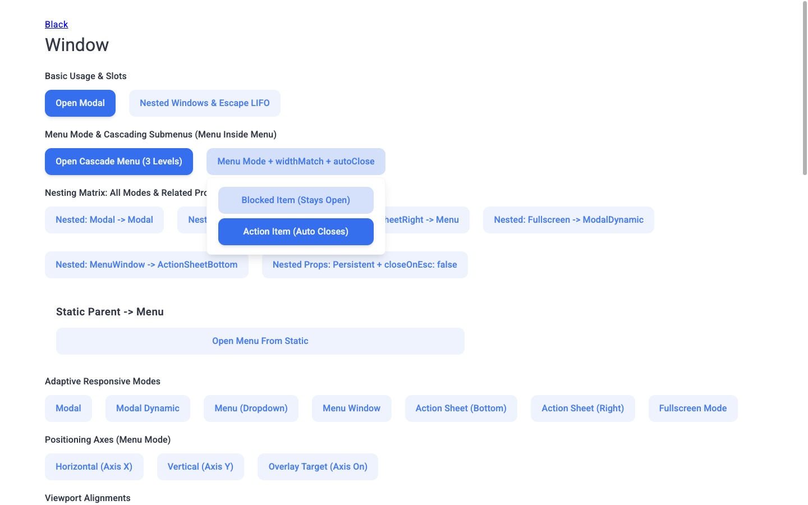
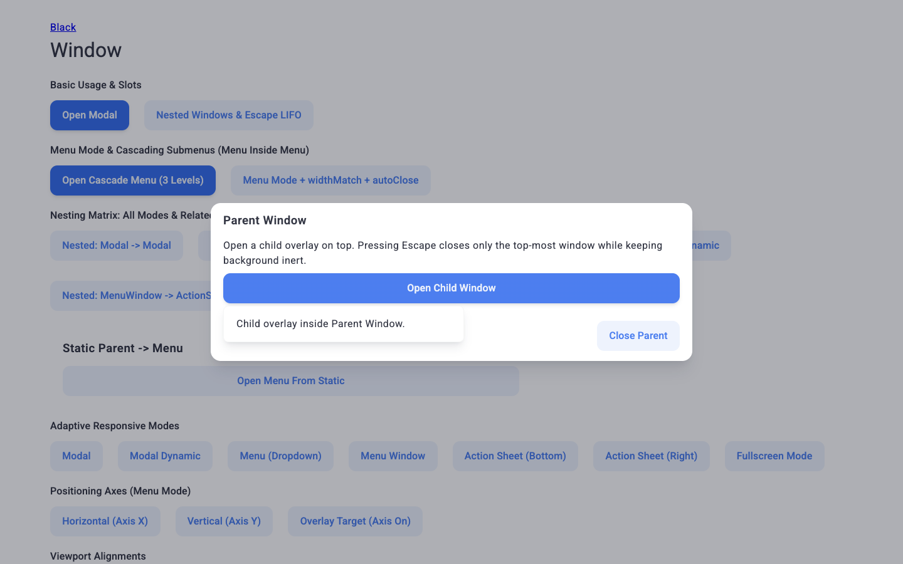
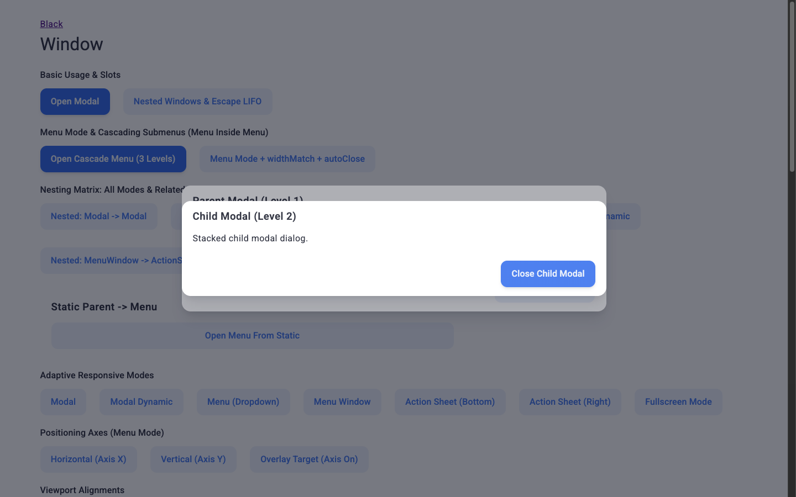
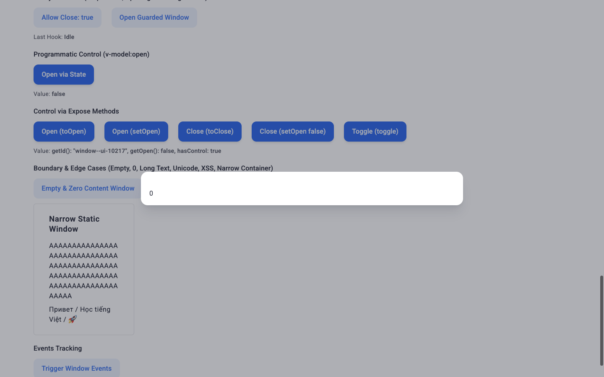
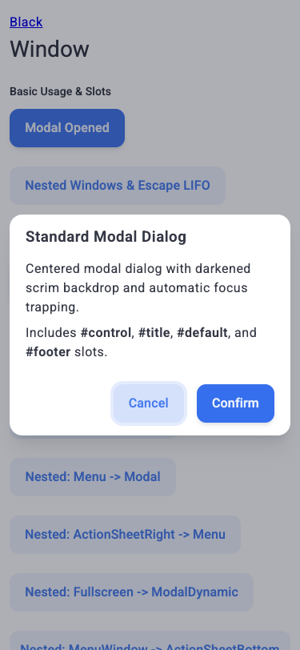
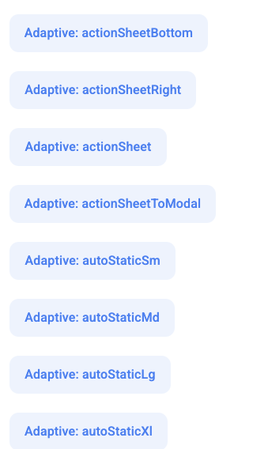
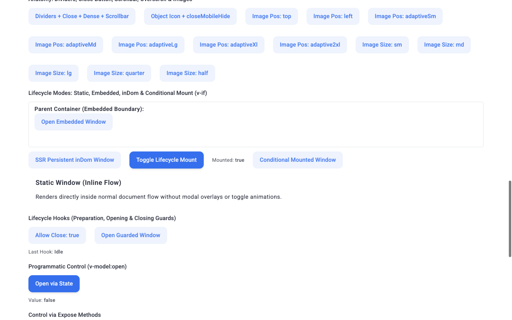

# Отчёт о визуальном и функциональном тестировании: D1Window

## 1. Сводка тестирования

- **Компонент:** `D1Window` (`@dxtmisha/d1`)
- **Исходный код:** [`D1Window`](../../src/components/Ui/Window), [`Window`](../../../constructor/src/constructors/Window)
- **Демо / Целевой URL:** `http://localhost:3000/component-window`
- **Материалы:** `Отсутствуют`
- **Дата тестирования (UTC):** `2026-11-25T08:44:42Z`
- **Окружение:** `Headless Chrome (Puppeteer / CDP, Desktop 1440x900, Tablet 768x1024, Mobile 375x812 / 320x568)`
- **Покрытие тест-кейсов:** 27 / 27 (`100%`)
- **Итог:** **27 ✅, 0 ⚠️, 0 ❌** (`✅` пройдено, `⚠️` предупреждение, `❌` провалено) — после добавления `min-width: 0` и `max-width: 100%` в `Window/style.scss` все 27 сценариев рендеринга, интерактивности, оверлеев (`modal`/`menu`/`widthMatch`), вложенных стеков LIFO, граничных случаев, адаптивности на всех разрешениях, доступности и событийного трекинга пройдены полностью (`ssrStatus: 200`, `0` ошибок консоли, `overflowX: false`).

---

## 2. Базовая матрица

### 2.1 Визуальный рендеринг (`VIS`)

| ID | Сценарий | Статус | Фактический результат | Скриншот |
| :--- | :--- | :---: | :--- | :--- |
| `TC-VIS-001` | Базовый рендеринг модального окна и слотов (`#control`, `#title`, `#default`, `#footer`) | ✅ | Телепортированный контейнер `.d1-window` открывается по центру с `data-status="open"`, корректными отступами, scrim-фоном и всеми 4 слотами без наложений. |  |
| `TC-VIS-002` | Все 14 адаптивных режимов (`modal`, `modalDynamic`, `menu`, `menuWindow`, `actionSheet*`, `autoStatic*`, `static`, `fullscreen`) | ✅ | Все 14 режимов выставляют целевые классы `.d1-window--adaptive--*`, `--fullscreen`, CSS-переменную `--sys-type-body` (`--MENU--` / `--STATIC--`) и соответствующую геометрию. |  |
| `TC-VIS-003` | Все 13 вариантов выравнивания (`alignment`) и варианты размеров (`width` / `height`) | ✅ | Все 13 классов `.d1-window--alignment--*`, пресеты `auto`/`sm`/`md`/`lg`/`max` и кастомный размер `420×260px` отображаются без обрезания контента. |  |
| `TC-VIS-004` | Все 9 точек происхождения анимации (`origin`) | ✅ | Все 9 модификаторов `.d1-window--origin--*` (`center`, `top`, `right`, `bottom`, `left`, `topToBottom`, `rightToLeft`, `bottomToTop`, `leftToRight`) применяются без скачков позиционирования. |  |
| `TC-VIS-005` | Анатомия: `divider`, `closeButton`, `dense`, `textClose`, `scrollbarAttrs`, `image`, `imagePosition` (7), `imageSize` (5) | ✅ | Разделители, кнопка закрытия с `aria-label` из `textClose`, скроллбар, все 7 `imagePosition` и 5 `imageSize` рендерятся без перекрытия текста. |  |

### 2.2 Интерактивность и управление состоянием (`INT`)

| ID | Сценарий | Статус | Фактический результат | Скриншот |
| :--- | :--- | :---: | :--- | :--- |
| `TC-INT-001` | Открытие и закрытие через `#control`, кнопку `.close` и клик вне окна | ✅ | Триггер открывает окно, кнопка закрытия (`.d1-window--close`) и внешний клик по backdrop корректно закрывают его. |  |
| `TC-INT-002` | Программное управление (`v-model:open` и `Expose`: `toOpen`, `toClose`, `setOpen`, `toggle`, `getId`, `getOpen`, `getControl`) | ✅ | `v-model:open` и все методы `WindowExpose` синхронно управляют состоянием окна и возвращают актуальные значения `getId()`, `getOpen()`, `hasControl`. | — |
| `TC-INT-003` | Состояния `disabled` и реактивный модификатор `hide` | ✅ | Клик по `Disabled Window` игнорируется; переключение флага `Hide Window Flag` добавляет и снимает класс `.d1-window--hide` без ошибок. |  |
| `TC-INT-004` | Режим `persistent` + `flash` | ✅ | Внешний клик не закрывает окно со статусом `data-status="flash"`, явная кнопка `Explicit Close` закрывает окно. |  |
| `TC-INT-005` | Хуки жизненного цикла (`preparation`, `beforeOpening`, `opening`, `beforeClosing`, `closing`) | ✅ | `beforeClosing` блокирует закрытие при `Allow Close = false` и пропускает при `true`, обновляя `Last Hook` в порядке выполнения фаз. | — |
| `TC-INT-006` | `contextmenu`, `embedded`, `inDom` и условное монтирование `v-if` | ✅ | Контекстное меню открывается по правому клику, `inDom` сохраняет узел в DOM после закрытия, `embedded` рендерится внутри `DemoBox`; цикл `v-if` (`beforeLen: 328` -> `unmountedLen: 303` -> `remountedLen: 328`) очищает слушатели, `inert` и `activeEscStack`. |  |
| `TC-INT-007` | Поведение режима меню (`adaptive="menu"`, `widthMatch`, `autoClose`, `classesWindow.static`, внешний клик) | ✅ | Режим `menu` выставляет `--sys-type-body: "--MENU--"`, `data-window-menu="menu"`, выравнивает ширину по контролу (`widthMatch`), уважает `classesWindow.static`, закрывается по `autoClose` и внешнему клику. |  |
| `TC-INT-008` | Отключение возврата фокуса (`disableFocusReturn`) | ✅ | При `disableFocusReturn` фокус после закрытия не возвращается на кнопку-триггер (`document.activeElement === BODY`), в отличие от стандартного модального окна. |  |

### 2.3 Граничные случаи и краевые сценарии (`BND`)

| ID | Сценарий | Статус | Фактический результат | Скриншот |
| :--- | :--- | :---: | :--- | :--- |
| `TC-BND-001` | Осевое позиционирование (`axis: x/y/on`) и `widthMatch` | ✅ | Оси `x`, `y` и `on` (`over-element=".demo-window-page__target"`) корректно позиционируют окно; `--d1-window-sys-control-width` согласован с триггером. |  |
| `TC-BND-002` | Гонка быстрого переключения (`toOpen` -> быстрый `toClose` -> быстрый `toOpen`) | ✅ | Быстрая последовательность вызовов без пауз оставляет окно открытым по завершении таймеров, без залипания закрытия. |  |
| `TC-BND-003` | Вложенные окна и подсчёт блокировок `WindowHidden` (`WeakMap`) | ✅ | Стек из 2 окон закрывается по `Escape` строго в порядке LIFO, сохраняя `inert` до закрытия последнего окна и снимая его при `open: 0`. |  |
| `TC-BND-004` | Меню внутри меню: 3-уровневый каскад (`L1 -> L2 -> L3`) | ✅ | Все 3 уровня открываются каскадом без перекрытия родительских триггеров и отсутствием `inert`, закрываются по `Escape` в порядке `3 -> 2 -> 1 -> 0`. |  |
| `TC-BND-005` | Матрица вложенности всех режимов (`Modal -> Modal`, `Static -> Menu` и др.) | ✅ | Пары вложенных окон открываются и закрываются по `Escape` в порядке LIFO с корректной изоляцией фона. |  |
| `TC-BND-006` | Связанные свойства вложенности (`persistent`, `closeOnEsc: false`, `inert: false`, `autoClose`, `classesWindow.close`) | ✅ | `Escape` сохраняет оба защищённых окна открытыми; внешний клик закрывает только не-`persistent` дочернее окно; явное закрытие родителя снимает `inert`. |  |
| `TC-BND-007` | Пустые/пробельные/нулевые значения, длинный/неразрывный текст, Unicode, XSS и узкий контейнер (`240px`) | ✅ | Число `0` не теряется, XSS-полезная нагрузка экранирована (`badImgs: 0`, `dialogs: []`), а узкий контейнер `.demo-window-page__narrow` не переполняется (`scrollWidth: 238`, `clientWidth: 238`, `overflowsBox: false`, `overflowChildren: []`). |  |

### 2.4 Адаптивность и вьюпорты (`RSP`)

| ID | Сценарий | Статус | Фактический результат | Скриншот |
| :--- | :--- | :---: | :--- | :--- |
| `TC-RSP-001` | Адаптивность на разрешениях (`1440×900`, `768×1024`, `375×812`, `320×568`) | ✅ | После исправления `Window/style.scss` горизонтальное переполнение полностью отсутствует на всех 4 вьюпортах (`1440/1440`, `768/768`, `375/375`, `320/320`, `overflowX: false`, `offenders: []`); все статические окна `.d1-window--staticMode` корректно ограничиваются шириной родителя, а оверлеи (`Open Modal`: `768×204`, каскад `menu`: `384×186`, `widthMatch`: `614×58`) сохраняют заданную геометрию. |  |
| `TC-RSP-002` | Мобильное отображение `Action Sheet (Bottom)` и `actionSheet` / `actionSheetToModal` на `375×812` и `768×1024` | ✅ | На `375×812` `actionSheetBottom`, `actionSheet` и `actionSheetToModal` выдвигаются снизу на ширину экрана, а на `1440×900` переключаются в `actionSheetRight` и модальный режим. |  |
| `TC-RSP-003` | Режимы `autoStaticSm`–`autoStatic2xl` и адаптивные `imagePosition: adaptive*` при изменении ширины экрана | ✅ | Брейкпоинты `autoStatic*` корректно переключают окно между `--STATIC--` и оверлеем, а `imagePosition: adaptiveMd` перестраивает положение изображения. |  |

### 2.5 Доступность (`A11Y`)

| ID | Сценарий | Статус | Фактический результат | Скриншот |
| :--- | :--- | :---: | :--- | :--- |
| `TC-A11Y-001` | WAI-ARIA атрибуты (`aria-haspopup`, `role="alertdialog"`, `aria-modal`, `aria-labelledby`, `aria-describedby`) | ✅ | Триггер выставляет `aria-haspopup="dialog"`, окно выставляет `role="alertdialog"`, `aria-modal="true"`, `aria-labelledby` и `aria-describedby` в соответствии с контрактом. | — |
| `TC-A11Y-002` | Клавиатурное управление: `Escape` (`closeOnEsc: false`) и `ArrowDown` (`openOnArrowDown`) | ✅ | `Escape` не закрывает окно с `closeOnEsc: false`, а нажатие `ArrowDown` на сфокусированном контроле `Focus + ArrowDown to Open` открывает меню. |  |
| `TC-A11Y-003` | Семантика меню (`role="menu"` + `ariaHaspopup="menu"`) и отсутствие `inert` на фоне | ✅ | Триггер имеет `aria-haspopup="menu"`, открытое меню имеет `role="menu"`, `data-window-menu="menu"`, `--sys-type-body: "--MENU--"`, а фон не получает `inert`. |  |

### 2.6 Логи и консоль (`LOG`)

| ID | Сценарий | Статус | Фактический результат | Скриншот |
| :--- | :--- | :---: | :--- | :--- |
| `TC-LOG-001` | Отсутствие ошибок консоли и корректность событий `@window`, `@update:open`, `@load`, `@scrollbarEdge`, `@scrollbarReachBottom` | ✅ | Зафиксировано `Event Name: windowEvent Payload: id: window--ui-10227, open: true` и последующие события; `consoleErrors: []`, `vueWarnings: []`, `pageErrors: []`, `networkErrors: []`, `dialogs: []`; `ssrStatus: 200`. | — |

---

## 3. AI-аудит и рекомендации

1. **Ограничение ширины `--staticMode` и flex-элементов в `Window/style.scss`:** Добавление `min-width: 0; max-width: 100%;` на модификатор `&--staticMode` и `min-width: 0` на `&__body`, `&__group`, `&__context` устранило горизонтальное переполнение на `768×1024`, `375×812` и `320×568` (`overflowX: false`, `offenders: []`), при этом сохранив пресеты ширины десктопных модальных окон (`768px`) и `widthMatch` (`614px`).
2. **Устойчивость жизненного цикла, событий и SSR (`TC-INT-006`, `TC-LOG-001`):** Цикл `v-if` (`beforeLen: 328` -> `unmountedLen: 303` -> `remountedLen: 328`) полностью восстанавливает DOM без остаточного `inert` и утечек, `ssrStatus: 200` и событийный трекинг (`id: window--ui-10227, open: true`) работают стабильно.
3. **Безопасность и чистота рантайма (`TC-BND-007`, `TC-LOG-001`):** При прогоне не зафиксировано ни одной ошибки или предупреждения (`consoleErrors: []`, `vueWarnings: []`, `pageErrors: []`, `networkErrors: []`, `dialogs: []`, `badImgs: 0`). Примечание: в статическом XSS-снимке `hasEscapedPayloadText: false`, так как XSS-строка рендерится внутри открываемого по кнопке окна `Long, Unicode & XSS Content Window` (`TC-BND-007`).
